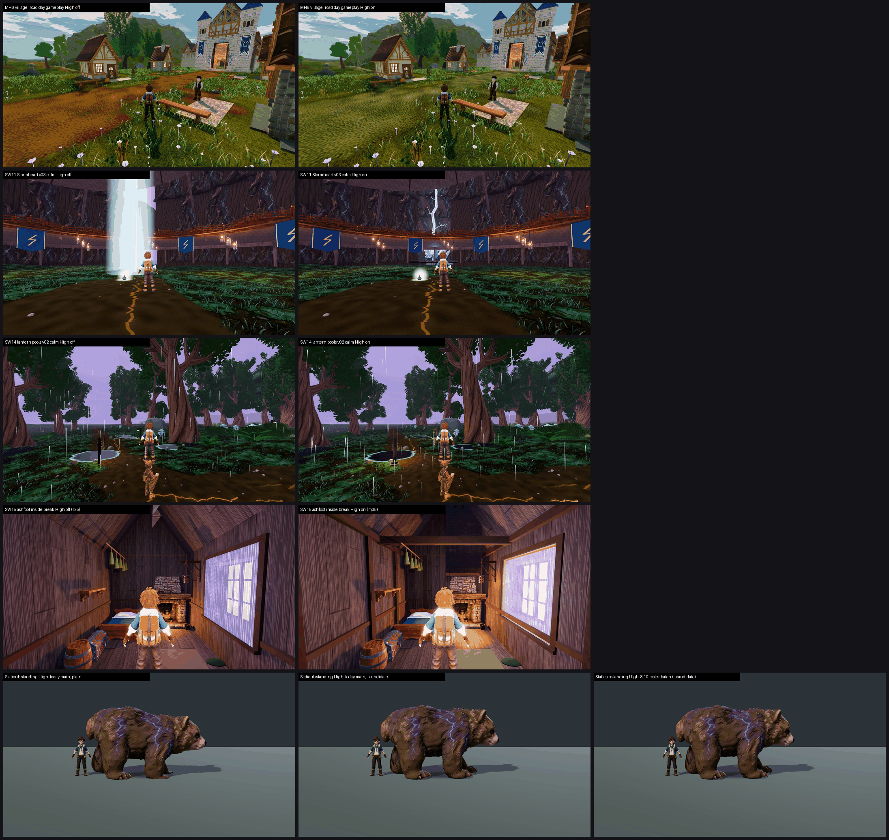

# B5: MH6 (CLOSE-OUT), SW11, SW14, SW15 and the Staticub check, on GPU (26 Oct 2026)

One judging run covered five items: 24 sets in 4 mixed batches, three code-blind judges each.
- **Anchors:** the high set (`anchors_hi.json`: repo anchors plus Stormcapra 7.79) so the batches bracket 7.5.
- **Fits:** all four confirm. r 0.74 / 0.95 / 0.84 / 0.82, RMSE 0.76 / 0.43 / 0.68 / 0.64.
- **Batch 1 caveat:** its RMSE is just over the 0.75 limit, so its mapped scores carry that caveat. Batch 1 holds SW11 Stormheart calm (both presets), heartstone Medium, SW14 calm-break Medium, and SW15 inside Medium and outside High.
- **Medium vs High:** the arms differ by 2–12% of pixels between presets. At thumbnail size the judges still sometimes gave both presets identical scores (MH6 farm_to_hall, SW11 Stormheart calm), so a preset difference below the judges' resolution is not resolved here.
- **Anchor scale:** these values are on the high-anchor scale. An off arm here can map differently from the same build's board figure (MH6 village_road off maps 5.85 / 6.47 vs 7.09 / 6.73 on the board). Each on/off pair sits in the same batch, so the deltas hold.

## Summary

| Item | Medium off → on | High off → on | Call | Tier (on, lower preset) | MET |
|---|---|---|---|---|---|
| **MH6** village path (mean of 3 stands) | 5.90 → **6.47 (+0.56)** | 5.97 → **6.54 (+0.56)** | **ON** | 6–7 | village_road **not met** (6.43 / 6.68) |
| **SW15** Ashfoot m35 seated + firelit, interior | 6.57 → **6.98 (+0.41)** | 6.12 → **6.73 (+0.61)** | **ON** (mean +0.51) | 6–7 | not met (6.98 / 6.73) |
| SW11 m29 Stormheart (calm + fading mean) | 5.02 → 5.33 (+0.32) | 4.76 → 5.20 (+0.45) | **ON as a defect fix**, under +0.5 so not a qualifying gain | below 6 | not met |
| SW11 m29 crown heartstone (survey stand at 8 m) | 5.23 → 5.37 (+0.14) | 5.04 → 5.08 (+0.04) | no measurable change | below 6 | not met |
| SW14 m33 Lantern Pools finish (2 sets mean) | 5.74 → 6.03 (+0.29) | 5.52 → 5.70 (+0.19) | under +0.5: no qualifying gain | below 6 | not met |
| **Staticub check** (main 1d5faebac vs 8.10 roster frames) | plain 7.11, --candidate 7.84 vs 8.10-batch frames 7.84 | plain 6.86, --candidate 7.76 vs 7.81 | **setup difference, not a dimmed asset** | 7.5+ (--candidate) | MET with --candidate (7.84 / 7.76) |

`_sheet_b5.png`, High: off on the left, on on the right.
1. MH6 village_road day gameplay.
2. SW11 Stormheart v03 calm.
3. SW14 lantern pools v02 calm.
4. SW15 Ashfoot inside, break phase.
5. Staticub standing: today plain, today --candidate, the 8.10 roster frame.

## MH6: Meadows village path texture (CLOSE-OUT for village_road). ON.

tb/meadows-land17 436ef3761 on main ac5e1426c, `terrain_presentation.json` `texture_candidates.path.enabled` on vs off. Both arms use `--f38-baseline`, with a local flag flip verified byte-identical on restore. One set per stand per preset, six standard views.

| Stand | Medium off → on | High off → on | P2-005 orange-smear defect | MET |
|---|---|---|---|---|
| **village_road** | 5.85 → **6.43 (+0.58)** | 6.47 → 6.68 (+0.21) | PRESENT 3/3 → PARTIAL 3/3 at both presets | not met (6.43 / 6.68) |
| farm_to_hall | 5.79 → **6.57 (+0.78)** | 5.79 → **6.57 (+0.78)** | PRESENT → PARTIAL 3/3 | not met |
| hall_front | 6.07 → 6.40 (+0.33) | 5.66 → **6.36 (+0.70)** | PRESENT → PARTIAL 3/3 | not met |

**What the judges saw.** The orange road is gone in all 18 calls, but it now reads as "an olive/khaki smear" or "a uniform olive cobble tile that blends into the grass", with "a greener, murkier grade". On the sheet, the path almost disappears into the meadow.

**Path to 7.5** (village_road is 0.8–1.1 short):
1. **Path material** (*texture*): a warm brown trodden earth, not olive. Narrower, with ruts, pebbles and grass breaking in at the edges, so the path separates from the meadow instead of merging with it.
2. **village_road dressing** (*scene*): a flat pale slab under the bench reads as a placeholder (6/6 calls) and may float. House edges crowd the camera in the reverse view.
3. **hall_front cameras** (*scene*): a timber post fills the left edge in the gameplay, night and rain frames (clipping PRESENT). The reverse camera is inside the hall, and the detail camera hugs the wall.
4. **Night:** the ground goes almost black in the night frames.

## SW15: Ashfoot m35, seated + firelit. ON.

tb/stormwood-m35-on 16101403b vs d8758c700. r25 is on in both arms, so this measures the round on top of r25. It replaces m34. m34 was not run as a third arm, so the seated-only step is not isolated.

| Stand | Medium off → on | High off → on | Recorded defects | MET |
|---|---|---|---|---|
| **ashfoot_shelter_inside** | 6.57 → **6.98 (+0.41)** | 6.12 → **6.73 (+0.61)** | roof-apex light leak (clipping) PARTIAL 3/3 → **FIXED 3/3** at both presets; window slab stays PARTIAL 3/3 (High: PRESENT 1 / PARTIAL 2 → PARTIAL 3); bare box FIXED on both arms | not met (6.98 / 6.73) |
| ashfoot_shelter_outside (no-change check) | 6.07 → 6.04 | 6.03 → 5.97 | identical calls | level, as expected |

**Path to 7.5** (0.5–0.8 short):
1. **Window** (*new_art* / *scene*): recess it into the wall with a frame and sill, show the storm outside, and keep the per-phase tint. Judges still call it "a flat glowing card". On the off arm it doesn't change with the phase; on the on arm it does, but it is still a card.
2. **Stormwood lining** (*scene*): judges call it "a generic wooden cabin". It needs copper, moss and storm cues.
3. **Composition:** the trainer blocks the centre and the hearth in every frame. A featureless green dome sits on the floor.

## SW11: Stormwood m29, the SW7 follow-up. ON as a defect fix.

tb/stormwood-m29-on 7d32103ce vs a58cc0d9c. It replaces the free-standing white core column with a cleft core in the trunk, keeps the steam low, and moves the heartstone survey stand to 8 m.

| Stand | Medium off → on | High off → on | Recorded defects |
|---|---|---|---|
| Stormheart calm (6 views) | 5.58 → 5.99 (+0.41) | 5.58 → 5.99 (+0.41) | **gap 3 (white column) PRESENT 3/3 → PARTIAL 1 / FIXED 2**; clipping PARTIAL 3/3 → **FIXED 3/3**; gap 2 (tree below reference) PRESENT 3/3 on both arms |
| Stormheart fading (6 views) | 4.45 → 4.67 (+0.22) | 3.93 → 4.41 (+0.48) | gap 3 PRESENT 3/3 → PARTIAL 2 / FIXED 1 (Medium); clipping PRESENT 2 / PARTIAL 1 → PRESENT 1 / PARTIAL 1 / FIXED 1 |
| Crown heartstone (6 picks) | 5.23 → 5.37 (+0.14) | 5.04 → 5.08 (+0.04) | heartstone missing/partial PARTIAL 3/3 on both arms (still out of view in v01); v01 rock clipping (Medium) PRESENT 2 / PARTIAL 1 → **FIXED 3/3** |

The cleft core works: the column is gone and judges no longer call it a rigid white slab. But the gain is +0.32 / +0.45, under the CPU's +0.53 / +0.54 and under the +0.5 bar. It removes a defect at no cost, so turn it on, but it does not count as a qualifying gain.

**Path to 7.5** (about 2.2 short):
1. **Stormheart as a hero tree** (*new_art*): gap 2 is still PRESENT 12/12, "smooth dark enclosing walls with a banner ring, with no readable bark, branches, crown or core".
2. **Fading phase:** waist-height lilac fog puffs and flat gold ground cracks. A real bolt with a branching ground impact in one v02 fading frame is the one beat every judge credits.
3. **Heartstone:** the 8 m stand does not bring it into the v01 cameras. Re-aim v01.

## SW14: Lantern Pools finish m33. No qualifying gain.

tb/stormwood-m33-on 619dd7fdd vs 9065dad7b (Meshy lantern posts + black pools). Two sets per preset: calm + break, and building + fading, all three views.

| Set | Medium off → on | High off → on | Lantern-pool defect |
|---|---|---|---|
| calm + break | 6.34 → 6.47 (+0.13) | 5.73 → 6.01 (+0.28) | PRESENT 3/3 on both arms |
| building + fading | 5.14 → 5.58 (+0.44) | 5.30 → 5.39 (+0.09) | PRESENT 3/3 → PARTIAL 3/3 (Medium); PRESENT 3/3 → PRESENT 2 / PARTIAL 1 (High) |

Judges credit the black fill as "closer to the board", but the pools are still "flat discs with smooth glowing rims and no banks". The mean gain is +0.29 / +0.19, against the CPU's +0.75.

**Path to 7.5** (about 1.5 short):
1. **Pools** (*new_art*): black water set into mossy banks with stones and reeds. Drop the glowing rim.
2. **Ground and fog** (*scene*): gap 1 PRESENT 12/12, plus waist-height fog sprites and painted gold path cracks.
3. **Staging:** the companion stands directly under or in front of the trainer in every frame. Judges read it as "a duplicate trainer".

## Staticub check: a setup difference, not a dimmed asset

Today's main 1d5faebac, shot plain and with `--candidate`, each against the 8.10 roster frames (1e83cafa0, shot with `--candidate`):

| Today's capture | Medium | High | vs 8.10-batch frames (same batch) |
|---|---|---|---|
| plain | 7.11 | 6.86 | 7.84 / 7.81 |
| **--candidate** | **7.84** | **7.76** | 7.84 / 7.81 |

- With `--candidate`, today's Staticub maps the same as the 8.10 frames (Medium 7.84 = 7.84, High 7.76 vs 7.81). The asset is not dimmed. Both modes load the same GLB (`creature_staticub_lod0.glb`); `--candidate` adds the F36 pose-recipe profile from `f36_pose_candidates.json`.
- Shot plain, it drops to 7.11 / 6.86. That matches the 6.77 / 7.37 ST control, which was also plain.
- **MET:** yes on the `--candidate` path (7.84 / 7.76; Medium extrapolated just above the 7.79 top anchor), not met plain.
- **Lane question:** which capture mode matches what players see in game? If the shipped creature uses the recipe profile, F36#18 / #71 stand as met. If not, the in-game look is the plain 7.11 / 6.86.

## Files

- `_sheet_b5.png`.
- Builders: `build_yard_SW11.ps1.txt`, `build_yard_SW1415.ps1.txt`, `build_yard_MH6.ps1.txt`, `build_yard_STC.ps1.txt`, `meadows_flags6.py.txt`.
- `yardstick/B5_rows.json`, `yardstick/coverage_*.json`.
- `yardstick/B5b1/` … `B5b4/`: `key`, `sets.md`, `candidates`, `j1`–`j3`, `batch`, `mapped`.

Captures: F41 catalogue (SW11/14/15) and `capture_f38_matrix.gd --seed=2042 --f38-baseline --times=day,night` (MH6) at each arm's SHA on a clean tree; `capture_f36_poses.gd --whole-body --context [--candidate]` (Staticub). Forward+ on a GTX 1060 at 1920x1080.
