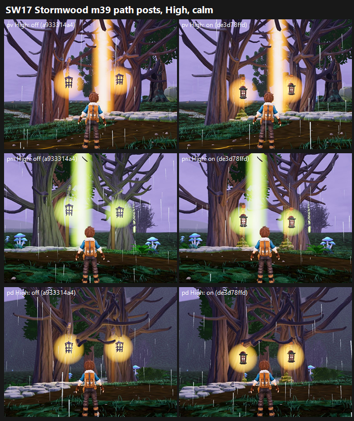

# SW17: Stormwood m39 junction lamps on path posts on GPU, de3d78ffd vs parent a933314a4 (26 Oct 2026)

**Verdict: no gain. Don't land it as is.** All three junctions score level or slightly lower: −0.03 to −0.06, the same at both presets.
- **The floating-lamp defect barely moves.** It was PARTIAL 3/3 off at pv and pd, and FIXED 3/3 off at pm. On, it is PARTIAL 2 / FIXED 1 at every stand. At pm the on arm is slightly worse than off (FIXED 3/3 → PARTIAL 2 / FIXED 1).
- **Why:** the new post is short, and it sits inside the lantern's glow halo. In the judges' notes, one says the halo hides most of the post and another sees no post under the low lantern. The off arm's lanterns are not truly floating either: they hang from a branch on a thin chain (pv, pd) or from a thin pole (pm). So the judges read both arms as about equally held up.
- **Tier:**
  - On arm, lower preset: below 6 at pd (5.98) and pm (5.82); 6–7 at pv (6.10).
  - Off arm: 6.04, 5.88 and 6.13.
- **MET:** not met at any stand on either arm.

| Stand | Medium off → on | High off → on | Floating lamps | Floating props | Clipping | Placeholder | MET |
|---|---|---|---|---|---|---|---|
| pv | 6.13 → 6.10 (−0.03) | 6.13 → 6.10 (−0.03) | PARTIAL 3 → PARTIAL 2 / FIXED 1 | PARTIAL 3 → PARTIAL 2 / FIXED 1 | PRESENT 1 / PARTIAL 2, both arms | PRESENT 1 / PARTIAL 2, both arms | not met (6.10 / 6.10) |
| pm | 5.88 → 5.82 (−0.06) | 5.88 → 5.82 (−0.06) | **FIXED 3 → PARTIAL 2 / FIXED 1** | FIXED 3 → PARTIAL 2 / FIXED 1 | PRESENT 1 / PARTIAL 2, both arms | PARTIAL 3, both arms | not met (5.82 / 5.82) |
| pd | 6.04 → 5.98 (−0.06) | 6.04 → 5.98 (−0.06) | PARTIAL 3 → PARTIAL 2 / FIXED 1 | PARTIAL 3 → PARTIAL 2 / FIXED 1 | PARTIAL 2 / FIXED 1, both arms | PARTIAL 3, both arms | not met (5.98 / 5.98) |

**Method:**
- **Capture:** `capture_stormwood_f10_matrix.gd` with three custom stands (pv, pm, pd: path junctions), calm, 1920x1080, Medium and High, at each arm's SHA on a clean tree.
- **Re-run:** the first run (queue 42) captured nothing, because my queue did not pass `--source-commit`, which `lookdev_capture_bootstrap.gd` requires. The re-run (queue 48) passed it and captured all 3 stands in each of the 4 runs.
- **Sets:** one set per stand per preset, one full frame per side. 6 sets in one batch, with three code-blind judges and high anchors. Fit r 0.91, RMSE 0.44, confirming.

**Caveats:**
- **Medium = High:** the judges scored the two presets identically.
- **Sample:** there are only 3 stands, and only in calm weather.
- **Pixel difference:** the arms differ by about 3% of pixels per frame, almost all of it at the lamps.

`_sheet_sw17.png`, High, calm, cropped around the junction: off on the left, on on the right. Rows are pv, pm and pd.

## What the judges saw

These are paraphrased from the judges' reports, except where quoted from their verdict files.
- **On:** a short post on a glowing or mossy base. One judge says the halo hides most of the post; another sees a low lantern with no visible post; the third reads it as grounded (FIXED).
- **Off:** lanterns hung from a branch on a thin chain or hook (pv, pd), which one judge finds the most appealing build. At pm the lanterns hang from a thin pole to the ground (FIXED, but spindly). There, the lime beam "washes the two hero trunks a muddy olive".
- **On both arms:**
  - The lamp glows are "flat yellow sprite discs", a "sprite-disc lamp glow that lights nothing" (all 3 judges flag the flat glow).
  - The guide beams (lime at pm, orange at pv) cut through the canopy (clipping).
  - There is a faceted grey boulder and a uniform pale pebble border.
  - The lilac sky has no fog depth.
  - There are no copper or glass accents.

## Path to 7.5 (best stand pv 6.10, about 1.4 short)

1. **Make the post read** (*new_art*): a taller, sturdier post with an arm and a stone or root footing, set a little away from the trunk, and a smaller halo so the post shows at small size. All 3 judges name the post as their top or second change.
2. **Real lamp light** (*scene*): replace the sprite glow discs with light that pools on the path, stones and trunks, and soften or recolour the guide beam so it stops cutting through branches and tinting trunks.
3. **Storm atmosphere** (*scene*): layered fog, a graded storm sky, rim light on the trunks, and copper or glass details at the junction.
4. **Ground** (*new_art* / *scene*): replace the faceted boulder and the uniform pebble border, and cluster plants around the waypoint.

## Files

- `_sheet_sw17.png`, `build_yard_SW17.ps1.txt`, `cand_queue48.ps1.txt`.
- `yardstick/SW17_rows.json`, `yardstick/coverage.json`.
- `yardstick/SW17b1/`: `key`, `sets.md`, `candidates`, `j1`–`j3`, `batch`, `mapped`.
