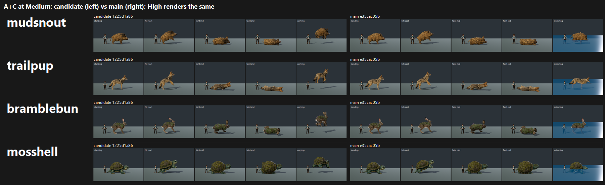

# A+C creature candidates on GPU: tb/creatures 1225d1a86 vs main (24 Oct 2026)

**Verdict: FAIL for all four species. None maps to 7.5 at either preset.** The candidate does not beat main by more than the noise on any of them.

| Species | Candidate (Medium = High) | Main (Medium = High) | Δ | Gap to 7.5 (candidate) | Verdict |
|---|---|---|---|---|---|
| Mosshell | **7.32** | 7.21 | +0.11 | 0.18 | FAIL |
| Bramblebun | **7.25** | 7.14 | +0.11 | 0.25 | FAIL |
| Mudsnout | 6.59 | 6.70 | −0.11 | 0.91 | FAIL |
| Trailpup | 6.36 | 6.50 | −0.14 | 1.14 | FAIL |

- **Terrapup:** pushed separately in `../terrapup-dog/` (7.09 / 7.09, FAIL).
- **Nightburrow:** judged in B (7a44a9367), which supersedes it.
- **Medium vs High:** the frames are the same, and every judge gave both presets identical scores.

**Read the Δ column with care:**
- At the stage camera, the judges described the candidate and main models as the same creature ("the images look identical" apart from the travel frame). The candidate's owner touch pass (weathered shoulders and scars baked into the albedo) is not visible at this size.
- The Δ comes only from the travel frame. The candidate build offers no swim role for these four, so its travel frame is **carrying** (`fly_grip`): the creature hangs in mid-air above a detached shadow. Main's travel frame is **swimming**: the creature stands on a flat blue slab with a hard white right edge, and the trainer stands inside it.
- Both are staging defects, and the judges docked each side for its own. The ±0.1 is staging, not the remakes.
- The CPU pick quoted in the candidate commit (Trailpup 7.58) does not hold on GPU Forward+: **6.36**.

`_sheet_ac_medium.png` (315 KB): each species at Medium, candidate (left) vs main (right), in standing, hit react, faint mid, faint end and the travel frame.

## Run

- **Candidate:** 1225d1a86 in its own worktree. **Main:** e35cac05b0 (origin/main 24dfec7b9).
- **Capture:** `capture_f36_poses.gd --species=terrapup,mudsnout,trailpup,bramblebun,nightburrow,mosshell --whole-body --context` at 1920x1080, Forward+ on a GTX 1060, Medium and High.
- **Frames:** 95 per candidate run; 125 per main run, because main has the extra swim role.

## Yardstick

- **Batches:**
  - Ab1: the Terrapup dog plus Mudsnout and Trailpup, candidate vs main per preset.
  - Ab2: Bramblebun and Mosshell, candidate vs main per preset.
- **Anchors:** 4 pairs each (`--include f36_0_npc:C1`).
- **Judges:** three fresh code-blind judges per batch, each given `JUDGE_PROMPT.md` verbatim.
- **Recorded defects:** none on these sets.

| Batch | Slope | Intercept | r | Anchor RMSE | Confirming | Warnings |
|---|---|---|---|---|---|---|
| Ab1 | 0.680 | 2.961 | 0.82 | 0.61 | yes | none |
| Ab2 | 1.080 | 0.624 | 0.85 | 0.65 | yes | none |

Per-judge mapped scores (j1 / j2 / j3) are the same at Medium and High:

| Side | j1 | j2 | j3 | Mean |
|---|---|---|---|---|
| mosshell candidate | 7.43 | 7.43 | 7.10 | 7.32 |
| mosshell main | 7.32 | 7.21 | 7.10 | 7.21 |
| bramblebun candidate | 7.21 | 7.43 | 7.10 | 7.25 |
| bramblebun main | 7.10 | 7.21 | 7.10 | 7.14 |
| mudsnout candidate | 6.56 | 6.70 | 6.50 | 6.59 |
| mudsnout main | 6.70 | 6.70 | 6.70 | 6.70 |
| trailpup candidate | 6.36 | 6.50 | 6.22 | 6.36 |
| trailpup main | 6.50 | 6.50 | 6.50 | 6.50 |

## Path to 7.5

These come from the judges' notes and `top_changes`, plus my own review of the frames.

### Shared lever, both builds (*scene*): fix the travel-role staging

All six judges named this as a top change.
- **Carrying:** keep the creature on the ground, with an attached contact shadow and a visible load, instead of floating it in mid-air.
- **Swimming:** use a real water surface with a waterline and partial submersion, not the flat blue slab with its blown white edge. Keep the trainer out of the water.
- **Expected effect:** this alone should carry **Mosshell (0.18 short)** and **Bramblebun (0.25 short)** over the bar. Their models drew "Palworld-finish" and "bar's level" comments, and the travel frame was the only thing every judge docked them for.
- **Re-judge:** I can re-run the yardstick with the travel frame left out, to confirm how much of the gap it accounts for.

### Per species

| Species | Gap | What closes it |
|---|---|---|
| Mosshell | 0.18 | Travel staging (above). Optionally lift the olive shell a value step, since one judge called it "fairly mid-tone". The model's scale and plate detail are already praised. |
| Bramblebun | 0.25 | Travel staging (above). Calm the moss cloak's noise, which one judge called "a little noisy", by clustering the moss into fewer, larger tufts. |
| Mudsnout | 0.91 | Travel staging, plus:<ul><li>**Identity** (*new_art*): all three judges called it "a plain real-world boar" with no Tetherbound hook. Add an elemental or earth accent the creature board supports: mud-crusted plates, tusk build-up or stone growth.</li><li>**Scale** (*config*): it is barely taller than the 1.80 m trainer, and the art direction asks for every creature to stand taller. Raise its scale.</li></ul> |
| Trailpup | 1.14 | Travel staging, plus:<ul><li>**Identity** (*new_art*): "a stock-realistic coyote with no type accent". Give it a type read through markings, a trail-dust mane or a glow accent, keeping the naturalistic bar.</li><li>**Scale** (*config*): about trainer height; raise it.</li><li>Appeal: give the face and eyes a readable expression.</li></ul> |

**Owner calibration note:** the owner reads Trailpup and Bramblebun at about 7–7.5, so these judges run harsh on plain naturalistic animals. I have not adjusted the scores; the bar stays at 7.5.

## Files

- `_sheet_ac_medium.png`.
- `yardstick/Ab1`, `yardstick/Ab2`:
  - `key.json`, `sets.md`, `candidates.json`, `recorded_defects.txt`, `judge_prompt_filled.txt`;
  - `j1`–`j3` (the judges' own blocks);
  - `batch.json`, `mapped.json`.
- Per-frame captures stay local.
