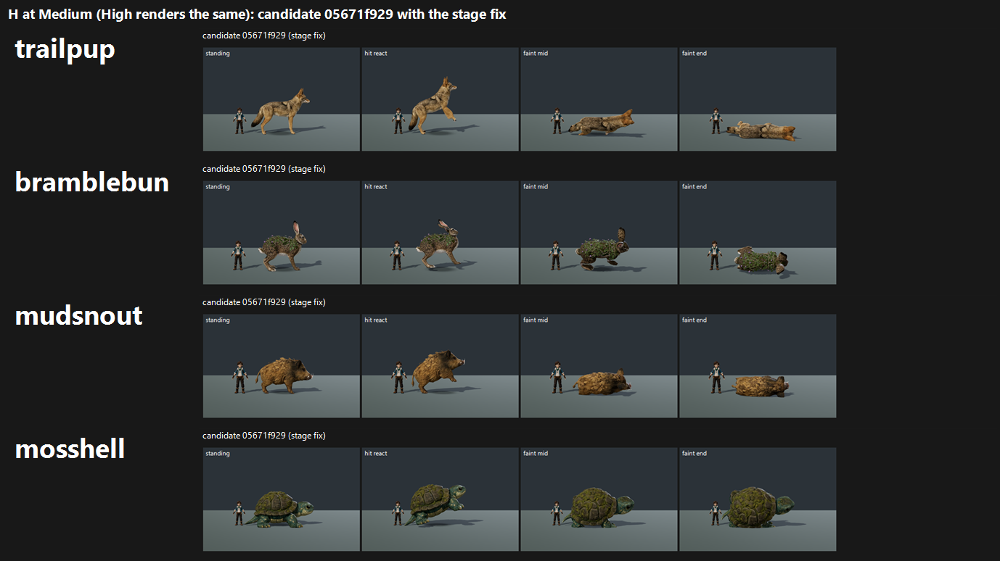

# H: creature stage fix + four species on GPU, tb/creatures 05671f929 (24 Oct 2026)

**Verdict: FAIL for all four. None maps to 7.5.** Per the coordinator, each candidate is judged against 7.5 on its own score: main still uses the old stage, so the delta to main is not meaningful.

Medium and High give the same score for every species.

| Species | Candidate | Tier | Main (old stage) | Earlier on the same day | Gap |
|---|---|---|---|---|---|
| Trailpup | **7.37** | 7–7.5 | 7.22 | 6.36 (A+C, 1225d1a86) | 0.13 |
| Bramblebun | **7.24** | 7–7.5 | 7.04 | 7.25 (A+C) | 0.26 |
| Mudsnout | **7.01** | 7–7.5 | 6.86 | 6.59 (A+C) | 0.49 |
| Mosshell | **6.93** | 6–7 | 6.75 | 7.32 (A+C) | 0.57 |

Terrapup dog3 is pushed separately in `../terrapup-dog3/` (7.33, tier 7–7.5).

## What the stage fix did

- **Travel frames:** the candidate now shoots no travel frame for these four, which are neither rideable nor swimmers. The floating fly_grip frame from A+C is gone, and no judge flagged a floating carry on the candidate.
- **Main's side** still shows the swim slab with the white edge. Every judge docked main's swim frame, so main's scores carry that penalty.
- **Trailpup** gains the most: +1.01 against A+C. Its "stock coyote" read softened to "a clean naturalistic coyote… readable hurt and faint poses". Its faint poses now carry the strip.
- **Mosshell loses** against A+C, down 0.39. With no travel frame, the turtle's **faint mid and faint end are the last two of four tiles, and they barely differ from standing**. All three judges said the faint "doesn't read without the label". The stage fix exposed a weak pose that a travel frame used to dilute.
- **Batches differ:** A+C used different anchors, so the earlier column is indicative, not a strict before/after.

`_sheet_H_medium.png` (290 KB): each candidate at Medium, in standing, hit react, faint mid and faint end.

## Yardstick

- **Batches:**
  - Hb1: dog3, plus Mosshell and Bramblebun candidate vs main at each preset.
  - Hb2: Trailpup and Mudsnout.
- **Judges:** three fresh code-blind judges per batch, each given `JUDGE_PROMPT.md` verbatim, with 4 anchor pairs.

| Batch | Slope | Intercept | r | RMSE | Confirming |
|---|---|---|---|---|---|
| Hb1 | 0.663 | 2.997 | 0.81 | 0.64 | yes |
| Hb2 | 0.895 | 1.398 | 0.88 | 0.59 | yes |

Per-judge mapped scores for each candidate (j1 / j2 / j3, the same at Medium and High):

| Species | j1 | j2 | j3 |
|---|---|---|---|
| Trailpup | 7.22 | 7.22 | 7.67 |
| Bramblebun | 7.64 | 6.97 | 7.11 |
| Mudsnout | 7.13 | 6.86 | 7.04 |
| Mosshell | 6.97 | 6.84 | 6.97 |

## Path to 7.5

| Species | Gap | What closes it |
|---|---|---|
| Trailpup | 0.13 | **Closest.** Rim or stage light separation for the low-contrast tan, plus a type accent. j2 noted it has "no elemental identity", and two judges said Bar B "yes". A subtle trail-dust mane or markings (*new_art*) should do it. |
| Bramblebun | 0.26 | Calm the moss: it "reads as foliage cards stuck onto its back" (j2). Integrate the moss into the fur with clumps and overlap (*new_art*). Its model was called "close to the owner bar" and Bar B "yes" by j1. |
| Mudsnout | 0.49 | **Scale:** "about the trainer's height", so raise it clearly above the 1.80 m ruler (*config*). **Identity and value:** "monotone ochre, face and eyes lost at small size" and "no Tetherbound type accent". Add darker mane, snout and leg values, a visible eye, and a mud or tusk-plate accent (*new_art*). |
| Mosshell | 0.57 | **Faint poses** (*new_art*, animation): the turtle must visibly collapse, withdrawing into the shell or tipping onto its side. Today faint mid and faint end look like standing. This is the only consistent note; the shell model and scale were praised. |

**Shared** (*scene*): every judge in both batches named the same staging issues. These are main's stage, and the candidate already fixes them. They stop costing points once the stage fix ships:
- the flat grey stage with no rim light;
- the old swim slab.

## Files

- `_sheet_H_medium.png`.
- `yardstick/Hb1`, `yardstick/Hb2`:
  - `key.json`, `sets.md`, `candidates.json`, `recorded_defects.txt`, `judge_prompt_filled.txt`;
  - `j1`–`j3` (the judges' own blocks);
  - `batch.json`, `mapped.json`.
- Per-frame captures stay local.
