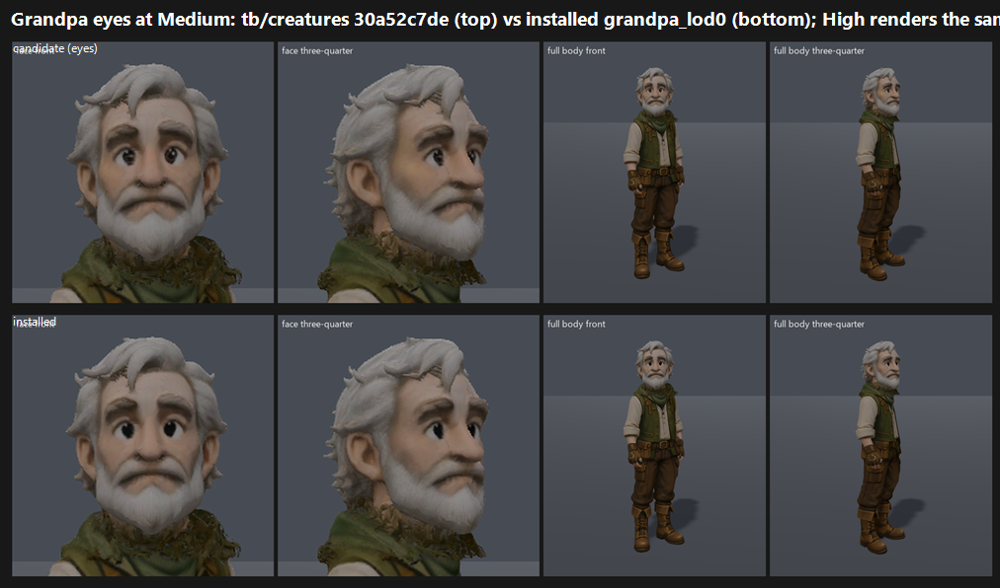

# F36#0 Grandpa eyes on GPU: tb/creatures 30a52c7de vs installed grandpa_lod0 (24 Oct 2026)

**Verdict: does NOT meet the bar.** The candidate maps to **7.20 at both Medium and High**, against **7.09** for the installed `grandpa_lod0`.

- **Gap:** +0.11 over the installed face, 0.30 short of 7.5.
- **Tier: 7–7.5.**
- **Compared with the face round:** the eye work lands at the same level as yesterday's facial-skin round (7.21 on its confirming batch, `../grandpa-face/`). Every judge saw it, though: all three put the candidate side ahead, and called it "livelier eyes with highlights" and "slightly warmer, more appealing skin".

## Run

- **Candidate:** `tb/creatures` 30a52c7de. A pupil, hazel iris, limbal ring and catch-light are painted into the bead eyes of the same installed head.
- **Control:** the same worktree with only the `art.json` `grandpa.model` line swapped to `grandpa_lod0.glb`, then restored; `git status` was clean afterwards.
- **Capture:** `tools/_capture_character_cast.gd` at 1920x1080, Forward+ on a GTX 1060, Medium and High.
- **Swap check:** the candidate and control frames differ only inside the Grandpa body box, (847,214)–(1133,975).
- **Sides:** the same as the face round: two face close-ups, front and three-quarter, plus both full-body frames (`gpeyes_sides.py.txt`).

`_sheet_grandpa_eyes.png`: Medium, candidate (top) vs installed (bottom).

## Yardstick (one batch)

- **Sets:** Medium (cand|ctl) and High (cand|ctl), with sides shuffled.
- **Anchors:** 4 pairs. The `craft` group is included so the anchors reach above 7.35, and Grandpa's own anchor group, `f36_0_npc:C1`, was left out (seed 12). This is the face round's confirming recipe.
- **Judges:** three fresh code-blind judges, each given `JUDGE_PROMPT.md` verbatim.
- **Fit:** slope 0.815, intercept 1.606, r 0.65, **anchor RMSE 0.82**, confirming.
  - Caveat 1: the anchor RMSE is above 0.75.
  - Caveat 2: some candidates are more than 0.5 outside the anchors' measured range.
  - The face round's confirming batch carried the same RMSE caveat (0.80).

| Side | j1 | j2 | j3 | Mapped mean |
|---|---|---|---|---|
| Candidate (eyes) | 7.31 | 6.98 | 7.31 | **7.20** |
| Installed | 7.15 | 6.90 | 7.23 | **7.09** |

## What the judges saw

- **Better:** livelier eyes with highlights. The bead-eye complaint from the face round is gone on the candidate side.
- **Remaining:**
  - "noisy, felt-like / shell-fur hair and beard" (all three);
  - the soft, rounded cartoon face against the stylised-realism world;
  - the neutral grey stage tests no world light.

## Path to 7.5 (gap 0.30)

1. **Hair and beard material** (*new_art*): clean up the noisy, felt-like shell-fur. Use cleaner strand clumps with a soft specular, so the hair reads as groomed white hair rather than fuzz. All three judges named it; this is the new top lever now that the eyes are fixed.
2. **A notch toward stylised realism** (*new_art*): a little more skin texture and age detail at the eyes and brow. The judges still call the face "more cartoon than the naturalistic creatures".
3. **Re-judge in a world frame:** Grandpa's yard view with time-of-day light (an F38 `grandpa-s-village` recapture). Two judges marked Bar B "no" only because the grey stage shows no world light.

## Files

- `_sheet_grandpa_eyes.png` and `gpeyes_sides.py.txt`.
- `yardstick/`:
  - `key.json`, `sets.md`, `candidates.json`, `recorded_defects.txt`, `judge_prompt_filled.txt`;
  - `j1`–`j3` (the judges' own blocks);
  - `batch.json`, `mapped.json`.
