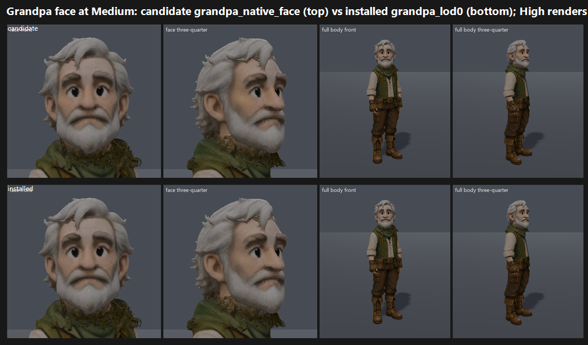

# F36#0 Grandpa face re-confirm on GPU: Medium and High (24 Oct 2026)

**Verdict: does NOT meet the bar.** On the one batch that confirms, the candidate `grandpa_native_face` maps to **7.21 at both Medium and High**, against **7.18** for the installed `grandpa_lod0`.

- It is 0.29 short of 7.5 and within noise of the installed face.
- The close-1020 result this re-checks was 7.53 vs 7.47 (the `f36_0_npc:C1` anchor). That does not reproduce on GPU Forward+ with a confirming batch.

## Run

- **Source:** main 24dfec7b9. On main, `art.json grandpa.model` is the candidate (`candidate/models/grandpa_native_face.glb`).
- **Control:** `grandpa_lod0.glb`, made by swapping that one `art.json` line for the run. The file was restored afterwards and checked clean with `git status`.
- **Capture:** `tools/_capture_character_cast.gd` at 1920x1080, Forward+ on a GTX 1060, Medium and High.
- **Did the swap take?** The candidate and control frames differ only inside the Grandpa body box, (847,213)–(1094,975). So the swap took, and the change is the masked facial-skin albedo refinement described in `art.json`.
- **Sides:** two face close-ups (head crops from the front and three-quarter cast frames, upscaled) plus both full-body frames, built by `grandpa_sides.py.txt`.
- **Not judged:** the F38 grandpa-s-village view. Those frames were cleared from local disk in the 24 Oct clean.

`_sheet_grandpa_face.png` (527 KB): Medium, candidate (top) vs installed (bottom).

## Yardstick: three batches, one confirming

Every batch:
- had two sets, Medium (cand|ctl) and High (cand|ctl), with sides shuffled;
- used three fresh code-blind judges, each given `JUDGE_PROMPT.md` verbatim;
- **left out the `f36_0_npc:C1` anchor group**, because C1A/C1B *is* this Grandpa comparison. Batch 3's seed was redrawn until C1 was absent.

| Batch | Anchors | Slope | Intercept | r | RMSE | Confirming | Candidate | Installed |
|---|---|---|---|---|---|---|---|---|
| b1 (default draw) | fight, boar, ranger NPC, aftermath | 0.552 | 3.338 | 0.60 | 0.64 | **no** (poor fit, extrapolated) | 7.13 | 7.02 |
| b2 (seed 7) | NPC C4, gap C7, f04 r22, … | 0.991 | 1.111 | 0.83 | 0.58 | **no**: both sides lie above the top anchor (7.03), so extrapolated | 8.08 | 7.88 |
| **b3** (seed 12, `--include craft`) | craft, f10 capacitor, gap C4, NPC C9 | 0.718 | 2.301 | 0.68 | **0.80** | **yes**, with a caveat: anchor RMSE above 0.75 | **7.21** | **7.18** |

**Verdict of record: b3.** Its per-judge mapped scores are the same at Medium and High:

| | j1 | j2 | j3 |
|---|---|---|---|
| Candidate | 7.18 | 6.97 | 7.47 |
| Installed | 7.26 | 6.90 | 7.40 |

**Raw direction across all nine judges:**
- in b1 and b2, all six judges put the candidate 0.1–0.2 above the installed face ("slightly warmer, livelier skin");
- in b3, two of three judges put the installed face 0.1 above the candidate.

The change is real but sub-threshold. At this camera, judges cannot reliably tell the two faces apart.

## What the judges saw

- **Strengths:** an appealing, readable elder; the green-and-brown palette fits the key art; a strong white-hair silhouette. Most judges said Bar B is "yes".
- **Recurring weaknesses:**
  - solid black "button" or "bead" eyes with no highlight, which look doll-like;
  - the face is "more cartoon than the naturalistic creatures";
  - the neutral grey stage tests no world light.

## Path to 7.5 (gap 0.29)

1. **Eyes** (*new_art*, a small texture or material change). Add a catch-light or specular highlight and an iris ring to the solid black eyes. Every batch named the bead eyes as the main weakness, so this is the cheapest lever.
2. **Bring the face toward stylised realism** (*new_art*). Soften the cartoon read, the oversized eyes and the smooth skin, toward the key art's realism: some skin texture, wrinkles at the eyes and brow, and less uniform albedo.

   The facial-skin albedo pass in the candidate moved in this direction, but too little to register.
3. **Re-judge in a world frame.** Grandpa's yard scene from F38, with time-of-day light, would test "fit with the key art's world", which the grey stage cannot.

   I'd recapture the F38 `grandpa-s-village` view for the next round. Its local frames were cleared.

## Files

- `_sheet_grandpa_face.png` and `grandpa_sides.py.txt`.
- `yardstick-grandpab1_r1/`, `yardstick-grandpab2/`, `yardstick-grandpab3/`:
  - `key.json`, `sets.md`, `candidates.json`, `recorded_defects.txt`, `judge_prompt_filled.txt`;
  - `j1`–`j3` (the judges' own blocks);
  - `batch.json`, `mapped.json`.
