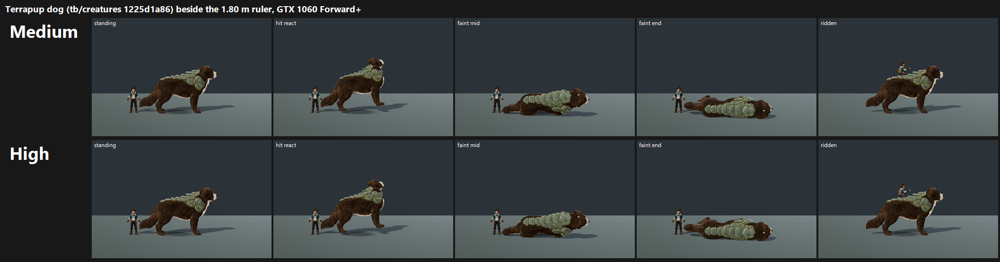

# F36#0 Terrapup dog on GPU: Medium and High (24 Oct 2026)

**Verdict: FAIL.** The dog maps to **7.09 at Medium and 7.09 at High**, 0.41 below the 7.5 bar. There were no recorded defects for this set.

- **Agreement:** all three judges scored it 6.0–6.2 raw (7.04–7.18 mapped) on both sides.
- **Medium vs High:** the frames are the same, so all three judges gave both presets identical scores.

## Run

- **Candidate:** `tb/creatures` 1225d1a86 (the A+C build), in its own worktree. Main is e35cac05b0 (origin/main 24dfec7b9).
- **Capture:** `tools/art_pipeline/capture_f36_poses.gd --species=terrapup --whole-body --context` at 1920x1080. Forward+ on a GTX 1060, with an isolated APPDATA per preset.
- **Frames:** the dog has ride and fly_grip roles; ride is shown.

`_sheet_terrapup_dog.png` (334 KB): Medium (top) and High (bottom) beside the 1.80 m ruler, in standing, hit react, faint mid, faint end and ridden.

## Yardstick (batch Ab1)

- **Set:** one set, Nk: side A is High, side B is Medium, with the same five poses.
- **Rest of the batch:** Mudsnout and Trailpup candidate vs main at each preset (in the A+C verdict), plus 4 anchor pairs (`anchor_tiles.py --pairs 4 --include f36_0_npc:C1`).
- **Judges:** three fresh code-blind judges, each given `JUDGE_PROMPT.md` verbatim.

| Fit | Slope | Intercept | r | Anchor RMSE | Confirming | Warnings |
|---|---|---|---|---|---|---|
| Ab1 | 0.680 | 2.961 | 0.82 | 0.61 | yes | none |

| Side | j1 | j2 | j3 | Mapped mean | Verdict |
|---|---|---|---|---|---|
| Medium | 7.18 | 7.04 | 7.04 | **7.09** | FAIL |
| High | 7.18 | 7.04 | 7.04 | **7.09** | FAIL |

## What the judges saw

- **Strengths:**
  - a distinct silhouette with the plated back;
  - a believable, grounded body;
  - the ride pose works.
- **Bar B:** "no" from all three.
- **Identity:** two of the three judges read it as an **otter** ("leaf-plated otter", "plated otter"); the third said "brown creature with mossy back plates". The dog identity is not landing.
- **Value:** the dark brown body sinks into the dark stage. It has no rim light and little value separation.
- **Ridden frame:** the rider reads as a speck on the back.

## Path to 7.5 (gap 0.41)

Ordered by how much of the gap each fix should close. These come from the judges' notes and my own review of the frames.

1. **Make it read as a dog, not an otter** (*new_art*, model). The long, low body with a long tail and short legs is what reads as otter.
   - Give it longer legs and a deeper chest with a tucked waist.
   - Make the ears and the muzzle-and-stop of the head visible in profile.
   - Shorten the tail, or carry it higher.

   All three judges flagged identity in some form, so this is the biggest lever.
2. **Value separation** (*new_art*, albedo and material).
   - Lift the brown coat a step: warmer russet or chestnut, with a lighter tan on the legs and face.
   - Strengthen the white chest blaze.
   - Give the fur a sheen or rim response, so the body separates from a dark background without a stage light.
   - The jade plates are already the brightest values. Keep them, and don't let the coat go darker.
3. **Faint end** (*scene*, pose). Today the faint end is a plates-up lump: the legs and head are hidden, and from this camera it reads as a shape, not a fainted dog. A side-lying faint with the legs, belly and head visible would read at once. My own review; the judges did not dock it.
4. **Ridden read** (*scene*, mount config). The rider is small and perched on the plates.
   - Seat the rider lower, in a saddle gap between the shoulder plates.
   - Or show the ride frame from a closer camera.

   The size itself is fine for a mount, and two judges did not flag scale.

**Owner calibration note:** the owner has said these judges run harsh on plain naturalistic animals. The dog's 7.09 sits near the owner's 7–7.5 read for Trailpup and Bramblebun. I have not adjusted the score; the bar stays at 7.5.

## Files

- `_sheet_terrapup_dog.png`.
- `yardstick-Ab1/`:
  - `key.json`, `sets.md`, `candidates.json`, `recorded_defects.txt`, `judge_prompt_filled.txt`;
  - `j1`–`j3` (the judges' own blocks);
  - `batch.json`, `mapped.json`.
- Per-frame captures stay local.
