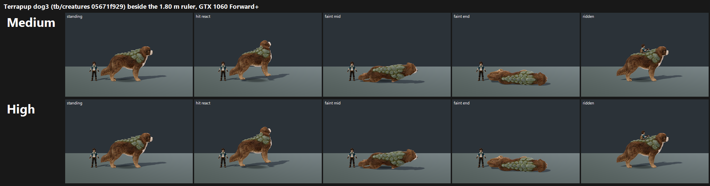

# F36#0 Terrapup dog3 on GPU: Medium and High (24 Oct 2026)

**Verdict: FAIL, but close.** Dog3 maps to **7.33 at both Medium and High**, 0.17 below the bar.

- **Tier: 7–7.5.**
- **Change from dog2:** up from 7.09 in `../terrapup-dog/` (+0.24).
- **Identity fixed:** all three judges now read it as a dog ("leaf-plated dog mount", "big furred dog with its green plated back", "solid naturalistic big dog"). Two of three called dog2 an otter.
- **Bar B:** two of three judges said "yes".

## Run

- **Candidate:** `tb/creatures` 05671f929, in its own worktree. This is item H: the stage fix plus the dog3 redraft.
- **Capture:** `tools/art_pipeline/capture_f36_poses.gd --species=…,terrapup --whole-body --context` at 1920x1080, Forward+ on a GTX 1060, Medium and High.
- **Frames:** the stage fix shoots fly_grip only for fly carriers, so the dog's travel frame is **ridden**.

`_sheet_terrapup_dog3.png` (340 KB): Medium (top) and High (bottom) beside the 1.80 m ruler, in standing, hit react, faint mid, faint end and ridden. The layout matches dog2's sheet, so the two can be compared directly.

## Yardstick (batch Hb1)

- **Set:** one set, Pg: dog3 Medium (A) vs dog3 High (B).
- **Rest of the batch:** Mosshell and Bramblebun, candidate vs main (in the H verdict), plus 4 anchor pairs.
- **Judges:** three fresh code-blind judges, each given `JUDGE_PROMPT.md` verbatim.

| Fit | Slope | Intercept | r | RMSE | Confirming |
|---|---|---|---|---|---|
| Hb1 | 0.663 | 2.997 | 0.81 | 0.64 | yes, no warnings |

| Side | j1 | j2 | j3 | Mapped mean |
|---|---|---|---|---|
| Medium | 7.57 | 7.17 | 7.24 | **7.33** |
| High | 7.57 | 7.17 | 7.24 | **7.33** |

## What the judges saw

- **Strengths:** "Reads instantly", it stands well above the ruler, real fur, and a clear ridden role. Judge 1 scored it 6.9 raw (7.57 mapped) and said the faint poses read without a label.
- **Remaining:**
  - "The green plate armour reads as a separate stuck-on asset" (j2).
  - "The faint end flattens into the floor" (j2).
  - "The rider is tiny and perched" (all three).

## Path to 7.5 (gap 0.17)

1. **Integrate the back plates into the body** (*new_art*, mesh and material). Blend the plate edges into the fur with moss and fur overlap at the borders and contact shadowing under each plate, so the plates grow out of the dog instead of sitting on it. This is the one model note left.
2. **Faint end** (*scene*, pose). It is still the plates-up lump from dog2. A side-lying faint showing the legs, belly and head would read better. This is my own note from the dog2 verdict, and j2 flagged it this round.
3. **Rider seat** (*scene*, mount config). Seat the rider lower, in a saddle gap between the shoulder plates, so the rider isn't a speck perched on top. All three judges noted it. It is cheap and should move a borderline judge.

Item 1 alone, or items 2 and 3 together, should close 0.17.

## Files

- `_sheet_terrapup_dog3.png`.
- `yardstick-Hb1/`:
  - `key.json`, `sets.md`, `candidates.json`, `recorded_defects.txt`, `judge_prompt_filled.txt`;
  - `j1`–`j3` (the judges' own blocks);
  - `batch.json`, `mapped.json`.
