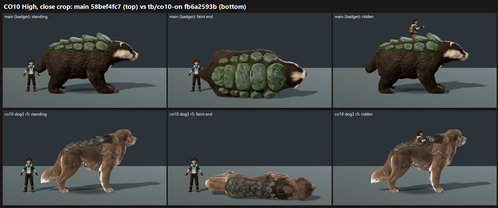

# CO10 CLOSE-OUT: Terrapup as the dog (dog3 r5) on GPU, tb/co10-on fb6a2593b vs main 58bef4fc7 badger (27 Oct 2026)

**Verdict: not met.**
- **Score:** dog3 r5 maps **6.30 / 6.30**, against the badger on main at 7.22 / 7.22 (−0.92 at both presets).
- **Tier:** 6–7, about 1.2 short of 7.5.
- **Progress since r1:** the gap to the badger roughly halves, from −1.82 for dog3 r1 in MJ/TP to −0.92 here. That is a cross-batch comparison of gaps, not of scores.
- **Coat:** orange-red PRESENT 3/3 (r1) → PARTIAL 2 / FIXED 1. The coat now leans warm tan.
- **Clipping:** PARTIAL 3/3 (r1) → PARTIAL 1 / FIXED 2.
- **"Plates strapped on":** PRESENT 3/3 (r1) → **PRESENT 2 / PARTIAL 1**. The small plate cluster still reads as a pack or blanket.
- **Owner direction "Terrapup must be the dog":** the badger is the comparison here, not the target. The dog is the asset to finish.

| Row | Medium main → co10 | High main → co10 | Plates strapped on | Coat orange-red | Clipping (rider/plates) | Floating faint | MET |
|---|---|---|---|---|---|---|---|
| terrapup | 7.22 → **6.30 (−0.92)** | 7.22 → **6.30 (−0.92)** | PARTIAL 2 / FIXED 1 → PRESENT 2 / PARTIAL 1 | FIXED 3 → PARTIAL 2 / FIXED 1 | FIXED 3 → PARTIAL 1 / FIXED 2 | FIXED 3 on both arms | not met (6.30 / 6.30) |

**Capture deviation:** the coordinator's line asked for `--candidate`. In queue 50 every terrapup run with `--candidate` aborted ("terrapup: F36 candidate did not install", 0 frames), so both arms were re-shot **plain** in queue 52, the same as MJ/TP. All 4 plain runs captured 15 frames.

**Method:**
- **Capture:** `capture_f36_poses.gd --whole-body --context --species=terrapup`, Medium and High, each arm at its own verified SHA on a clean tree.
- **Sets:** standard roster layout (standing, hit react, faint mid, faint end, ridden). 2 sets in one batch, three code-blind judges, high anchors. Fit r 0.97, RMSE 0.27, confirming.
- **Caveat:** the judges call the Medium and High strips pixel-identical at thumbnail size, so the two presets carry one result.

`_sheet_co10.png`, High, close crop: the main badger on top, dog3 r5 below (standing, faint end, ridden).

## What the judges saw

- **dog3 r5:**
  - "tan canine with a strapped-on cluster of plates".
  - "a small backpack of plates".
  - "muddy plate ridge and marginal height over the trainer".
  - One judge reads it as a "tawny cat/wolf", not clearly a dog.
- **Main badger:** "a coherent naturalistic creature". One judge adds that its "saturated plastic-green shell" sits on the fur "with a hard seam".

## Path to 7.5 for the dog (6.30, about 1.2 short)

1. **Grow the plates into the coat** (*new_art*). The plates are still the main defect (PRESENT 2/3). Use more, smaller, overlapping plates along the spine and shoulders. Let moss and fur break over their edges, so there is no cluster outline or "backpack".
2. **Coat colour** (*scene*): push the warm tan toward a desaturated chestnut brown (still PARTIAL 2/3).
3. **Scale and read** (*new_art*): make the dog clearly taller than the 1.80 m trainer (one judge calls it marginal). Strengthen the dog read: muzzle, ears and tail silhouette, so it isn't taken for a cat or wolf.
4. **Rider seat** (*new_art*): shape a seat into the plates so the rider sits in, not on, the plate cluster (clipping still PARTIAL 1/3).

## Files

- `_sheet_co10.png`, `cand_queue52.ps1.txt` (the plain re-run).
- `yardstick/CO10_rows.json`, `yardstick/coverage.json`.
- `yardstick/CO10b1/`: `key`, `sets.md`, `candidates`, `j1`–`j3`, `batch`, `mapped`.
