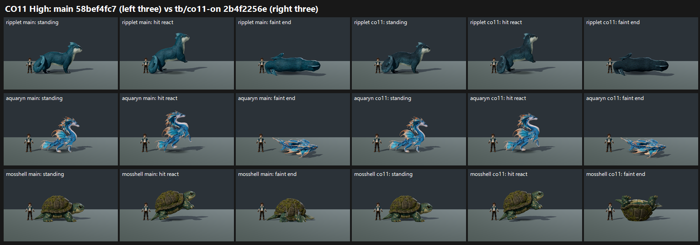

# CO11 CLOSE-OUT: near-bar creatures on GPU, tb/co11-on 2b4f2256e vs main 58bef4fc7 (27 Oct 2026)

**Verdict: no new species meets 7.5. Land Ripplet's matte coat and Mosshell's faint. Drop the grounded flinch for Aquaryn and Tidecoil, where it regresses.**

Tidecoil already **meets** 7.5 on main (7.88 / 7.88). It still meets on co11 (7.64 / 7.64) but scores lower, so keep main's Tidecoil.

| Species (form) | Change | Medium main → co11 | High main → co11 | Key defect main → co11 | MET (co11) |
|---|---|---|---|---|---|
| **ripplet** (plain) | matte countershaded coat | 6.68 → **7.26 (+0.58)** | 6.53 → **7.01 (+0.48)** | glossy coat PRESENT 3/3 → PARTIAL 3/3 | not met (7.26 / 7.01) |
| **mosshell** (plain) | faint on its back | 6.60 → 6.66 (+0.06) | 6.72 → **7.17 (+0.45)** | twisted faint PARTIAL 2 / FIXED 1 → PARTIAL 3 (Medium); PARTIAL 3 → **FIXED 3** (High) | not met (6.66 / 7.17) |
| **water_mosshell** (plain) | faint on its back | 6.77 → 7.10 (+0.33) | 7.12 → **7.67 (+0.55)** | twisted faint PARTIAL 3 → PARTIAL 3 (Medium); PRESENT 2 / PARTIAL 1 → PARTIAL 1 / FIXED 2 (High) | not met (7.10 / 7.67) |
| solmane (--candidate) | grounded flinch | 6.26 → 6.55 (+0.29) | 6.46 → 6.68 (+0.22) | flinch PRESENT 3 → PRESENT 1 / PARTIAL 2 (Medium); PRESENT 2 / PARTIAL 1 → PRESENT 1 / PARTIAL 1 / FIXED 1 (High) | not met |
| **aquaryn** (--candidate) | grounded flinch | 7.02 → 6.84 (−0.18) | 7.34 → 7.12 (−0.22) | flinch PARTIAL 3/3 → **PRESENT 3/3** (now reads near-static) | not met (main 7.02 / 7.34 not met either) |
| water_aquaryn (--candidate) | grounded flinch | 7.09 → 7.09 (0.00) | 7.02 → 6.92 (−0.10) | flinch PARTIAL 3 → PRESENT 3 (High); unchanged (Medium) | not met |
| **tidecoil** (--candidate) | grounded flinch | **7.88 → 7.64 (−0.24)** | **7.88 → 7.64 (−0.24)** | flinch FIXED 3/3 → PARTIAL 3/3 | **MET on both arms; main is higher** |
| water_tidecoil (--candidate) | grounded flinch | 7.32 → 7.25 (−0.07) | 7.24 → 6.95 (−0.29) | flinch FIXED 3 → PARTIAL 3 (High) | not met |

**Recommendation by commit:**
- **Ripplet matte coat: land.** Mean +0.53, a qualifying gain. The glossy-coat defect clears to PARTIAL 3/3.
- **Mosshell faint on its back: land.** Mean +0.35 across both forms, no regression. The twisted faint is FIXED 3/3 at High for the land form. Not a qualifying gain, but a defect fix.
- **Grounded flinch:**
  - Keep for **Solmane** (+0.26, flinch defect improves).
  - **Drop for Aquaryn and Tidecoil and their water forms.** Their flinch goes from a rear to near-static: Aquaryn's flinch defect PARTIAL → PRESENT 3/3, Tidecoil's FIXED → PARTIAL 3/3. Both score lower, and Tidecoil already meets 7.5 on main.

**Capture:**
- **Recipe species:** `capture_f36_poses.gd --whole-body --context`, one run per species, each arm at its own verified SHA on a clean tree. Aquaryn, Tidecoil, Solmane and their water forms ran with `--candidate`, as asked.
- **Deviation:** **Mosshell, water_mosshell and Ripplet were shot plain.** They are not in `f36_pose_candidates.json` `enabled_species`, so `--candidate` aborts ("F36 candidate did not install", 0 frames), and plain is how the game shows them.
- **Water forms:** water_aquaryn and water_tidecoil were added in the completion run (queue 55).

**Method:**
- **Sets:** 16 sets (8 forms × 2 presets) in 4 batches, standard roster layout and crop, three code-blind judges each, high anchors. Fits r 0.74 / 0.90 / 0.93 / 0.85, RMSE 0.39–0.64, all confirming.
- **Caveat:** batch 1's fit is the weakest (r 0.74). It holds water_aquaryn High, mosshell High, aquaryn Medium and water_tidecoil Medium, so read those four rows with more margin.

`_sheet_co11.png`, High: rows are Ripplet, Aquaryn and Mosshell. The left three frames are main and the right three co11 (standing, hit react, faint end). Ripplet's coat is darker and matte; Aquaryn's hit react barely changes on co11; Mosshell's faint end lies on its back.

## What the judges saw (paraphrased from their reports)

- **Ripplet:**
  - co11 has a darker back with a lighter chest (coat PARTIAL).
  - Main is "a single flat saturated cyan" that reads plastic (PRESENT).
  - One judge notes the colours drift from the Sirenseal water board's grey-white.
- **Mosshell:**
  - co11's faint end clearly lies on its back.
  - On main, the faint is a lowered standing pose.
  - Both arms: only about trainer height, and one judge notes the island/tree crown from the board is missing.
- **Aquaryn / Tidecoil:**
  - On co11 the hit react is "nearly a copy of standing" or "only the head pulls back".
  - Main's rear-up hit react reads better.
- **Solmane:** on both arms the faint stays "a crouch with wings raised" rather than a collapse.

## Path to 7.5

- **Ripplet** (7.26 / 7.01, about 0.25–0.5 short): keep the matte coat, push the countershading further (lighter belly), and move toward the Sirenseal board's grey-white.
- **water_mosshell** (7.10 / 7.67, Medium about 0.4 short): High already clears 7.5. Medium needs the same read: make the faint mid less tipped, so it settles straight onto the back.
- **Mosshell** (6.66 / 7.17): scale it clearly taller than the trainer, and restore the board's island/tree crown.
- **Solmane** (6.55 / 6.68): a faint that collapses rather than crouching with the wings up, and a flinch that reads without leaving the ground.
- **Aquaryn** (main 7.02 / 7.34, the better arm): keep main's rear-up flinch but keep it grounded (it is PARTIAL on main for lifting), and ground the faint mid at Medium.
- **Tidecoil:** met on main. Keep main.

## Files

- `_sheet_co11.png`, `build_yard_CO11.ps1.txt`, `cand_queue53.ps1.txt`, `cand_queue55.ps1.txt`.
- `yardstick/CO11_rows.json`, `yardstick/coverage.json`.
- `yardstick/CO11b1/`–`CO11b4/`: `key`, `sets.md`, `candidates`, `j1`–`j3`, `batch`, `mapped`.
