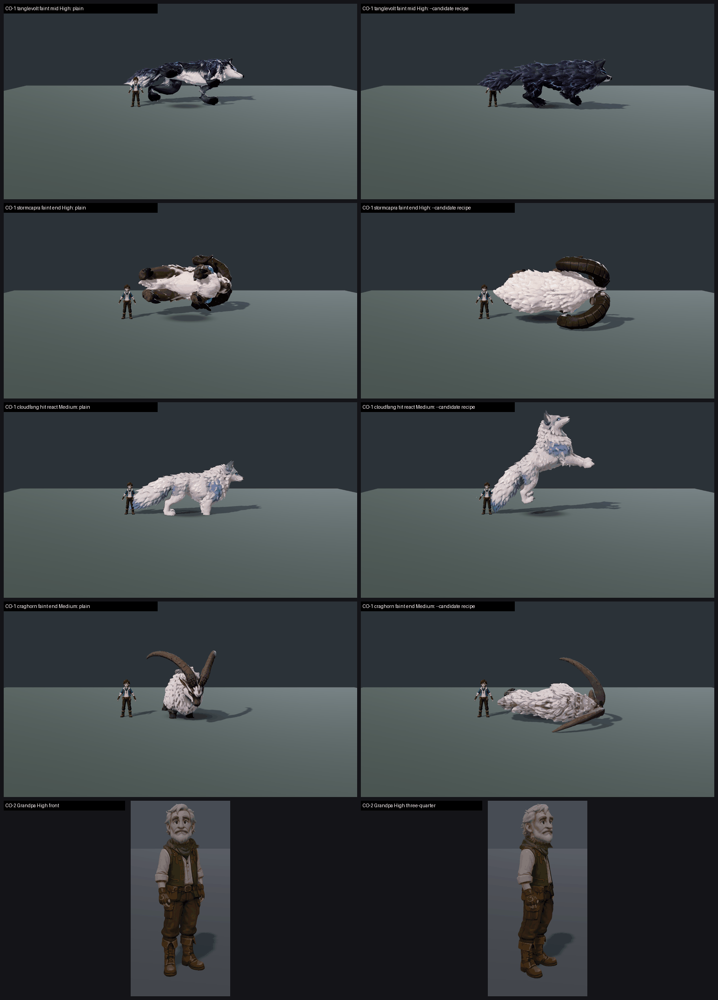

# CO-1 + CO-2 CLOSE-OUT: the six held-shove creatures and Grandpa, on GPU, main 1f9a321a5 (26 Oct 2026)

**Verdict:**
- **CO-1:** on the `--candidate` recipe pass, 3 of 6 species are met (≥7.5 on both presets): **Tanglevolt, Frostclaw, Craghorn**. Breezetail (7.35 / 7.47), Cloudfang (7.44 / 7.44) and Stormcapra (7.14 / 7.48) are just short. On the plain pass, none is met (6.26–6.86). The recipe pass scores **+0.57 to +1.43** above plain for every species.
- **CO-2: Grandpa is met**, 8.35 / 8.35 mapped. Raw judge scores are 7.3–7.6. The mapped figure is extrapolated above the top anchor (7.89), so read it as "clearly ≥ 7.5", not as an exact 8.35.

**What CO-1 could not cover.** The brief asked for the remaining swim / fly_grip / ride rows. **None of the six species has those clips**, so `--context` shot no travel rows. All six were judged on standing / hit react / faint mid / faint end. If F36#77 / #45 / #73 / #41 / #35 / #43 refer to travel rows, they can't be closed until the clips exist.

**Which pass is the game?** As with Staticub (B5), the recipe and plain captures load the same model; `--candidate` adds the F36 pose-recipe profile from `f36_pose_candidates.json`. The recipe pass is what clears the bar. If the in-game creature uses that recipe profile, the three MET rows stand. If it uses the plain path, none is met. **The lane needs to confirm which.**

**Method:**
- **Capture:** `capture_f36_poses.gd --whole-body --context --source-commit=1f9a321a5`, with `--candidate` (recipe) and without (plain), Medium and High, 60 frames per arm per preset. The Grandpa capture used `_capture_character_cast.gd`.
- **CO-1 sets:** 12 (one per species per preset), A/B is recipe vs plain in the roster layout and crop, 2 batches.
- **CO-2:** one-sided (the same front + three-quarter close crop on both sides), 2 sets in their own batch.
- **Anchors:** the high set (`anchors_hi.json`). CO-1 includes the Stormcapra GPU anchor (7.79). CO-2 includes the Tanglevolt (7.89) and Stormcapra GPU anchors, and **excludes the npc C1 anchor, because it is Grandpa**.
- **Caveat:** Stormcapra and Tanglevolt are also judged species in CO-1, so a same-species anchor is in the batch.
- **Fits:** CO-1 r 0.86 / 0.93, RMSE 0.42 / 0.49. CO-2 r 0.89, RMSE 0.55. All confirming.

| Species | Medium plain → recipe | High plain → recipe | Floating faint (3 judges) | Tier (recipe, lower preset) | MET (recipe) |
|---|---|---|---|---|---|
| **tanglevolt** | 6.43 → **7.86** (+1.43; extrapolated just above 7.79) | 6.86 → **7.72** (+0.86) | plain PRESENT 1 / PARTIAL 2 (Medium), PRESENT 2 / PARTIAL 1 (High) → recipe FIXED 3/3 | **7.5+** | **MET** (7.86 / 7.72) |
| **frostclaw** | 6.52 → **7.57** (+1.05) | 6.40 → **7.72** (+1.32) | FIXED on both | **7.5+** | **MET** (7.57 / 7.72) |
| **craghorn** | 6.53 → **7.58** (+1.05) | 6.53 → **7.58** (+1.05) | FIXED on both | **7.5+** | **MET** (7.58 / 7.58) |
| cloudfang | 6.45 → 7.44 (+0.99) | 6.45 → 7.44 (+0.99) | FIXED on both | 7–7.5 | not met (7.44 / 7.44) |
| breezetail | 6.26 → 7.35 (+1.09) | 6.37 → 7.47 (+1.10) | FIXED on both | 7–7.5 | not met (7.35 / 7.47) |
| stormcapra | 6.57 → 7.14 (+0.57) | 6.50 → 7.48 (+0.98) | plain PRESENT 3/3 (Medium), PRESENT 1 / PARTIAL 2 (High) → recipe FIXED 3/3 | 7–7.5 | not met (7.14 / 7.48) |
| **CO-2 grandpa** | **8.35** (raw 7.3–7.6) | **8.35** | — | **7.5+** | **MET** (extrapolated above 7.89) |

`_sheet_co12.png`: plain on the left, recipe on the right.
1. Tanglevolt faint mid, High.
2. Stormcapra faint end, High.
3. Cloudfang hit react, Medium.
4. Craghorn faint end, Medium.
5. Grandpa, High, front and three-quarter.

## What the judges saw

- **Plain pass:** the poses break the read.
  - The faint either never goes down (Breezetail, Cloudfang, Frostclaw, Craghorn: "faint end is an upright sit facing the camera") or flips belly-up into a black-and-white slab that floats above its shadow (Tanglevolt, Stormcapra).
  - The hit react is the standing pose.
- **Recipe pass:** the faints are grounded and read without a label, and every creature stands taller than the 1.80 m trainer. Two problems remain:
  - **Airborne hit react:** in the recipe hit react, Cloudfang, Frostclaw, Breezetail and Tanglevolt leap clear of the stage with the shadow detached. It reads "as a pounce, not a flinch" (4 of 6 CO-1 judges).
  - **Stormcapra horn skinning:** in the recipe faint mid and faint end, the horns stretch into long black tube loops (3 of 6 judges call it a skinning fault).
- **Grandpa:** "polished and appealing". The only notes are minor: a slightly noisy moss collar fringe, gloves and trousers that merge into one brown mass, and dim, flat stage light.

## Path to 7.5 (recipe pass, the three not met)

1. **Breezetail** (7.35 / 7.47):
   - Hit react (*animation*): replace the leap with a grounded flinch or recoil. Judges say this alone should carry it.
   - Scale: one judge reads it as barely trainer-height on High.
2. **Cloudfang** (7.44 / 7.44):
   - Hit react: the same grounded flinch.
   - Material: the white fur needs more value contrast and a rim light against the grey stage.
3. **Stormcapra** (7.14 / 7.48): fix the horn skinning in the faint (*rig* / *weights*), so the horns stay rigid and attached. Medium is the low preset. The hit react should also differ more from standing.

For all six, if the game turns out to use the plain path, the faint pass needs to be brought onto it (grounded collapse, no belly-up float, no upright sit). The plain path sits at 6.3–6.9, about 0.6–1.2 short.

## Files

- `_sheet_co12.png`, `build_yard_CO12.ps1.txt`.
- `yardstick/CO12_rows.json`, `yardstick/coverage.json`.
- `yardstick/CO12b1/`, `CO12b2/`, `CO2gb1/`: `key`, `sets.md`, `candidates`, `j1`–`j3`, `batch`, `mapped`.
