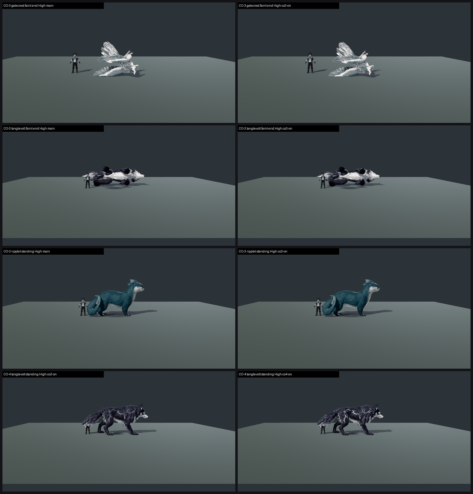

# CO-3 + CO-4 CLOSE-OUT: shared creature rim + faint settle, and Tanglevolt arcs, on GPU (26 Oct 2026)

**Verdict: no gain from either change at the standard judging scale, and neither closes a species.**
- **CO-3** (tb/co3-on 33ba3f2a2 vs main ac5e1426c): rim 0.15 + faint settle. All 10 species map within ±0.06 of main, except Mudsnout Medium at −0.31 (noise: its frames differ by at most 0.6% of pixels). The two recorded defects get the same calls on both arms:
  - floating faint: PARTIAL 5/60 on each arm;
  - hard rim/halo: PRESENT 2 + PARTIAL 12 on co3-on, vs PRESENT 2 + PARTIAL 11 on main.
- **CO-4** (tb/co4-on 4c35d5d7e vs co3-on): Tanglevolt High maps 7.15 on both arms in the standard batch. **Score of record: no gain, not met.**
- **CO-4 diagnostic** (close crops, not the score of record): 7.28 → **7.85 (+0.57)**, soft arcs PRESENT 3/3 → **FIXED 3/3**. **The new arcs read only when the creature fills the frame.** At the standard roster crop (about 300 px per frame) the judges cannot see them. To count at play scale they need to be thicker or brighter.
- **MET:** 1 of 10 species is at or above 7.5 on both presets: Stormursa (7.80 / 7.63), one of the two over-rim controls. Its Medium figure is extrapolated just above the top anchor (7.79).

**Measured change on screen.** For each species and preset I measured the share of pixels whose difference between main and co3-on is above 16/255 in the standing, hit, faint-mid and faint-end frames:
- 0.0–0.8% for every species, in every pose except faint end;
- faint end: Galecrest 1.2% and Tanglevolt 0.55%, where the settle acts;
- CO-4 Tanglevolt standing: 0.14%.

**Method:**
- **Arms:** isolated arms on current main, all verified: co3-on's parent is main ac5e1426c (6 files changed), and co4-on's parent is co3-on (6 files changed).
- **Capture:** `capture_f36_poses.gd --whole-body --context --source-commit=<arm>` on a clean tree, Medium and High.
  - Plain: Ripplet, Stormtrail, Paddlenewt, Cindercub, Mudsnout, Trailpup, Duskhush, Tanglevolt, Galecrest.
  - With `--candidate`: Stormursa, because it was recipe-on in the roster batch.
  - Each plain run exits 1 because **Galecrest has no fly_grip clip** ("galecrest: missing fly_grip clip"). All nine species are still shot (100 frames).
- **Sets:** the roster layout (standing / hit react / faint mid / faint end + travel role where shot, same crop). 21 sets in 4 batches, three code-blind judges each.
- **Anchors:** the local high set (`anchors_hi.json`), which adds Stormcapra 7.79 so the batch brackets 7.5. The Tanglevolt anchor was left out to avoid a same-species anchor. Fits: r 0.78 / 0.97 / 0.95 / 0.85, RMSE 0.70 / 0.29 / 0.41 / 0.48, all confirming. In batch 1 the judges under-read the Stormcapra candidate anchor (6.0 vs 7.79), so its fit is the weakest.
- **CO-4 diagnostic:** one set at a close crop around Tanglevolt (crop 520x300 of the 1920x1080 frame, four poses), same anchors, three fresh judges. Fit r 0.89, RMSE 0.53.

| Species | Medium main → co3-on | High main → co3-on | Recorded defects (co3-on) | Tier (co3-on, lower preset) | MET |
|---|---|---|---|---|---|
| **stormursa** (control, --candidate) | 7.80 → 7.80 | 7.63 → 7.63 | float/halo FIXED | **7.5+** | **MET** (7.80 / 7.63; Medium extrapolated) |
| tanglevolt | 7.44 → 7.40 | 7.04 → 7.04 (CO-4 standard: 7.15 → 7.15) | float PARTIAL 4/6 (faint mid); halo PARTIAL 1/6 | 7–7.5 | not met (7.40 / 7.04) |
| ripplet | 6.89 → 6.95 | 7.22 → 7.22 | FIXED | 6–7 | not met (6.95 / 7.22) |
| stormtrail | 7.35 → 7.35 | 6.86 → 6.86 | FIXED | 6–7 | not met (7.35 / 6.86) |
| mudsnout | 7.31 → 7.00 | 6.67 → 6.61 | FIXED / halo PARTIAL 1 | 6–7 | not met (7.00 / 6.61) |
| cindercub | 6.86 → 6.86 | 6.84 → 6.84 | FIXED | 6–7 | not met (6.86 / 6.84) |
| trailpup | 6.86 → 6.86 | 6.86 → 6.86 | FIXED | 6–7 | not met (6.86 / 6.86) |
| paddlenewt | 6.69 → 6.69 | 6.69 → 6.69 | FIXED | 6–7 | not met (6.69 / 6.69) |
| duskhush | 6.29 → 6.25 | 6.29 → 6.25 | halo PARTIAL 6/6 | 6–7 | not met (6.25 / 6.25) |
| galecrest (control) | 5.94 → 5.94 | 6.48 → 6.48 | halo PRESENT 2 / PARTIAL 4; float PARTIAL 1 | below 6 | not met (5.94 / 6.48) |
| **CO-4 tanglevolt diagnostic (close crop, High)** | | 7.28 → **7.85 (+0.57)** | soft arcs PRESENT 3/3 → **FIXED 3/3**; float PARTIAL/PRESENT both arms | (diagnostic) | (not the score of record) |

**Anchor scale.** These mapped values use the high-anchor set. Ripplet's 6.95 / 7.22 here vs its roster board 7.49 is the scale difference between anchor sets, not a regression. Main and co3-on sit on the same scale in the same batch.

`_sheet_co34.png`, High: the main / co3-on pair on the left and right for each row, except the CO-4 row, which is co3-on vs co4-on.
1. Galecrest faint end.
2. Tanglevolt faint end.
3. Ripplet standing.
4. CO-4 Tanglevolt standing (the arcs read at this size).

## Path to 7.5, per species

Taken from the judges' notes. The rim and settle do not change these.

- **Tanglevolt** (7.40 / 7.04):
  1. **Arcs** (*new_art*): CO-4's crisper arcs need to read at play scale. Make the lines thicker, or raise the emission or bloom further, until they survive the standard crop.
  2. **Faint** (*scene* / animation): the faint mid still hangs above its shadow on both arms (4/6 calls). At faint end the wolf rolls belly-up into a white-and-black lump that loses the arcs. The settle rule acts only after the clip ends, so the faint-mid float needs the clip or root fixed.
  3. **Staging:** the trainer stands inside the tail fur in standing and hit react.
- **Ripplet** (6.95 / 7.22; the board's near-bar species): the surface is a smooth, flat teal with little fur detail (*texture*), and the tail overlaps the trainer in the hit and faint frames (*stage spacing*).
- **Stormtrail** (7.35 / 6.86): a slate body on a slate stage, with dim blue streaks. It needs value separation and brighter streaks (*texture* / rim).
- **Mudsnout** (7.00 / 6.61): it stands only about as tall as the trainer, against the rule that creatures stand taller (*scale*). Judges read it as a plain real-world boar with no Ground-type identity (*new_art*).
- **Cindercub** (6.86 / 6.84): near-black fur merges with the dark stage, the faint becomes a shapeless dark mass, and the tail runs through the trainer. It needs a rim or key light, lighter fur and a signature accent.
- **Trailpup** (6.86 / 6.86): it reads as a stock coyote with no Tetherbound markings. It needs elemental markings and an accent colour (*new_art*).
- **Paddlenewt** (6.69 / 6.69): it barely clears the trainer's height, and the material is flat with narrow mid-tones. Scale it up and add scale detail and value contrast.
- **Duskhush** (6.25 / 6.25): the near-black owl merges with the stage and its face is lost. A pale streak on the faint-end body draws halo PARTIAL 6/6. It needs mid-value plumage, visible eyes and a soft rim light.
- **Galecrest** (control, 5.94 / 6.48): a chrome-white bird with hard bright edges (halo PRESENT 2, PARTIAL 4) instead of the board's slate and tan. In hit react it thins to a spike. It needs a matte slate-and-tan feather material with no bright edge. It also needs a **fly_grip clip**: the capture reports it missing.

## Files

- `_sheet_co34.png`, `build_yard_CO34.ps1.txt`.
- `yardstick/CO34_rows.json`, `yardstick/coverage.json`.
- `yardstick/CO34b1/` … `CO34b4/`: `key`, `sets.md`, `candidates`, `j1`–`j3`, `batch`, `mapped`.
- `yardstick/CO4zb1/`: the close-crop diagnostic.
