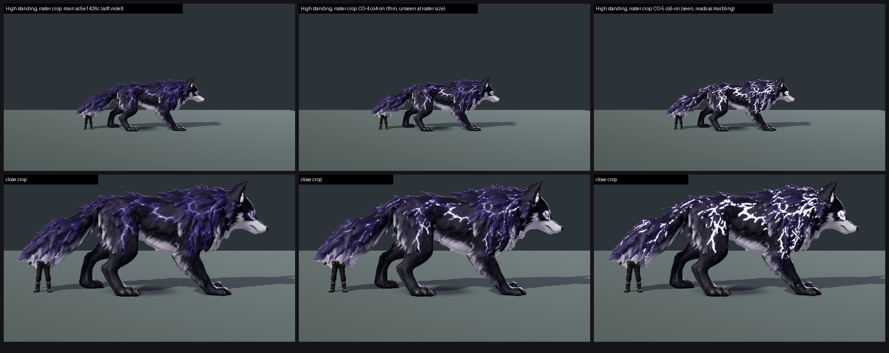

# CO-5 CLOSE-OUT: Tanglevolt arcs v2 on GPU, tb/co5-on e78759f17 vs main ac5e1426c (26 Oct 2026)

**Verdict: no gain, and a small loss. Not met.**
- Tanglevolt maps **6.96 → 6.64 (−0.32)** at both presets in the standard roster batch.
- The arcs are now visible at roster size: the soft-arcs defect goes PRESENT 6/6 → **PARTIAL 6/6**.
- But all three judges read them as **broad white blotches or "marbling"** rather than thin white-violet lines, and say they "muddy the dark-wolf identity".
- 1 px dilation plus emission 5.0 overshoots: the cores clip to flat white and the violet is gone (see the sheet's close crop).

**Method:**
- **Arms:** co5-on (main + arcs only, 6 files, parent main ac5e1426c) vs main ac5e1426c.
- **Control frames:** CO-3's main-arm capture of the same SHA (`out\CO3-ship-*`), with identical `capture_f36_poses.gd --whole-body --context` flags. So only co5-on was shot.
- **Sets:** the standard roster crop and layout (standing / hit react / faint mid / faint end), Medium and High, 2 sets, three code-blind judges.
- **Anchors:** the high set with the Stormcapra GPU anchor (7.79); the Tanglevolt anchor is excluded. Fit r 0.86, RMSE 0.43, confirming.
- **On screen:** the arms differ by 0.35% of pixels in the standing frame. CO-4 differed by 0.14%.
- **Judging resolution:** the judges scored Medium and High identically. The two presets were in one batch, and at roster size they look the same.

| Preset | main → co5-on | Soft-arcs defect | Floating faint | MET |
|---|---|---|---|---|
| Medium | 6.96 → **6.64 (−0.32)** | PRESENT 3/3 → PARTIAL 3/3 | PARTIAL 2 / PRESENT 1 on both arms | not met (6.64) |
| High | 6.96 → **6.64 (−0.32)** | PRESENT 3/3 → PARTIAL 3/3 | PARTIAL 2 / PRESENT 1 on both arms | not met (6.64) |

`_sheet_co5.png`: High standing, at the roster crop (top) and a close crop (bottom).
- Left: main, soft violet.
- Middle: CO-4 co4-on (thin violet-white lines, unseen at roster size; the close-crop diagnostic scored 7.85).
- Right: CO-5 co5-on (seen at roster size, but flat white blotches).

## Path to 7.5

1. **Arcs** (*texture* / *material*): aim between CO-4 and CO-5.
   - Keep CO-4's thin violet-white core and colour.
   - Make it read at roster size through **glow, not width**: a tight halo or bloom around a 1 px core.
   - Cap emission below white clipping, so the core stays white-violet and the violet surround survives. Something like emission 3.5–4 with the dilation applied to the glow mask only.
   - Fewer, longer, branching strokes would read as lightning rather than marbling.
2. **Faint** (*animation*): the faint mid still lifts off its shadow on both arms, 6/6 calls. The plain capture also rolls belly-up into a black-and-white lump. This is the same issue as CO-1, where the `--candidate` recipe faint grounds it.

Tanglevolt's best result so far is the CO-1 recipe pass on main 1f9a321a5: 7.86 / 7.72, MET, pending the lane's answer on whether the game uses the recipe profile. Combining CO-4-style arcs with the recipe poses is the likely route to MET on whichever path the game uses.

## Files

- `_sheet_co5.png`.
- `yardstick/CO5b1/`: `key`, `sets.md`, `candidates`, `j1`–`j3`, `batch`, `mapped`.
