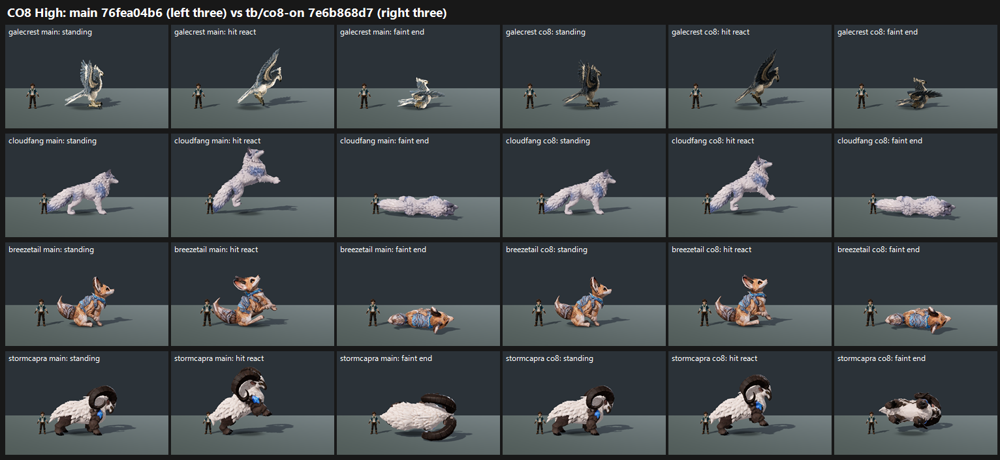

# CO8 CLOSE-OUT: Galecrest matte + grounded flinch + Stormcapra faint on GPU, tb/co8-on 7e6b868d7 vs main 76fea04b6 (26 Oct 2026)

**Verdict: land Galecrest matte and the Cloudfang flinch. Both now MEET 7.5. Do NOT land the Stormcapra changes: they drop a row that main already meets.**

| Row | Medium main → co8 | High main → co8 | Key defect main → co8 | Tier (co8) | MET |
|---|---|---|---|---|---|
| **Galecrest** (all roles) | 6.54 → **7.70 (+1.16)** | 6.22 → **7.68 (+1.46)** | glossy / over-bright: PRESENT 3/3 → **FIXED 3/3** | 7.5+ | **MET on co8** (7.70 / 7.68). Main not met. |
| **Cloudfang** (hit) | 7.14 → **7.64 (+0.50)** | 7.14 → **7.64 (+0.50)** | flinch: PRESENT 3/3 → PARTIAL 1 / FIXED 2 | 7.5+ | **MET on co8** (7.64 / 7.64). The close-out exception applies: it crosses 7.5. |
| Breezetail (hit) | 6.46 → 6.77 (+0.31) | 6.46 → 6.89 (+0.43) | flinch: PRESENT 3/3 → PRESENT 1 / PARTIAL 2 (Medium), PARTIAL 3 (High) | 6–7 | not met (6.77 / 6.89). Gain under +0.5. |
| **Stormcapra** (hit + faint) | 7.60 → **6.60 (−1.00)** | 7.68 → **6.10 (−1.58)** | twisted faint: PARTIAL 2 / FIXED 1 → **PRESENT 3/3** | 6–7 | **main MET (7.60 / 7.68); co8 not met** |

**What happened to Stormcapra:**
- **Faint:** the −90 roll turns the faint **belly-up**, legs in the air with the dark underside showing (see the sheet, bottom right). All three judges call the twisted-faint defect PRESENT, at both presets. Main's +90 roll lies the ram on its side, horns up, and reads cleanly. The co8 faint also picks up a floating call (High PARTIAL 3/3; Medium PARTIAL 2 / FIXED 1; main FIXED 3/3).
- **Flinch:** the grounded flinch over-damps Stormcapra's hit react. It reads as "near-static" (High PRESENT 3/3, Medium PARTIAL 3/3). Main's rear is called a "full rear" (mixed calls), but it still scores higher.

**Recommendation by commit:**
- **Land 6007b8069 (Galecrest matte).**
- **Land e6225b215 (grounded flinch) for Cloudfang and Breezetail only**, excluding Stormcapra. Breezetail doesn't count as a gain (+0.31 / +0.43) but doesn't regress.
- **Drop 7e6b868d7 (Stormcapra faint roll −90)** and keep main's Stormcapra hit and faint.

**Method:**
- **Capture:** `capture_f36_poses.gd --candidate --whole-body --context`, 1920x1080, Medium and High, at each arm's SHA on a verified checkout with a clean tree. `--candidate` installs the F36 recipe profile, which is the game's profile, so the recipe pass is the score of record. All 4 runs captured 45 frames.
- **Arms:** co8's base is d212fbed6. Main 76fea04b6 is 8 commits ahead of it, but none of them touch creature or pose files.
- **Sets:** standard roster layout and crop (as CO-3): standing, hit react, faint mid and faint end, plus carrying for Galecrest. 8 sets in 2 batches, three code-blind judges each, high anchors. Fits r 0.91 / 0.93, RMSE 0.55 / 0.43, both confirming.
- **Caveats:**
  - Cloudfang and Breezetail got identical Medium and High scores on the main arm. Cloudfang did on co8 too.
  - The GPU result differs from CPU b51 (6.87 vs main 4.60). On GPU, main's Stormcapra and Cloudfang were already near or at the bar.

`_sheet_co8.png`, High: each row is one species. The left three frames are main and the right three are co8 (standing, hit react, faint end).

## What the judges saw

- **Galecrest:** co8 is a "matte slate-and-tan raptor [that] matches the Galecrest style bar and its carrying flight reads". Main's "silver-white over-bright plumage looks plastic" (glossy defect PRESENT 3/3 in both batches).
- **Cloudfang:** on main, the hit react "launches the whole body into the air". The co8 flinch is grounded, though one judge reads it "as a forward lunge rather than a flinch". Also noted: "white-on-pale fur reads clumpy and the face and eyes get lost" at small size.
- **Breezetail:** the flinch is grounded but subtle. "the busy blue pattern muddies the torso at small size"; another judge calls it "a textile print" (all 3 judges flag it).
- **Stormcapra:** the standing model "is at the owner bar". On co8, the faint "flips into a brown-and-white twisted lump" or "collapses into a twisted black-and-white piebald lump".

## Path to 7.5

- **Galecrest and Cloudfang:** met. For Cloudfang, keep the flinch planted (no forward lunge), and lift the fur's value separation from the stage so the face reads.
- **Stormcapra:** main is met. If the faint should face the camera, keep it lying on its side, spine to the floor, not belly-up: rotate the yaw so the face turns toward the camera, not the roll. Keep main's hit react, or reduce the flinch damping for this species.
- **Breezetail** (6.77 / 6.89, about 0.7 short):
  1. Simplify or desaturate the blue harness print so the torso reads as fur (all 3 judges).
  2. Make the flinch a clear planted recoil (currently PARTIAL).

## Files

- `_sheet_co8.png`, `build_yard_CO8.ps1.txt`, `cand_queue47.ps1.txt`.
- `yardstick/CO8_rows.json`, `yardstick/coverage.json`.
- `yardstick/CO8b1/`, `CO8b2/`: `key`, `sets.md`, `candidates`, `j1`–`j3`, `batch`, `mapped`.
