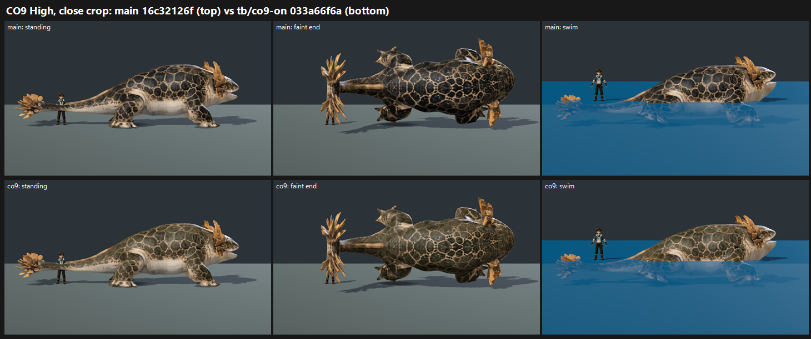

# CO9 CLOSE-OUT: Mirejaw olive-umber fill on GPU, tb/co9-on 033a66f6a vs main 16c32126f (27 Oct 2026)

**Verdict: no qualifying gain at the score of record, and not met.** The change does what it was built for: in close crops, the water form's sooty back clears.

**Score of record** (standard roster crop, as MJ/TP): main → co9 by row and preset.

| Row | Medium | High |
|---|---|---|
| mirejaw | 6.39 → 6.28 (−0.11) | 6.23 → 6.44 (+0.21) |
| water_mirejaw | 6.28 → 6.49 (+0.21) | 6.28 → 6.49 (+0.21) |
| **Mean** | | **+0.13** |

- Near-black back on co9: PARTIAL 3/3 at three of the four sets, and PRESENT 1 / PARTIAL 2 on land Mirejaw at Medium. Main shows the same mix, with one PRESENT call at three sets.
- The fit is weak (r 0.81, RMSE 0.71). Several judges said the two arms look identical at strip size.

**Close-crop diagnostic** (not the score of record; same rule as CO-4): the same frames cropped to the creature, one batch, three judges. Fit r 0.87, confirming.

| Row | Medium | High | Sooty back, main → co9 |
|---|---|---|---|
| water_mirejaw | 6.07 → **7.06 (+0.99)** | 6.10 → **6.79 (+0.69)** | PRESENT 3/3 → FIXED 2 / PARTIAL 1 (Medium); PRESENT 3/3 → PARTIAL 3 (High) |
| mirejaw | 6.56 → 6.46 (−0.10) | 6.66 → 6.93 (+0.27) | mixed (see below) |
| **Mean** | | **+0.46** | |

- **Land Mirejaw at Medium:** one judge's calls for that set have the arms swapped (it calls the co9 side sooty and the main side warm olive). The close-crop sheet below shows co9 is the olive one.
- **Tier:** 6–7 for co9 in both crops (lowest row 6.28 standard, 6.46 close).
- **MET:** not met on any row in either crop.
- **Recommendation:** the coordinator's call. There is no qualifying gain (+0.13 standard, +0.46 close), but nothing regresses beyond noise and the defect it targets improves. It is safe to land as a defect fix; it carries no tier change.

`_sheet_co9.png`, High, close crop of water_mirejaw: main on top, co9 below (standing, faint end, swim). co9's cells are a warm olive-umber, and its faint-end back is no longer near-black.

**Method:**
- **Capture:** `capture_f36_poses.gd --candidate --whole-body --context`, Medium and High, each arm at its own verified SHA on a clean tree. All 4 runs captured 25 frames.
- **Sets:** standard roster layout (standing, hit react, faint mid, faint end, plus swimming for the water form). 4 sets plus 4 close-crop sets, each in its own batch, three judges per batch, high anchors.

## What the judges saw

- **co9:** "warm tan-olive body with pale belly and gold crests reads as a real creature" (close crop).
- **Both arms:**
  - "the evenly tiled dark reticulated skin" and "the uniform tiled hex print": placeholder PARTIAL on every side, because the net reads as procedural rather than authored scales.
  - The faint-end back still goes dark on some sides.

## Path to 7.5 (co9 at 6.3–6.5 standard, 6.5–7.1 close; about 0.5–1.2 short)

1. **Author the scale pattern** (*new_art* / *scene*): irregular, hand-varied cells instead of the evenly tiled net. All three judges in both batches name this.
2. **Value structure** (*scene*): grade the warm olive-umber back down to a pale belly, and keep the values up in the faint frames so the rolled-over back never reads near-black.
3. **Stage light** (*scene*): a rim or fill light so the creature separates from the dark stage at strip size. This is where the standard crop loses the improvement.

## Files

- `_sheet_co9.png`, `build_yard_CO910.ps1.txt`.
- `yardstick/CO9_rows.json`, `yardstick/CO9z_rows.json`, `yardstick/coverage.json`.
- `yardstick/CO9b1/` (score of record), `yardstick/CO9zb1/` (close-crop diagnostic): `key`, `sets.md`, `candidates`, `j1`–`j3`, `batch`, `mapped`.
