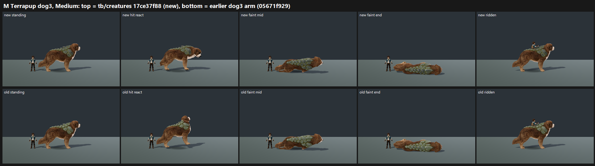

# M: Terrapup dog3 on GPU, tb/creatures 17ce37f88 vs the earlier dog3 arm (25 Oct 2026)

**Verdict: a small gain (+0.10 paired), not yet 7.5. Tier 6–7 on this batch's scale.**
- **Scores:** new dog3 **6.78** vs earlier dog3 **6.68**, in the same batch, mapped.
- **Stone plates** ("bright green add-ons stuck on the coat"): improved from PRESENT 1 / PARTIAL 2 to PARTIAL 3. Judges now see muted sage plates that still sit "like a separate blanket" on the coat.
- **Rider on the back:** the rider sits on the back and does not float. The call is unchanged between arms: PARTIAL 2 / FIXED 1. In the full frame the trainer is seated on the plate hump at the shoulders, with the legs hidden in the plate layer and no gap (see the sheet's ridden frame). Judges call it "perched high on the plate hump rather than seated in the coat".
- **Cower hit:** not called out by any judge either way. At sheet size the hit-react frame reads close to standing on both arms.

**Read this against 7.33 carefully.** The earlier dog3 frames scored 7.33 in their own round (item H). The same frames score 6.68 here, so this batch's anchors map about 0.65 lower. The paired difference (+0.10) is the trustworthy number. On H's scale the new dog3 would sit at about 7.4, still short of 7.5.

`_sheet_m.png` (0.26 MB), at Medium: the new dog3 on top, the earlier dog3 below.

## Run

- **Candidate:** `tb/creatures` 17ce37f88. This is the lane branch with the dog3 model, `rideable.mount_offset` 2.58 m, the cower hit, and weathered plates.
  - The checkout was verified in the reflog.
  - An earlier queue capture of M silently ran on 4e5217f1b because a partial-clone checkout failed. Those frames were deleted and M was re-captured.
- **Control:** the earlier GPU dog3 arm (H-cand, `tb/creatures` 05671f929), with the same tool and flags.
- **Capture:** `capture_f36_poses.gd --species=terrapup --whole-body --context` at 1920x1080, Forward+ on a GTX 1060, Medium and High, 15 frames each. On this stage Medium and High render pixel-identically.

## Yardstick

- **Sets:** one set, new vs old at Medium (standing, hit react, faint mid, faint end, ridden), with 4 anchor pairs.
- **Judges:** three fresh code-blind judges.
- **Fit:** slope 0.727, intercept 2.734, r 0.83, RMSE 0.60, confirming.

## Path to 7.5

1. **Plates grown into the coat** (*new_art* or texture). Add a fur-to-stone transition: moss creeping into the fur at the plate edges, and fur growing around the plate rims. Darken and weather the plate value further toward earth-grey.
2. **A real seat** (*new_art*). A saddle or worn pad, or a dip in the plate layer, so the rider reads as seated *in* the back. Today they read as perched on the hump.
3. **A cower that reads at strip size** (*rig*): lower the head and drop the hindquarters clearly away from the standing pose.
4. **Rim light** on the brown coat. This is the shared creature note from batches 1 and 2.

## Files

- `_sheet_m.png`, `build_yard_M.ps1.txt`.
- `yardstick/`:
  - `key.json`, `sets.md`, `candidates.json`, `recorded_defects.txt`, `judge_prompt_filled.txt`;
  - `j1`–`j3`;
  - `batch.json`, `mapped.json`.
