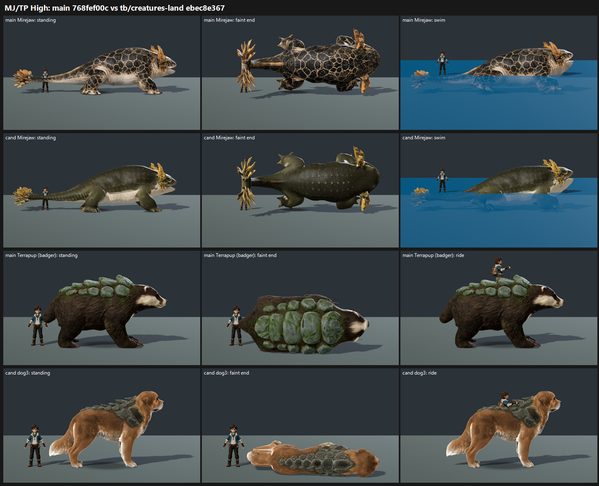

# MJ/TP: Mirejaw retexture + Terrapup dog3 r1 on GPU, tb/creatures-land ebec8e367 vs main 768fef00c (26 Oct 2026)

**Verdict: neither lands. Both candidates score below main at both presets.**
- **Mirejaw** (land and water) retexture: 6.53 → **5.45 (−1.08)**. The back does **not** read olive-umber: the near-black/sooty back defect is PRESENT 2 / PARTIAL 1 on the candidate (main PARTIAL 3/3). The candidate also picks up a placeholder call (PRESENT 1 / PARTIAL 2; main FIXED 3/3), because the judges read its skin as smooth and unmarked next to main's patterned hide.
- **Terrapup dog3 r1:** 6.75 (main badger) → **4.93 (−1.82)**.
  - The coat reads **orange-red, not chestnut**: PRESENT 3/3.
  - **"Plates strapped on" is PRESENT 3/3.** All three judges see the plates as a separate pack or saddle on top of the dog. On main's badger the same defect is PARTIAL 3/3.
  - **New on dog3:** the rider sinks into the plate pad, and the pad is wider than the torso in the faint frames (clipping PARTIAL 3/3; main FIXED 3/3).
- **Tier:**
  - Mirejaw candidate: below 6. Main: 6–7.
  - dog3: below 6. Main badger: 6–7.
- **MET:** not met for any arm (Mirejaw candidate 5.45 / 5.45, main 6.53 / 6.53; dog3 4.93 / 4.93, badger 6.75 / 6.75).

| Row | Medium main → cand | High main → cand | Near-black back | Placeholder | Coat orange-red | Plates strapped on | Clipping | Floating faint |
|---|---|---|---|---|---|---|---|---|
| mirejaw | 6.53 → 5.45 (−1.08) | 6.53 → 5.45 (−1.08) | PARTIAL 3 → PRESENT 2 / PARTIAL 1 | FIXED 3 → PRESENT 1 / PARTIAL 2 | — | — | — | FIXED 3 → FIXED 3 |
| water_mirejaw | 6.53 → 5.45 (−1.08) | 6.53 → 5.45 (−1.08) | same | same | — | — | — | FIXED 3 → FIXED 3 |
| terrapup | 6.75 → 4.93 (−1.82) | 6.75 → 4.93 (−1.82) | — | — | FIXED 3 → **PRESENT 3** | PARTIAL 3 → **PRESENT 3** | FIXED 3 → PARTIAL 3 | PARTIAL 1 / FIXED 2 → FIXED 3 |

**Method:**
- **Capture:** `capture_f36_poses.gd --whole-body --context`, 1920x1080, Medium and High, at each arm's SHA on a verified checkout. Mirejaw and water_mirejaw ran with `--candidate` on both arms; Terrapup ran plain on both arms. All 8 runs completed (25 or 15 frames each).
- **Sets:** the standard roster layout and crop (as CO-3): standing, hit react, faint mid and faint end, plus swimming (water_mirejaw) or ridden (Terrapup). 6 sets in one batch, three code-blind judges, high anchors.
- **Fit:** r 0.94, RMSE 0.44, confirming.

**Caveats:**
- **Presets:** the judges scored Medium and High identically, as in the last few creature batches; they look alike at strip size.
- **Mirejaw rows:** mirejaw and water_mirejaw also got identical scores. All three judges read the four Mirejaw sets as one creature in two skins and scored by skin, so the swim frame did not move the water rows.
- **Strip size:** each strip is 3064 px wide with five frames. The judges say contact gaps and clipping are low-confidence at that size; the colour and plate calls are unanimous.
- **Full-res check (mine, not scored):** the candidate Mirejaw is a dark olive-green with faint dotted rows when standing, not near-black. The sooty read comes mainly from the rolled-over back at faint end and from losing main's cream rosette pattern.

`_sheet_mjtp.png`, High, cropped close: rows are main Mirejaw, candidate Mirejaw, main Terrapup (badger) and candidate dog3. Columns are standing, faint end, and swim or ride.

## What the judges saw

- **Candidate Mirejaw:** "smooth unmarked olive skin" that "looks like a flat base colour"; "smooth dark olive reads placeholder". On both arms the backs "go sooty when rolled over in faint end". The gold frills and long salamander silhouette read well.
- **Main Mirejaw:** the reticulated cream-rosette hide "is the side that earns its finish", but it also turns near-black on the back at faint end (PARTIAL 3/3).
- **dog3:** "orange-red dog with a thin plate strip reads as a recoloured dog"; "saddle-like plate pad read as a dog in armour rather than one creature"; "a strapped-on plate blanket". One judge sees the pad wider than the torso in the faint frames.
- **Main badger:** "dark-brown badger body with a mossy domed shell is a readable, grounded creature", though the shell "still sits on the body like a separate green carapace" (PARTIAL). All three judges prefer it to dog3 by 1.3–2.0 raw points.

## Path to 7.5

**Mirejaw** (best arm is main at 6.53, about 1.0 short):
1. **Keep main's reticulated pattern and warm it** (*scene*): shift the dark rosette fill from near-black toward olive-umber and keep the cream markings. Don't trade the pattern for a smooth olive skin; that is what cost the candidate its 1.08.
2. **Faint end** (*scene*): lift the values on the rolled-over back so it doesn't collapse to near-black.

**Terrapup** (best arm is the badger at 6.75, about 0.75 short). For the next dog3 approach, the plates-on-top build reads as strapped on to every judge, and the r1 coat reads orange-red.
1. **If dog3 continues** (*new_art*): the plates have to grow out of the fur. Make them smaller and overlapping along the spine, with moss and fur breaking over the plate edges and no pad outline. Shape a seat into the plates for the rider. Shift the coat to a desaturated chestnut brown.
2. **If the badger stays** (*scene* / *new_art*): blend the shell's lower edge into the fur so it stops reading as a separate carapace, and keep the plate detail in the faint frames.

## Files

- `_sheet_mjtp.png`, `build_yard_MJTP.ps1.txt`.
- `yardstick/MJTP_rows.json`, `yardstick/coverage.json`.
- `yardstick/MJTPb1/`: `key`, `sets.md`, `candidates`, `j1`–`j3`, `batch`, `mapped`.
