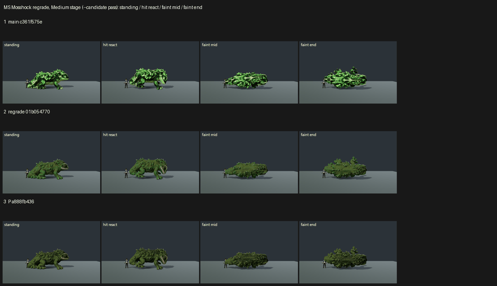

# MS: Mosshock regrade on GPU, tb/creatures-land 01b054770 vs main c361f575e (25 Oct 2026)

**Verdict: the regrade holds at ≥6, scoring 6.62–6.79. It is +1.30 over main (5.32) and level with P's retexture: 6.79 vs 6.62 head to head, the same score within judge noise. Tier 6–7.**

The capture used `capture_f36_poses --species=mosshock --whole-body --context --candidate` on the Medium stage, the same setup as P. Each arm ran at its own SHA in the lane worktree.

The judging used one batch with two sets, so P's number sits on the same scale. Three code-blind judges, 4 anchor pairs. Fit: slope 0.75, r 0.84, RMSE 0.58, confirming, no warnings.

| Set | A | B | Recorded defects (3 judges) |
|---|---|---|---|
| regrade vs main | regrade **6.62** | main 5.32 (**+1.30**) | camouflage blotch: main PRESENT 3/3 → regrade **FIXED 3/3**; oxblood mouth/eye rim: FIXED on both* |
| regrade vs P (a888fb436) | P 6.62 | regrade **6.79** (+0.17) | both defects FIXED on both sides 6/6* |

*All three judges said they read the mouth and eye-rim colour at thumbnail size. No dark red was visible; the open mouth reads pale.

`_sheet_ms.png` has three rows: main, the regrade, and P's candidate. Each row shows standing, hit react, faint mid and faint end.

## What the judges saw

- **Regrade vs main:** every judge gave the regrade the clear win. Main still shows the lime-and-black camouflage, which breaks up the silhouette and hides the face. That is PRESENT in all four poses for all three judges.
- **Regrade vs P:** the regrade was rated slightly brighter, with better separation from the stage (5.2 / 5.7 / 6.0 vs 5.0 / 5.5 / 5.7 raw). That is a small lift, not a different look.
- **What still holds it under 7:** all three judges named the same problems.
  - One mid-green value across the whole body. The lighter belly and throat do not read at stage size.
  - No readable eye, cream belly or accent veins from the board, so the face is lost except in the open-mouth hit react.
  - The faint-end pose collapses into "a mossy log".
  - Standing height is about the trainer's height (borderline against "every creature stands taller").

## Path to 7.5

1. **Value structure** (*scene*): a pale throat and belly that reads at stage distance, a darker spine, and a rim light.
2. **The board's face** (*new_art* or texture): large orange eyes with a catch-light and a clear head silhouette, so the face reads in standing and faint.
3. **Board accents** (*texture*): cyan storm veins in the moss. Keep them off dark red.
4. **Scale and pose** (*scene*): about 10–20% larger so it clearly outsizes the trainer, and a faint-end pose that keeps the head readable.

## Files

- `_sheet_ms.png`, `build_yard_MS.ps1.txt`.
- `yardstick/MS_rows.json`.
- `yardstick/MSb1/`: `key`, `sets.md`, `candidates`, `j1`–`j3`, `batch` and `mapped`.
