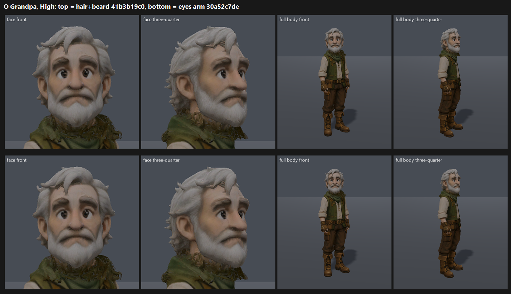

# O: Grandpa hair and beard on GPU, tb/creatures 41b3b19c0 vs the eyes arm 30a52c7de (25 Oct 2026)

**Verdict: no measurable change. The hair and beard texture is invisible at judging size, even in face close-ups.**

- **Scores:** both arms map to **7.65–7.72**, and the result is the same on both presets.
  - Medium: candidate 7.65, eyes arm 7.72.
  - High: candidate 7.72, eyes arm 7.65.
  - So the arms differ only by which judge scored which side.
- **Hair defect** ("smooth, soft-edged or blurry mass rather than crisp strands and locks"): **PARTIAL on all 12 calls**, both arms.
  - All three judges: "only the outline (crown, forelock) breaks into locks; the beard and the sides of the hair are a soft, felt-like mass."
  - One judge saw a slight edge on one side; two could not tell the sides apart.
- **Score caveat:** both arms score above this batch's top anchor (7.35), so the values are extrapolated. The fit itself confirms: slope 0.98, r 0.95, RMSE 0.29.
  - The earlier GPU eyes round put the same eyes arm at 7.20.
  - Read Grandpa as "about 7.2–7.7, near the bar", not as a confirmed pass.
  - A batch with anchors above 7.5 would settle it.
- **Tier: 7–7.5 by the earlier round, possibly 7.5+.** The two rounds disagree.

`_sheet_o.png`, at High: hair and beard on top, the eyes arm below. Each row is two face close-ups and two full-body frames.

## Run

- **Candidate:** `tb/creatures` 41b3b19c0. This is the eyes plus crisper hair and beard texels (about 7.6% of the atlas), on the same head, mesh and colours. Verified.
- **Control:** the GPU eyes arm `gpeyes-cand` (tb/creatures 30a52c7de). The coordinator confirmed this is the right control.
- **Capture:** `tools/_capture_character_cast.gd`, front and three-quarter, at 1920x1080, Forward+ on a GTX 1060.
- **Sets:** face crops upscaled from the frames, plus full body (`gphair_sides.py.txt`).

## Yardstick

- **Sets:** 2 (Medium, High), with 4 anchor pairs.
- **Anchors:** Grandpa's own C1 anchor was excluded, and the craft anchors included, as in the eyes round.
- **Judges:** three fresh code-blind judges.
- **Fit:** slope 0.981, intercept 1.442, r 0.95, RMSE 0.29, confirming. One warning: the scores are extrapolated above the top anchor.

## Path to 7.5 (and past it)

This round shows that texel sharpening alone is not a >0.5 change. Under the owner's direction, it should not be re-queued on its own.
- **If hair is pursued** (*new_art*): it needs geometry. Use layered hair and beard cards or lock meshes with alpha-tested strand edges, plus a rim light on the stage so the locks separate.
- **To settle where Grandpa stands:** add a re-anchored batch (anchors above 7.5) to the next big Grandpa candidate.

## Files

- `_sheet_o.png`, `gphair_sides.py.txt`.
- `yardstick/`:
  - `key.json`, `sets.md`, `candidates.json`, `recorded_defects.txt`, `judge_prompt_filled.txt`;
  - `j1`–`j3`;
  - `batch.json`, `mapped.json`.

Commit held until R's F41 capture finished, so the lane HEAD did not move during F41.
