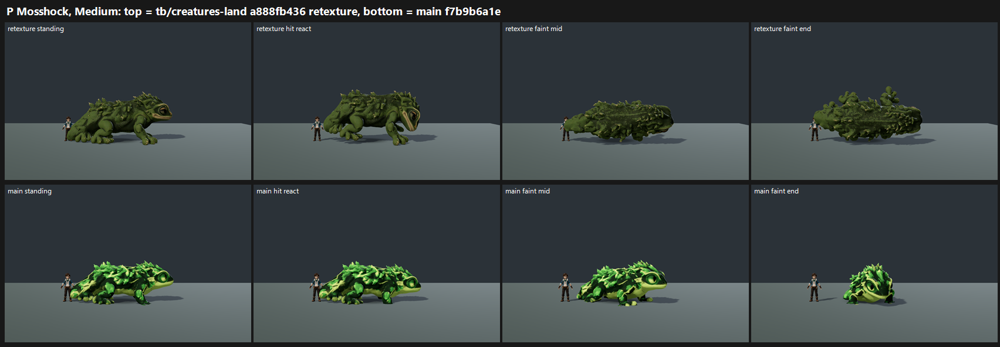

# P: Mosshock retexture on GPU, tb/creatures-land a888fb436 vs main f7b9b6a1e (25 Oct 2026)

**Verdict: a big lift, +1.76. Mosshock leaves the below-6 tier.**
- **Scores:** retexture **6.52** vs main **4.76**, mapped, at Medium (High is pixel-identical on this stage). Tier 6–7.
- **Camouflage** ("yellow-black or lime-and-black blotches that break the silhouette and hide the face"): **FIXED 3/3** on the retexture, PRESENT 3/3 on main.
- **Red check on the mouth and eye rims:** **FIXED 3/3**. Judges flagged low confidence at strip size, so I checked the full 1920x1080 frame: the mouth line and eye rims are tan to olive-brown, the iris is amber, and there is no red or oxblood anywhere on the body.
- **Height:** in the full frame it stands well above the 1.80 m trainer (body length about 4x and back height about 1.3x the trainer).

`_sheet_p.png` (0.28 MB), at Medium: the retexture on top, main below.

## What still holds it under 7.5 (all three judges)

- **One muddy mid-tone:** the even moss coat reads as "a single olive mid-value with no eye pop or rim light". It barely separates from the grey stage.
- **The face does not read:** the eyes do not stand out from the coat.
- **Faint end flattens into a slab** that "reads like a log", and the face disappears in the faint frames.
- Two judges also call it "only just taller than the trainer" at strip size. The full frame says otherwise for the back height, but the silhouette is low and long.

## Run

- **Candidate:** `tb/creatures-land` a888fb436, the coordinator's Meshy retexture of the existing mesh, graded to deep moss with an olive-brown mouth and rims and amber irises. Mesh, rig, UVs and the 3.6 m size are unchanged.
  - The checkout was verified in the reflog.
  - The capture is the `--candidate` pass, so the cower-hit recipe shows.
- **Control:** the batch 2 main arm on main f7b9b6a1e, with the same commit and flags.
- **Capture:** `capture_f36_poses.gd --species=mosshock --whole-body --context [--candidate]` at 1920x1080, Forward+ on a GTX 1060, Medium and High.
  - Mean absolute difference between Medium and High: 0.01/255.

## Yardstick

- **Sets:** one set, retexture vs main (standing, hit react, faint mid, faint end), with 4 anchor pairs.
- **Judges:** three fresh code-blind judges.
- **Fit:** slope 1.100, intercept 0.175, **r 0.94**, RMSE 0.43, confirming.

## Path to 7.5

The gap is 0.98.

1. **Value structure and a face** (texture or material). Keep the even coat, but:
   - add a lighter belly and throat;
   - darken the moss toward the spine;
   - give the eyes a bright amber iris with a highlight and a darker rim, so the head reads at 30%.
2. **Rim light** on the creature. This is the shared creature note from batches 1 and 2.
3. **A faint that keeps the head up and visible** (*rig*), instead of the flat slab.
4. **Silhouette height:** a higher head carriage or crest so the standing read is taller than the trainer at strip size.

## Files

- `_sheet_p.png`, `build_yard_P.ps1.txt`.
- `yardstick/`:
  - `key.json`, `sets.md`, `candidates.json`, `recorded_defects.txt`, `judge_prompt_filled.txt`;
  - `j1`–`j3`;
  - `batch.json`, `mapped.json`.
