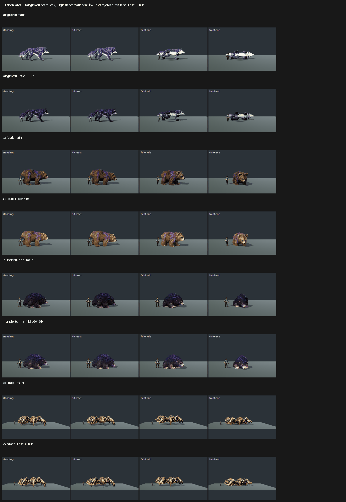

# ST: storm arcs and the Tanglevolt board look on GPU, tb/creatures-land 1b9c6616b vs main c361f575e (25 Oct 2026)

**Verdict: Tanglevolt is back to the owner's dark-navy coat, +1.68 / +1.10 (7.66 / 7.30, tier 7–7.5). The arcs show but don't yet pop: PARTIAL in 6 of 6 calls. The other three storm creatures barely move. Voltarach renders identically on both arms, Thundertunnel gains +0.14 / +0.24, and Staticub splits +0.57 / −0.42.**

- **Capture:** `capture_f36_poses --species=tanglevolt,staticub,thundertunnel,voltarach --whole-body --context`, Medium and High stages, each arm at its own SHA in the lane worktree.
- **Judging:** 8 sets in 2 batches, three code-blind judges each.
- **Fits:** batch 1 r 0.94, RMSE 0.46; batch 2 r 0.91, RMSE 0.56. Both confirm. Batch 2's warning: Tanglevolt Medium (7.66) sits above the top anchor (7.53), so that number is slightly extrapolated.

| Species | Medium main → cand | High main → cand | Recorded defects (3 judges) | Tier (cand, lower preset) |
|---|---|---|---|---|
| **Tanglevolt** | 5.98 → **7.66 (+1.68)** | 6.20 → **7.30 (+1.10)** | coat lighter/violet: PRESENT 6/6 → **FIXED 6/6**. Arcs dull or flooding: PRESENT 6/6 → PARTIAL 6/6 | **7–7.5** |
| Staticub (judged as a storm bear) | 6.77 → 7.34 (+0.57) | 7.37 → 6.95 (−0.42) | arcs: PRESENT → PARTIAL/FIXED at Medium; PARTIAL/FIXED → PRESENT/PARTIAL at High | 6–7 (split, so no net gain) |
| Thundertunnel | 6.06 → 6.20 (+0.14) | 6.29 → 6.53 (+0.24) | arcs: PRESENT 6/6 → PRESENT 3 / PARTIAL 3 | 6–7 |
| Voltarach | 5.32 → 5.32 (0.00) | 5.32 → 5.32 (0.00) | arcs PRESENT 12/12. The two arms render the same: gold floods the body as blotches | below 6 |

`_sheet_st.png`: at High, main then candidate for each species, with standing, hit react, faint mid and faint end.

## The coordinator's two questions

- **Is the coat dark navy again?** Yes, on Tanglevolt. All six judges marked the "lighter, more violet, washed out" coat defect FIXED. Several judges called the candidate a match for "the owner's in-game Tanglevolt". On main the coat reads as washed lavender, with the violet glow flooding the body.
- **Do the arcs pop?** Not yet. On Tanglevolt the arcs are visible as lighter streaks but are "a little soft" (PARTIAL 6/6). Voltarach's gold is unchanged from main and still reads as a hazard-stripe blotch pattern, with no dark coat for arcs to pop against. Thundertunnel's arcs read as a dim violet sheen on the spines.

## Path to 7.5

1. **Turn the Tanglevolt coat ON.** To reach 7.5, make the arcs thin, high-intensity white-violet emissive lines with a tight bloom (*scene*). Also fix the faint clips: on both arms the wolf rolls belly-up into a pale slab with black leg blobs (*anim*).
2. **Voltarach material** (*texture*): a dark bronze/black base with thin gold arcs and readable blue eyes, as on its board. Today the gold covers most of the body.
3. **Thundertunnel** (*texture + scale*): brighter spine arcs, a face that reads at small size, and about 15–20% more scale. It stands only at the trainer's height.
4. **Staticub:** no net change at stage level. Its faint end sits upright facing the camera; it needs a grounded side-lying faint.

## Files

- `_sheet_st.png` and `build_yard_ST.ps1.txt`.
- `yardstick/coverage.json` and `yardstick/ST_rows.json`.
- `yardstick/STb1` and `yardstick/STb2`, each with `key`, `sets.md`, `candidates`, `j1`–`j3`, `batch` and `mapped`.

**Two process notes:**
- For the three non-Tanglevolt species, the builder handed the judges the arc defect spelled out one character per item. All six judges re-joined it into the full sentence. The builder is fixed for future runs, and Bar A scores don't use defect keys.
- One judge's saved file (STb1 j1) left out set Ws by mistake. I restored it from the full JSON in that judge's report before aggregating.
