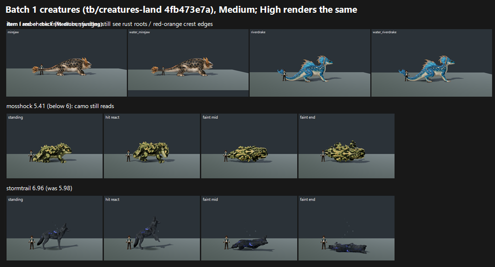

# Batch 1 creatures on GPU: item I (amber frills) and the tier-1 re-score, tb/creatures-land 4fb473e7a (25 Oct 2026)

**Verdict: the hard-rule red check does NOT clear.**
- **Mirejaw, both forms:** PARTIAL, 6 of 6 calls.
- **Riverdrake, both forms:** PARTIAL, 4 PARTIAL to 2 FIXED.
- **Re-score:** Stormtrail rises out of the below-6 tier (6.96, up from 5.98). **Mosshock falls further (5.41, down from 5.85).** Riftfrill also slips.

The batch's G3 fight re-test is judged separately, once its main-branch control arm has captured.

| Species | Mapped (Medium = High) | Roster baseline (1e83cafa0) | Δ | Tier | Red check (3 judges × 2 sides) |
|---|---|---|---|---|---|
| riverdrake | 6.99 | 7.20 | −0.21 | 6–7 | **PARTIAL** (4) / FIXED (2) |
| water_riverdrake | 6.99 | 7.32 | −0.33 | 6–7 | **PARTIAL** (4) / FIXED (2) |
| stormtrail | **6.96** | 5.98 | **+0.98** | 6–7 | n/a |
| riftfrill | 6.11 | 6.51 | −0.40 | 6–7 | n/a |
| mirejaw | 6.00 | 6.52 | −0.52 | 6–7 | **PARTIAL** (6) |
| water_mirejaw | 6.00 | 6.45 | −0.45 | 6–7 | **PARTIAL** (6) |
| mosshock | **5.41** | 5.85 | −0.44 | **below 6** | n/a |

The Δ column compares two different judging batches with different anchors, so treat it as indicative. Even so, the batch-to-batch agreement on unchanged species in earlier rounds was about ±0.13, so moves of 0.4 or more are real signal.

## Red check (item I, hard rule)

- **The colour change landed:** all three judges read the frills as amber or orange-gold.
- **Mirejaw (land and water) still fails** the red check on two counts:
  - rust-brown tones at the frill roots;
  - in faint end, the tail stretches into "a dark rust / maroon rod". This is the same stretched-tail artefact the roster baseline flagged ("a dark stretched bar along the tail that reads as broken geometry"). It now carries a red cast.
- **Riverdrake (land and water):**
  - two judges call the crest and frill edges "red-orange, close to the reserved red" or "rust-orange";
  - one judge reads them as tan-orange (FIXED).
- **The water forms look identical to the land forms at this size.** The coordinator said water Mirejaw should now have its own texture, but no judge could tell the forms apart: they were scored identically and described as "the same gecko" and "the same drake".

## Re-score findings

- **Stormtrail (+0.98):** it now reads as "a dark wolf with blue storm accents, close to the Tanglevolt bar". Before, it read as "a flat black placeholder dog". The remaining issue is the near-black body with no rim light.
- **Mosshock (−0.44):** the repaint did not land. All three judges still describe "yellow-black / lime-and-black camouflage blotches" that break up the silhouette and hide the face. It is also no taller than the trainer, and its faint poses barely differ from standing.
- **Riftfrill (−0.40):** glossy, plastic-smooth surface; shorter than the trainer.

`_sheet_batch1.png`, at Medium:
- the four amber species, standing;
- mosshock;
- stormtrail.

## Run

- **Source:** `tb/creatures-land` 4fb473e7a = a986d3142 (the Mosshock repaint) + Mosshock's cower hit. It contains f3d6d65f0 (item I) and a22e582cd (tier 1).
- **Capture:** `capture_f36_poses.gd --whole-body --context` at 1920x1080, Forward+ on a GTX 1060, Medium and High.
  - `--candidate` for mirejaw, water_mirejaw, riverdrake, water_riverdrake and mosshock.
  - Own clips (no `--candidate`) for stormtrail and riftfrill.
  - There is no `water_mosshock` in the data.
- **Earlier capture:** item I was also captured on f3d6d65f0 before the PC dropped. The verdict uses the current head.

## Yardstick (one batch)

- **Sets:** 7, Medium vs High per species, with 4 anchor pairs.
- **Recorded defect:** the red check, on the four frill species only.
- **Judges:** three fresh code-blind judges.
- **Fit:** slope 1.107, intercept 0.171, **r 0.91**, RMSE 0.57, confirming, no warnings.

## Path to 7.5

1. **Clear the hard rule (*new_art*, texture):**
   - Push the Mirejaw frill roots fully to amber or gold. The rust gradient at the base is what reads as red.
   - Push the Riverdrake crest edges from red-orange to amber, gold or teal.
   - Fix the **stretched-tail faint end** on Mirejaw. This is a rig or pose bug, and in rust it reads as a maroon rod.
2. **Mosshock:** the camo must go, not just darken. Use an even moss-and-skin pattern that leaves the face and eyes readable (*new_art*). Scale it above the 1.80 m ruler (*config*), and give it a faint that collapses (R1 from the roster baseline).
3. **Stormtrail:** add rim light or lift its value (R2) to move it from 6.96 toward 7.
4. **Riftfrill:** add surface detail instead of gloss, and scale it above the ruler (R3).
5. **Riverdrake (both forms):** stage the ridden frame so the rider is visible, and fix the rigid "plank" tail in faint end.

## Files

- `_sheet_batch1.png`, `species_scores.json` (per-judge mapped scores and red-check votes), `build_yard_b1.ps1.txt`.
- `yardstick/`:
  - `key.json`, `sets.md`, `candidates.json`, `recorded_defects.txt`, `judge_prompt_filled.txt`;
  - `j1`–`j3` (the judges' own blocks);
  - `batch.json`, `mapped.json`.
