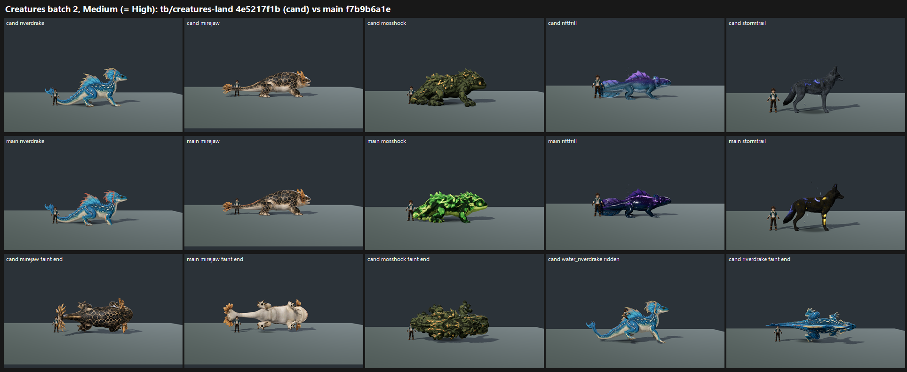

# Creatures batch 2 on GPU: tb/creatures-land 4e5217f1b vs main f7b9b6a1e (25 Oct 2026)

**Verdict: the red check CLEARS. Mosshock FAILS again.**
- **Red check:** all four frill species are FIXED on the candidate side, 12 of 12 calls (3 judges × 4 species).
- **Lifts:**
  - riverdrake and water_riverdrake +0.95, and mirejaw +0.96 (mirejaw's lift is not from the frills; see the note under the table);
  - water_mirejaw +1.41;
  - riftfrill +0.87;
  - stormtrail +0.87.
- **Mosshock** drops to **4.82**, below main's 5.29. The camouflage defect is PRESENT 3/3.
- **No species reaches 7.5.** Eight are in the 7–7.5 tier, three in 6–7, and Mosshock is below 6.

| Species | Candidate | Main | Δ | Tier (cand) | Recorded defect (cand / main) | Candidate pixels vs main |
|---|---|---|---|---|---|---|
| trailpup | 7.34 | 7.43 | −0.09 | 7–7.5 | n/a | identical |
| stormtrail | **7.31** | 6.44 | +0.87 | 7–7.5 | n/a | changed (rim reverted, other changes kept) |
| paddlenewt | 7.28 | 7.25 | +0.03 | 7–7.5 | n/a | small (roughness) |
| cindercub | 7.24 | 7.31 | −0.07 | 7–7.5 | n/a | identical |
| mudsnout | 7.22 | 7.25 | −0.03 | 7–7.5 | n/a | identical |
| water_riverdrake | **7.16** | 6.19 | +0.97 | 7–7.5 | red: **FIXED 3** / PRESENT 2, PARTIAL 1 | changed |
| riverdrake | **7.13** | 6.19 | +0.94 | 7–7.5 | red: **FIXED 3** / PRESENT 2, PARTIAL 1 | changed |
| water_mirejaw | **7.07** | 5.66 | +1.41 | 7–7.5 | red: **FIXED 3** / PRESENT 3 | changed |
| mirejaw | 6.92 | 5.96 | +0.96 | 6–7 | red: **FIXED 3** / FIXED 3 | changed |
| nightburrow | 6.51 | 6.51 | 0.00 | 6–7 | n/a | identical |
| riftfrill | 6.37 | 5.50 | +0.87 | 6–7 | n/a | changed |
| mosshock | **4.82** | 5.29 | −0.47 | **below 6** | camo: **PRESENT 3** / PRESENT 2, PARTIAL 1 | changed |

**Notes on the table:**
- **Mapped scores are Medium.** On this neutral stage, Medium and High are pixel-identical: mean absolute difference ≤ 0.06 out of 255 on the creature crop. So High = Medium, as in batch 1.
- **Identical to main:** mudsnout, trailpup, cindercub and nightburrow render the same as main (≤ 0.1/255). Their "owner touches" are therefore already on main at these scores, and those rows are a re-score, not a candidate lift.
- **Main mirejaw already reads amber:** main mirejaw is FIXED 3/3 on the red check, so the item I frills are on main for that species. The candidate's mirejaw lift comes from its pose and material, not the frills.

`_sheet_batch2.png` (0.46 MB), at Medium:
- row 1: candidate standing;
- row 2: main standing;
- row 3: mirejaw faint end (candidate, then main), Mosshock faint end, water_riverdrake ridden, and riverdrake faint end.

## What the judges saw

- **Red check:** the riverdrake crest now reads pale peach, cream or gold. Main keeps red crest tips. The mirejaw and water_mirejaw frills read amber or gold.
- **Mosshock, "one hue, close values":**
  - It now reads as **dark olive-black with orange-yellow blotches**. On main it is lime with black blotches.
  - Judges still call it camouflage that dissolves the silhouette and face, with the faint end "a mossy rock pile".
  - The commit itself notes that "the blotch shapes are baked into the source atlas", and that is what the judges see. Darkening the colours kept the pattern.
  - On the stage it is no taller than the trainer at the shoulder.
- **Riftfrill:** the candidate (cyan body, pale belly, violet fin) separates from the ground. Main reads as "a near-black purple slug". Both stand low beside the trainer, which is the owner's small class and not scored as a defect.
- **Stormtrail:** the candidate reads as a dark wolf with blue storm veins, "close to Tanglevolt". Main's black coat with flat gold bands reads as off-board paint. Both lack rim light.
- **Pose and material issues on the candidate:**
  - **Mirejaw faint end** goes near-black: the tail curl turns its dark back to the camera. Two judges call it "a dark smear".
  - **Riverdrake (land) faint end** curls upright into a seated coil (2 of 3 judges). The water form's faint stays flat.
  - **water_riverdrake ridden:** 2 of 3 judges could not see the rider at strip size. In the full frame the trainer sits at the base of the neck, small against the body.
  - **Main's water forms** go pale and untextured in faint mid and end. The candidate fixes this for water_mirejaw.

## Run

- **Candidate:** `tb/creatures-land` 4e5217f1b. It descends from 9463a4326 → 78361d936 + 4fb473e7a and folds in the batch 1 fixes.
- **Control:** main f7b9b6a1e, the lane checkout's merge of that commit.
- **Capture:** `capture_f36_poses.gd --whole-body --context` at 1920x1080, Forward+ on a GTX 1060, Medium and High, for 12 species.
  - The candidate side for the five pose-recipe species (mirejaw, water_mirejaw, riverdrake, water_riverdrake, mosshock) uses the `--candidate` pass. It differs from the plain pass on every one of them.
  - Without `--candidate`, the run logs "missing swim/ride clip" for water_mirejaw and water_riverdrake on both arms, and exits 1 after writing all its frames.

## Yardstick (two batches of 6)

- **Sets:** 12, candidate vs main per species, with 4 anchor pairs per batch.
- **Judges:** three fresh code-blind judges per batch, given `JUDGE_PROMPT.md` verbatim.
- **Recorded defects:** the red check on the four frill species, and the batch 1 camouflage description on Mosshock.

| Batch | Slope | Intercept | r | RMSE | Confirming |
|---|---|---|---|---|---|
| b1 | 0.900 | 1.935 | 0.88 | 0.51 | yes |
| b2 | 1.084 | 0.446 | 0.89 | 0.63 | yes |

## Path to 7.5

The owner's order is: the lowest to 6, then 7, then 7.5.

1. **Mosshock, 4.82 → 6** (*new_art*, texture). The pattern is in the atlas, so recolouring cannot remove it.
   - Re-author the base-colour atlas as an even moss coat: one mid-value green with soft lichen variation and no hard-edged blotches.
   - Give it a lighter face mask so the eyes read.
   - Then scale it above the 1.80 m ruler at the shoulder (*config*). Batch 1's note that the faint should collapse still stands.
2. **The 6–7 tier up to 7:**
   - **mirejaw:** keep its faint end readable. Either keep the belly to the camera, or lift the back's value so the curl is not a black shape.
   - **riftfrill:** the roughness change worked (+0.87). The remaining note is a rim light or lighter value on the back.
   - **nightburrow:** unchanged from main. Its yellow-spotted black back plate breaks the silhouette into noise, so calm the plate pattern and add a rim light.
3. **The 7–7.5 tier up to 7.5:** every judge named the same small levers.
   - **Rim light** on dark bodies (stormtrail, cindercub, nightburrow).
   - **Riverdrake (land):** replace the upright seated coil in faint end with a flat collapse.
   - **water_riverdrake ridden:** frame the rider so it reads at strip size, by seating it higher or scaling the shot.
   - **Identity accents** on the naturalistic stock-animal species (trailpup, mudsnout). Judges call them "a plain realistic boar/coyote" without a Tetherbound accent.
   - **Scale** above the trainer wherever the owner's class allows.

## Files

- `_sheet_batch2.png`, `species_scores.json` (per species and arm: mapped, per judge, defect votes), `coverage.json`, `build_yard_b2.ps1.txt`.
- `yardstick/b1`–`b2`:
  - `key.json`, `sets.md`, `candidates.json`, `recorded_defects.txt`, `judge_prompt_filled.txt`;
  - `j1`–`j3`;
  - `batch.json`, `mapped.json`.
