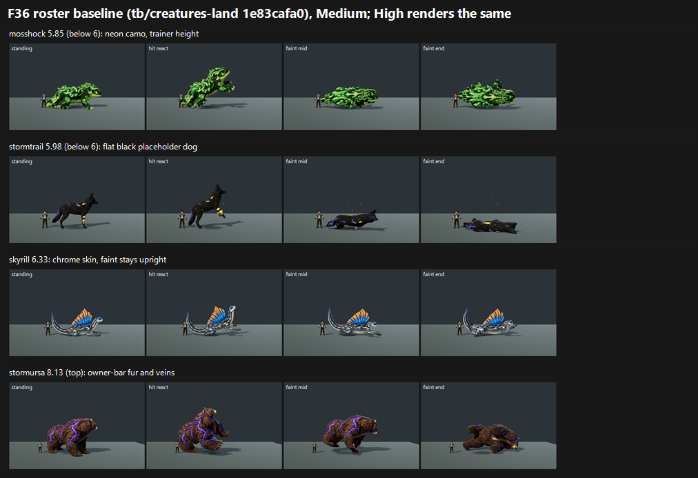

# F36 roster baseline on GPU: 55 subjects, tb/creatures-land 1e83cafa0 (24 Oct 2026)

**Verdict: 9 of 55 species PASS. They map to 7.5 or more at both presets, with no recorded defects.** The other 46 fail.

| Tier | Count |
|---|---|
| **7.5 and above (PASS)** | 9 |
| 7–7.5 | 15 |
| 6–7 | 29 |
| **below 6** | 2: **mosshock 5.85**, **stormtrail 5.98** |

- **Medium vs High:** every species maps the same at both presets. The judges saw no Medium/High difference on any candidate.
- **Agreement with H:** the scores line up with H's independent batches (05671f929): Mosshell 6.90 here vs 6.93 in H, Trailpup 7.34 vs 7.37, Mudsnout 6.96 vs 7.01, Bramblebun 7.37 vs 7.24.

## Run

- **Source:** `tb/creatures-land` 1e83cafa0. That is main 124a7393c plus the two capture-stage fixes: fly_grip is shot only for fly carriers, and swimmers get real water.
- **Capture:** `tools/art_pipeline/capture_f36_poses.gd --whole-body --context` at 1920x1080, Forward+ on a GTX 1060, Medium and High.
  - **36 recipe-on species**, with `--candidate`: abyssal_guardian … water_torrentoad.
  - **19 own-clip species**, without it: bramblebun … water_mosshell.
  - These are the lanes' exact lists.
- **Frames:** 435 + 230 at each preset. Every species has standing, hit react, faint mid and faint end; travel roles were shot only where they exist (1 carrier, 4 rideable, 10 swimmers).
- **Missing clips:** the own-clip run exited 1 because **`water_cannonback` is missing its ride and swim clips**. It was judged on its stage poses only.

`_sheet_f36_roster_base.png` (217 KB), at Medium:
- the two below-6 species;
- a chrome-material example (skyrill);
- the top score (stormursa).

## Yardstick

- **Sets:** 55, one per species, Medium vs High. Each side shows standing, hit react, faint mid, faint end and the travel role if any. They are shuffled with a fixed seed into **5 batches of 11**, each with 4 anchor pairs.
- **Judges:** three fresh code-blind judges per batch (15 in total), each given `JUDGE_PROMPT.md` verbatim.
- **One fix:** one judge's saved JSON had a missing brace. That judge corrected its own file, and no scores changed.

| Batch | Slope | Intercept | r | RMSE | Confirming | Note |
|---|---|---|---|---|---|---|
| b1 | 0.704 | 2.769 | 0.75 | **0.81** | yes | Caveat: anchor RMSE above 0.75 |
| b2 | 1.050 | 0.902 | 0.84 | 0.67 | yes | meadowhart and water_torrentoad sit above the 7.53 top anchor; this batch's anchors reach 7.35 or more, so it confirms |
| b3 | 0.808 | 2.090 | 0.88 | 0.57 | yes | none |
| b4 | 1.177 | −0.273 | 0.97 | 0.33 | yes | terrapup and water_tidecoil sit above the top anchor (confirming) |
| b5 | 1.051 | 0.672 | 0.96 | 0.40 | yes | aeriex, riptusk, tuskroot, staticub and stormursa sit above the top anchor (confirming) |

## Per species (mapped, Medium = High)

| Species | Score | Tier | Main issue (judges' notes) |
|---|---|---|---|
| mosshock | **5.85** | <6 | Neon-green camo pattern swallows face and form; trainer height |
| stormtrail | **5.98** | <6 | Flat black placeholder dog with emissive bands; faint flattens to a sheet |
| water_mangrove_monitor | 6.24 | 6–7 | Dark olive on grey, face lost in spines; wheel-shaped faint end |
| sparkit | 6.28 | 6–7 | Below the trainer's height; flat mustard material; faint tail through the trainer |
| shadelet | 6.29 | 6–7 | Near-black, no rim light; silhouette dissolves |
| water_cragclaw | 6.32 | 6–7 | Faint poses the same as standing |
| skyrill | 6.33 | 6–7 | Chrome-mirror skin; faint keeps head and sail up |
| ashtusk | 6.36 | 6–7 | Near-black plates merge with shadow; faint is an armoured ball |
| fulgocobra | 6.38 | 6–7 | Dark brown on stage; hood stays up in faint; no trainer ruler in frame |
| cragclaw | 6.40 | 6–7 | Plasticky salmon skin; faint the same as standing |
| glimmermoth | 6.43 | 6–7 | Stays upright through faint; pale body merges; barely trainer height |
| water_mirejaw | 6.45 | 6–7 | **Crimson gill frills near the reserved oxblood**; dark faint blob; trainer stands on the swim water |
| ribbonray | 6.48 | 6–7 | Neon-magenta emissive ribbons read as an effect; hit react goes airborne |
| riftfrill | 6.51 | 6–7 | Glossy dark purple; back below the trainer's head |
| mirejaw | 6.52 | 6–7 | Low, at trainer height; body through the trainer in faint end; stretched dark bar on the tail |
| nightburrow | 6.59 | 6–7 | Muddy brown/gold loses the head; **stray spike above the back in faint frames**; faint hunched upright |
| water_abyssal_guardian | 6.63 | 6–7 | Thin and spindly; neck stays raised in faint |
| veridian | 6.63 | 6–7 | Contorted neck in faint mid; moss noise; tiny rider |
| pipwing | 6.66 | 6–7 | Trainer height; faint collapses to a shapeless heap |
| paddlenewt | 6.75 | 6–7 | Chest-high to the trainer; crest vanishes in faint; stray tail spike |
| tempestwing | 6.76 | 6–7 | Thin and low-contrast; faint stays perched |
| reedwing | 6.78 | 6–7 | Flat decal-like blue/yellow blotch pattern; faint deflates |
| stormbrush | 6.82 | 6–7 | Oversaturated plastic-blue fur; bulk hides the ruler |
| galewisp | 6.84 | 6–7 | Carrying frame carries nothing; faint wing over the trainer |
| voltarach | 6.87 | 6–7 | Chrome-gold statue shader; face lost |
| mosshell | 6.90 | 6–7 | Faint poses the same as standing (head up) |
| abyssal_guardian | 6.91 | 6–7 | Glossy vinyl-blue skin with regular dots; toy-like |
| cannonback | 6.92 | 6–7 | Brass-gear "machinery" shell reads as kitbash |
| mangrove_monitor | 6.92 | 6–7 | Low contrast; faint flat with the trainer inside the tail |
| mudsnout | 6.96 | 6–7 | Barely trainer height; single tan value flattens the face |
| water_mosshell | 6.99 | 6–7 | Faint poses don't collapse; rider perched |
| duskhush | 7.07 | 7–7.5 | Near-black plumage hides the face; barely above the trainer |
| water_riptusk | 7.10 | 7–7.5 | Head up in faint; **swim frame water still reads as a flat slab, with the trainer standing on it** |
| brooktail | 7.13 | 7–7.5 | About trainer height |
| cindercub | 7.18 | 7–7.5 | Near-black merges with stage; trainer clips the tail in faint |
| sirenseal | 7.20 | 7–7.5 | Hit react airborne with a detached shadow; faint through the trainer |
| riverdrake | 7.20 | 7–7.5 | Plank-flat faint end through the trainer |
| water_sirenseal | 7.24 | 7–7.5 | Airborne hit react; rider a near-invisible speck |
| burrowback | 7.30 | 7–7.5 | Flat faint end; small perched rider |
| torrentoad | 7.32 | 7–7.5 | Faint stays upright |
| water_riverdrake | 7.32 | 7–7.5 | No visible rider; red frills near the reserved red; pancake faint |
| water_aquaryn | 7.33 | 7–7.5 | No visible rider; faint flattens into a fin pile |
| trailpup | 7.34 | 7–7.5 | "Stock animal", no rim light or type accent |
| bramblebun | 7.37 | 7–7.5 | None major ("matches the owner's style bar") |
| water_cannonback | 7.42 | 7–7.5 | Plating busy at small size; **ride and swim clips missing** |
| ripplet | 7.49 | 7–7.5 | 0.01 short; "close to Palworld creature finish" |
| water_torrentoad | **7.59** | PASS | Faint barely changes; trainer floats on the swim water |
| terrapup | **7.61** | PASS | Main's fur-and-shell bear (the badger mesh) |
| aeriex | **7.64** | PASS | — |
| riptusk | **7.64** | PASS | — |
| water_tidecoil | **7.88** | PASS | — |
| tuskroot | **7.89** | PASS | — |
| meadowhart | **7.94** | PASS | — |
| staticub | **8.10** | PASS | — |
| stormursa | **8.13** | PASS | — |

**Note on terrapup:** this is main's model, the "badger mesh", which the Creatures lane says is the player's fixture Terrapup. It maps to 7.61 and passes here. The dog3 redraft in `../../F36-0/terrapup-dog3/` maps to 7.33. On today's GPU numbers, main's terrapup outscores the dog redraft.

## Path to 7.5 (judge of record's advice)

Every species needs one or more of six roster-wide fixes. The species named under each are the ones whose judges flagged it.

| # | Fix | Kind | Species (lowest first) |
|---|---|---|---|
| R1 | **Faint poses that collapse**: head down, body on its side or belly, grounded, never floating or standing. | new_art (animation) | water_cragclaw, skyrill, ashtusk, fulgocobra, cragclaw, glimmermoth, water_abyssal_guardian, tempestwing, mosshell, water_mosshell, torrentoad, water_riptusk, nightburrow, aeriex/riptusk/water_torrentoad (minor) |
| R2 | **Value and rim light for dark creatures**: lift the albedo a step, lighter face, belly or eye accents, and a stage rim light. | scene (stage light) + new_art (albedo) | stormtrail, water_mangrove_monitor, shadelet, ashtusk, fulgocobra, riftfrill, nightburrow, duskhush, cindercub |
| R3 | **Scale above the 1.80 m trainer** (the art direction's rule). | config | mosshock, sparkit, glimmermoth, riftfrill, mirejaw, pipwing, paddlenewt, mudsnout, brooktail, duskhush |
| R4 | **Off-style materials**: chrome (skyrill, voltarach), neon or emissive (ribbonray, mosshock camo), toy decal (reedwing), plastic or glossy (cragclaw, stormbrush, abyssal_guardian), machinery shell (cannonback), placeholder (stormtrail). | new_art (material) | as listed |
| R5 | **Staging on the pose stage:**<ul><li>stop faint bodies passing through the trainer (sparkit, mirejaw, mangrove_monitor, riverdrake, sirenseal, galewisp, cindercub);</li><li>show the rider (water_riverdrake, water_aquaryn, water_sirenseal);</li><li>ground the hit react (sirenseal, water_sirenseal, ribbonray);</li><li>carry the trainer in galewisp's carrying frame;</li><li>keep the ruler in frame (fulgocobra);</li><li>sink the swimmer into the water so the trainer doesn't stand on it (water_riptusk, water_torrentoad, water_mirejaw). The stage fix's "real water" still reads as a flat slab to two of three judges.</li></ul> | scene (capture stage, animation) | as listed |
| R6 | **Small artefacts:** a stray spike in the faint frames (nightburrow, paddlenewt); crimson frills near the oxblood reserved for Team Tether (water_mirejaw, water_riverdrake). The **missing water_cannonback ride and swim clips** go here too. | new_art | as listed |

**Suggested order, under the owner's priorities:**
1. **Below 6:** mosshock needs R4 (replace the camo) and R3. Stormtrail needs R4 and R2 (a real fur material and a value lift on the placeholder dog) plus an R1 faint that doesn't pancake.
2. **6–7, cheapest first:**
   - R3 scale fixes are config only: sparkit, mirejaw, paddlenewt, pipwing, riftfrill, glimmermoth.
   - R2 stage rim light is one stage change that lifts the whole dark group.
   - Then R1 faint animations for the crabs and turtles, which reach the most species.
3. **7–7.5:**
   - R5 staging is mostly capture-stage work: riders, clipping, airborne hits.
   - Ripplet is 0.01 short and should cross on any re-judge with a rim light.

## Files

- `_sheet_f36_roster_base.png`, `species_scores.json` (per-judge mapped scores per species and preset), `coverage.json`, `build_yard_f36base.ps1.txt`.
- `yardstick/b1`–`b5`:
  - `key.json`, `sets.md`, `candidates.json`, `recorded_defects.txt`, `judge_prompt_filled.txt`;
  - `j1`–`j3` (the judges' own blocks);
  - `batch.json`, `mapped.json`.
- Per-frame captures stay local.
