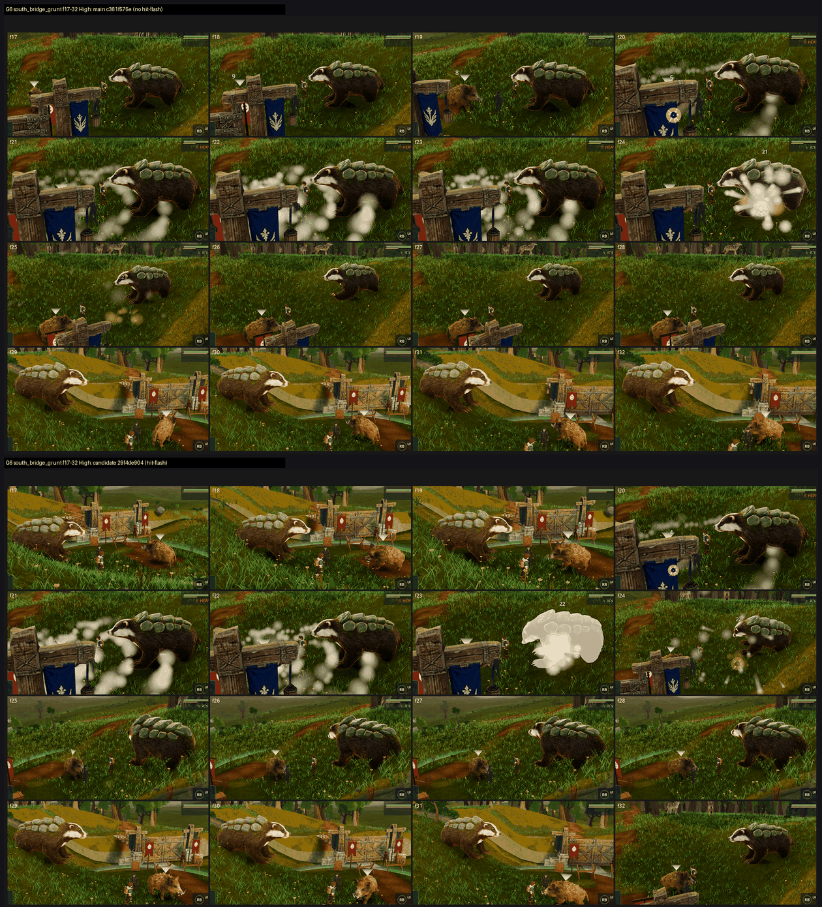

# G6: P2-016 body hit-flash on GPU, tb/creatures-land 29f4de904 (wince off, hit-flash on) vs main c361f575e (26 Oct 2026)

**Verdict: the flash works, but only partly. The score gain is too small to count (+0.10 Medium, +0.15 High), and P2-016 is only half closed.**
- When the flash is caught, it reads. Every judge sees **a full-body white flash on the boar at impact** in a few frames. The defect "a struck creature shows no visible hit on its body" goes from PRESENT/PARTIAL on main to **FIXED 2/3** on the candidate in the second half of the grunt fight, at both presets.
- Two problems remain:
  1. **Most hits still show nothing on the body.** The flash is caught on only one or two hits per half-fight. Most strikes, the badger's in particular, carry only a burst, a ring or a damage number on top. Two judges do see one full-body flash on the badger (a solid white silhouette at f23 in one set), so the flash is not missing from the badger entirely; it just rarely lands in a captured frame.
  2. **The flash is an opaque white silhouette** that "wipes out the creature's features and nearly reads as a glitch" (2 judges). The judges ask for a short partial tint or rim pulse plus a recoil that keeps the fur detail.

| Set | Medium main → cand | High main → cand | P2-016 main → cand (3 judges) |
|---|---|---|---|
| south_bridge_grunt f1–16 | 6.49 → 6.34 (−0.15) | 6.29 → 6.40 (+0.11) | PRESENT/PARTIAL → PRESENT 2 |
| south_bridge_grunt f17–32 | 6.30 → **6.79 (+0.49)** | 6.40 → **6.66 (+0.26)** | PRESENT 1 / PARTIAL 1 → **FIXED 2** |
| warden_aldis f1–16 | 6.49 → 6.85 (+0.36) | 6.37 → 6.43 (+0.06) | PRESENT 1 / PARTIAL 1 → PARTIAL/FIXED |
| warden_aldis f17–32 | 6.51 → 6.24 (−0.27) | 6.46 → 6.63 (+0.17) | PARTIAL 2 → PRESENT 2 (Medium); PRESENT 2 → PARTIAL 2 (High) |
| **Mean** | **6.45 → 6.55 (+0.10)** | **6.38 → 6.53 (+0.15)** | |

In each set, one of the three judges left P2-016 blank; the counts above cover the other two.

**Method and limits:**
- **Capture:** `capture_f38_fight.gd`, G5 shape: two trainer fights (south_bridge_grunt, warden_aldis), 32 frames at 0.15 s, Medium and High, at each arm's SHA. Sets are 4x4 grids of 16 consecutive frames per trainer-half, cropped to the field. 8 sets in 2 batches, three code-blind judges each, high anchors. Fits r 0.79 / 0.85, RMSE 0.66 / 0.46, both confirming.
- **Sampling:** the flash lasts **0.12 s** and frames are **0.15 s** apart, so any given hit has roughly a 0.8 chance of being caught in a frame. Some "no flash" calls may be missed hits rather than missing flashes. That most hits show no flash at all, across both trainers and presets, suggests either a shorter visible flash than 0.12 s or flashes being hidden by the opaque smoke at impact.
- **The two fights aren't frame-locked.** The arms play out differently (different hits at different frames), so per-set deltas mix the flash with fight variance. Read the mean and the defect calls rather than any single set.
- **Short capture:** the candidate's Medium warden_aldis run has **27 of 32 frames** (one judge sees 11 of 16 in a set). The other three runs have 32/32.

`_sheet_g6.png`: south_bridge_grunt, frames 17–32, High. Top: main. Bottom: the candidate, where the boar's full-body white flash shows.

## What else the judges saw (both arms; not part of this candidate)

- **White puff smoke:** opaque cotton-ball smoke buries the fighters in many frames, often right at impact.
- **Camera:** close and low, with a uniform grass carpet in the foreground and no sky or depth. In one fight it cuts hard to a fence or gate post that fills the frame (around f20–f29).
- **Trainers:** tiny in frame.

## Path to close P2-016 and lift the fight

1. **Make the flash land on every hit** (*scene*). Check why most strikes show no body change: whether the flash is shorter than the frame interval, whether the smoke covers it, or whether it fires for only some hit types or creatures.
2. **Swap the opaque white silhouette** for a short partial tint or rim pulse plus a small recoil that keeps the fur readable.
3. **Fight VFX and camera** (*scene*): replace the opaque smoke with small grounded dust or impact bursts, and keep the camera out of gates and fences with some horizon in view.
4. **Re-capture tip:** to confirm the flash without the sampling gap, run one capture at a 0.05 s frame interval around a known hit.

## Files

- `_sheet_g6.png`, `build_yard_G6.ps1.txt`.
- `yardstick/G6_rows.json`.
- `yardstick/G6b1/`, `G6b2/`: `key`, `sets.md`, `candidates`, `j1`–`j3`, `batch`, `mapped`.
