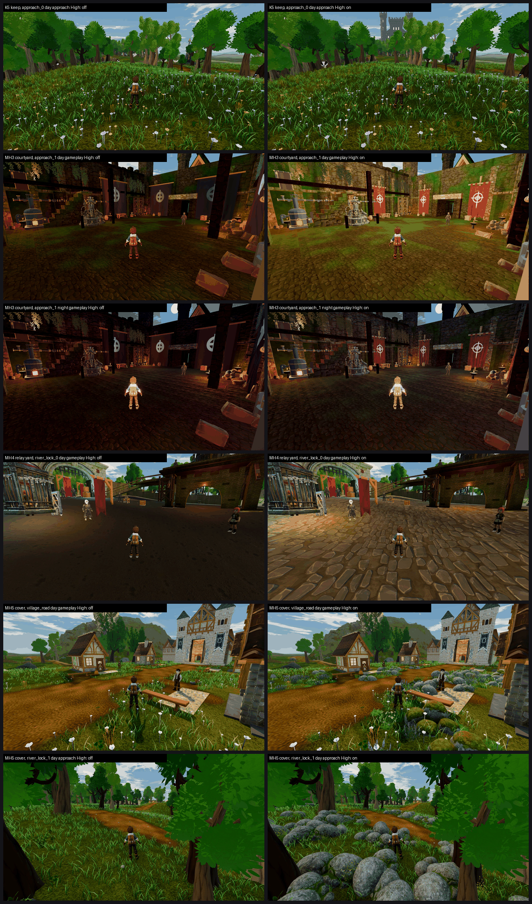

# Meadows block: K5, MH3, MH4 (tb/meadows d35483f3c) and MH5 (tb/meadows-land16 cd6927c91) on GPU (26 Oct 2026)

**Summary:**

| Item | Medium off → on | High off → on | Mean gain | Call | Tier (on, lower preset) | MET |
|---|---|---|---|---|---|---|
| **MH4** relay yard stone flags | 4.50 → **5.93 (+1.43)** | 4.50 → **5.93 (+1.43)** | **+1.43** | **ON** | below 6 | not met |
| MH3 courtyard daylight + banner (day and night mean) | 4.69 → 5.09 (+0.40) | 4.79 → 5.35 (+0.56) | +0.48 | **borderline**: clears +0.5 on High only | below 6 | not met |
| MH5 ground cover (village_road + river_lock_1 mean) | 5.95 → 6.10 (+0.15) | 5.95 → 6.49 (+0.54) | +0.35 | **borderline**: High only, at a frame-time cost on High | 6–7 | not met |
| K5 keep r5 (hero gatehouse) | 5.33 → 5.63 (+0.30) | 5.43 → 5.56 (+0.13) | +0.22 | **no qualifying gain**; P2-003 still PRESENT 6/6 | below 6 | not met |

**Method:**
- **Capture:** `capture_f38_matrix.gd --seed=2042`, day + night, Medium and High.
- **K5 / MH3 / MH4:** the flags were flipped locally on d35483f3c with `meadows_flags4.py` (byte-identical restore). The flag-on arms ran with `--f38-candidate` and the off arm with `--f38-baseline`.
  - I checked that this is not a confound: in this commit, `--f38-candidate` only affects `meadows_catalog_presentation.gd`, and that layer is already `enabled: true` in config, so it is on in both arms.
  - The off-vs-off pixel difference is 0.00%, so the capture is deterministic.
- **MH5:** `grass_field cover_candidate` on vs off with `meadows_flags5.py`, `--f38-baseline` on both arms.
- **Two Medium runs crashed** (K5-off and K5-mh3, 0xC0000094 in the NVIDIA Vulkan driver; see `../CRASH-0xC0000094/`). Both were re-run cleanly (48/48) and those re-runs are used here.
- **Judging:** 12 sets in 2 batches, three code-blind judges each, high-anchor set. Fits r 0.94 / 0.90, RMSE 0.45 / 0.52, both confirming.
- **Caveat:** several sets got identical Medium and High scores (MH4, MH3 day, MH5 village). The two presets differ by 5–15% of pixels but look alike at thumbnail size.

`_sheet_mb.png`, High: off on the left, on on the right.
1. K5: approach_0, day approach.
2. MH3: approach_1, day gameplay.
3. MH3: approach_1, night gameplay.
4. MH4: river_lock_0, day gameplay.
5. MH5: village_road, day gameplay.
6. MH5: river_lock_1, day approach.

## MH4: relay yard stone flags. ON.

| Preset | off → on | Ground-pad defect | Placeholder |
|---|---|---|---|
| Medium | 4.50 → 5.93 (+1.43) | PRESENT 3/3 → FIXED 2 / PARTIAL 1 | PRESENT 3/3 → PARTIAL 3/3 |
| High | 4.50 → 5.93 (+1.43) | PRESENT 3/3 → FIXED 2 / PARTIAL 1 | PRESENT 3/3 → PARTIAL 3/3 |

- **On:** "laid cobbles" in the day and night gameplay and detail views; one judge calls them "an oversized stamped texture".
- **Off:** "a flat untextured dark or black slab", worst at night, where figures lose ground contact.
- **Path to 7.5** (on 5.93, about 1.6 short):
  - The approach meadow is "washed-out and flat".
  - In the detail frame a dark-clad NPC overlaps a crate (clipping PARTIAL).
  - Two judges flag **a red banner on a gibbet-like post in a friendly yard**. This is a possible oxblood leak; check that it isn't Team Tether red in a non-Tether space.
  - Scale the cobble texture down.

## MH3: courtyard daylight + banner models. Borderline.

| Set | Medium off → on | High off → on | Flat-banner defect |
|---|---|---|---|
| approach_1 by day | 4.71 → 5.13 (+0.42) | 4.71 → 5.13 (+0.42) | PRESENT 3/3 → PRESENT 1 / PARTIAL 2 |
| approach_1 at night | 4.67 → 5.05 (+0.38) | 4.86 → 5.56 (+0.70) | PRESENT 3/3 → PRESENT 1 / PARTIAL 2 |

- The banners on the on arm "show some draping, hung from crossbeams" and are smaller. On the off arm they are "giant flat oxblood or dark panels with huge emblems". Oxblood here is on the enemy stronghold, which is allowed.
- The off arm's day grade "looks like dusk". The courtyard-daylight change lifts it, though judges still call the day "murky" on both.
- **P2-003 (no tall lit landmark) is PRESENT 12/12 on both arms.**
- **Path to 7.5** (on 5.1–5.6, about 2 short):
  - A tall lit keep that is visible from both approach stands.
  - In the gameplay and reverse frames, orange planks and beams cut into the right edge of the frame (clipping PRESENT on several calls). Pull the cameras off them.
  - Textured courtyard ground.

## MH5: Meadows ground cover. Borderline.

| Stand | Medium off → on | High off → on | P2-005 ground cover |
|---|---|---|---|
| village_road | 6.47 → **6.84 (+0.37)** | 6.47 → **6.84 (+0.37)** | PRESENT 3/3 → PARTIAL 3/3 |
| band3_the_river_lock_1 | 5.43 → 5.36 (−0.07) | 5.43 → **6.14 (+0.71)** | PRESENT 3 (Medium) / PRESENT 2, PARTIAL 1 (High) → PARTIAL 3/3 |

- Every judge credits the mossy rock clusters and flower drifts as breaking up the carpet (PRESENT → PARTIAL 12/12).
- On river_lock_1, though, the boulders read as "identical round grey domes, evenly scattered, like a generator", and they "turn saturated blue at night". That costs the Medium set its gain.
- **village_road is NOT met** (6.84 / 6.84). The judges still flag the flat pale slab and tilted plank by the bench, and the pillars and well cutting the frame edge.

**Frame time** (`tools/_owner_fps_probe.gd`, 20 s per site, 1920x1200, because the probe sizes its own window; GTX 1060 3GB, Forward+). One sample per site and arm, so read the differences as indicative:

| Site | Medium off → on (fps avg) | High off → on (fps avg) |
|---|---|---|
| band1_open_eye | 23.8 → 23.7 | 24.2 → **18.7** (+12.1 ms) |
| village_high | 22.6 → 23.0 | 25.0 → 22.4 (+4.6 ms) |
| village_square_eye | 27.9 → 27.1 | 22.2 → 20.0 (+4.9 ms) |

- No measurable cost on Medium. On High, the cover costs 2–5.5 fps (+4.6 to +12 ms per frame).
- Draw calls and primitives barely change (cover on, High: 524 vs 554 draw calls at band1). The cost is likely shading or overdraw from the Meshy cover meshes rather than the draw count.
- Raw `fps.json` files are in `mh5_fps/`. This is not an Ally measurement.

**Path to 7.5** (village_road 6.84, about 0.7 short):
1. Vary the boulder sizes and bed them in, and fix the blue night tint.
2. Replace the pale slab and plank at the bench, and clear the camera-edge pillar and well.
3. Add worn earth along paths (MH6's path texture pairs with this).

## K5: keep r5 hero gatehouse. No qualifying gain.

| Preset | off → on | P2-003 |
|---|---|---|
| Medium | 5.33 → 5.63 (+0.30) | PRESENT 3/3 on both |
| High | 5.43 → 5.56 (+0.13) | PRESENT 3/3 on both |

**Does the keep dominate the skyline?** No. On both arms, judges say the stronghold "does not appear at all" in some approach views, or is "only a small grey castle seen through the trees". The gatehouse barely registers from approach_0. The on arm adds a placeholder call (flat grey castle shape, PARTIAL 2/3).

**Path to 7.5:** a much taller lit keep or gate tower, framed through a gap in the trees on the approach cameras. Today a wall of blob-canopy trunks blocks the view.

## Files

- `_sheet_mb.png`, `build_yard_MB.ps1.txt`, `meadows_flags4.py.txt`, `meadows_flags5.py.txt`.
- `mh5_fps/fps-{off,on}-{Medium,High}.json`.
- `yardstick/MB_rows.json`, `yardstick/coverage.json`.
- `yardstick/MBb1/`, `MBb2/`: `key`, `sets.md`, `candidates`, `j1`–`j3`, `batch`, `mapped`.
