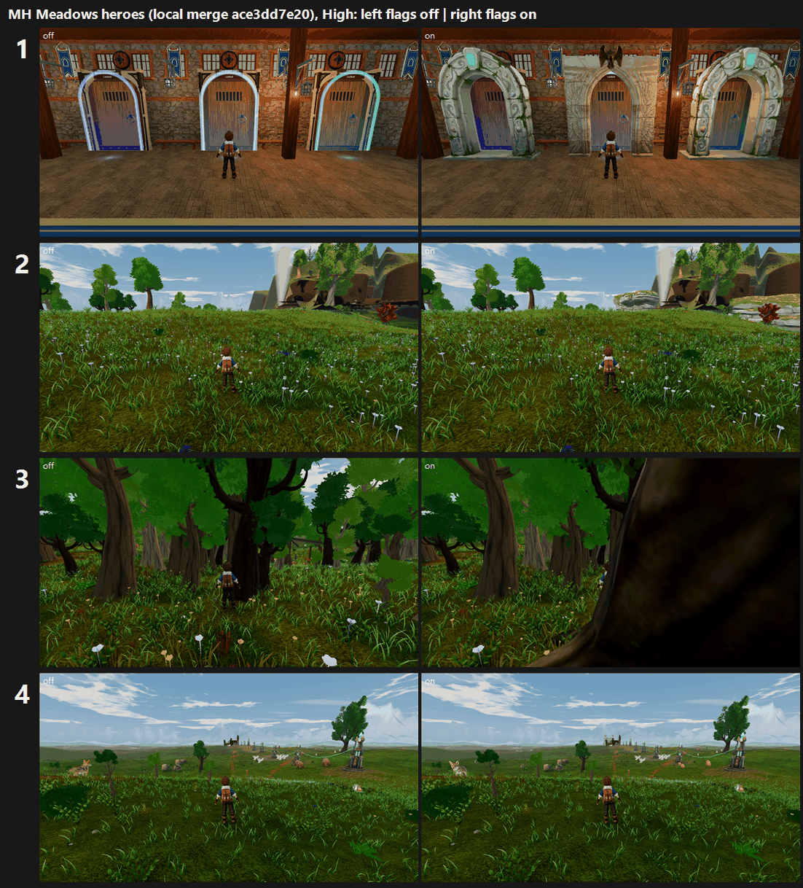

# MH: Meadows heroes on GPU, four flags on vs off on the same build (25 Oct 2026)

**Build:** local merge `ace3dd7e20` = tb/meadows-land11 89c5b91f64 + land12 a634da3791 + land3 4d204e402. This lane made the merge commit; it is not pushed.

**Verdict: turn the arch facades ON (+0.79 / +1.11). Cliffs gain +0.40, under the 0.5 rule. Ironwood scores worse (−0.30 to −0.61). The gatehouse gives no visible change (0.00 to +0.08). Keep those three OFF.**

The control has all four flags off (`--f38-baseline`). The candidate has `crossing_hall.arch_facades`, `meadows_hero_pieces.cliffs`, `meadows_hero_pieces.ironwood` and `stronghold.hero_gatehouse` on (`--f38-candidate`). Each flag was judged only on its own stands: 12 sets in 3 batches, three code-blind judges each. Every batch fit confirms: r 0.84–0.93, RMSE 0.35–0.59.

| Flag (stands) | Medium off → on | High off → on | Recorded defect (3 judges) | Call | Tier (on, lower preset) |
|---|---|---|---|---|---|
| **arch_facades** (7 realm arch details + 1 night) | 5.55 → **6.34 (+0.79)** | 4.71 → **5.82 (+1.11)** | F38 L6 PRESENT 6/6 → **PARTIAL 6/6** | **ON** | below 6 (5.82) |
| cliffs (Stone and Root bank face) | 5.75 → 6.15 (+0.40) | 5.75 → 6.15 (+0.40) | P2-014 PRESENT 6/6 → PARTIAL 6/6 | OFF (<0.5) | 6–7 if on |
| ironwood, Ironwood Grove | 6.42 → 6.12 (−0.30) | 5.75 → 5.59 (−0.16) | canopy PARTIAL → **PRESENT** (5 of 6 calls) | OFF | — |
| ironwood, Ridgeline Watch | 5.21 → 4.60 (−0.61) | 5.67 → 5.06 (−0.61) | canopy unchanged; **reverse camera inside the new trunk** | OFF | — |
| hero_gatehouse, approach 0 (open field) | 5.13 → 5.21 (+0.08) | 5.92 → 5.86 (−0.06) | P2-003 PRESENT 12/12 on both arms | OFF | — |
| hero_gatehouse, approach 1 (courtyard) | 4.45 → 4.45 | 4.45 → 4.45 | P2-003 PRESENT on both arms | OFF | — |

`_sheet_mh.png`, at High, with the flags off on the left and on on the right:
1. Cloudreach arch: carved surrounds replace the neon rims.
2. Stone and Root approach: a stratified outcrop is added at the right edge, small and distant.
3. Ridgeline Watch reverse: the new hero trunk fills the camera.
4. Stronghold approach: no visible gatehouse at this distance.

## Why each flag landed where it did

- **Arches (ON):** all 9 judges read the candidate as carved stone portal surrounds with keystones, and the control as blank doors with neon rims. What is left to fix:
  - the plaster window-strip wall above the arches;
  - the dark mossy surrounds, which read blocky and under-lit;
  - wall slabs at the frame edges in the 1st, 4th and 5th detail views;
  - flat, even light in the Hall.
- **Cliffs (+0.40):** every judge saw the outcrop as real stratified, mossy rock, which moves P2-014 to PARTIAL. But it is small and far away. About 70% of each frame is empty grass foreground, and the faceted tan/grey planes and the smooth white cone stay visible behind it.
  - The CPU gain (+1.04) was measured with a closer read. Extending the rock across the whole bank face, or seating the camera closer, is the likely route past +0.5.
- **Ironwood (worse):** the new hero trees read as puffy lime "broccoli" blobs to most judges, worse than the control's spikier canopies. At Ridgeline Watch the day-clear reverse camera sits inside a new trunk (sheet row 3), so clipping is PRESENT on the candidate only.
  - Fix the placement before re-judging: move the right/left-behind tree out of the reverse camera's view cone.
  - The canopy needs layered, backlit leaf cards, not the current crown mesh.
- **Gatehouse (no change):** the frames differ by only 4–9% of pixels and no judge saw a landmark.
  - **Approach 0:** the stronghold is still a speck behind the pylons.
  - **Approach 1:** the courtyard camera faces dark walls, banners and orange crates, and the gatehouse is not in frame.
  - The CPU result (parked at +0.39) and this GPU result agree. The judges ask for a tall, lit keep that dominates the pylons from the meadow path.

## Path to 7.5 (Meadows)

1. **Turn the arches ON.** The next arch step is the Hall itself (*scene*): replace the window-strip wall, add warm firelight pools, lift the dark surrounds, and clear the frame-edge wall slabs.
2. **Land a stronghold keep that reads from the approach** (*new_art*): tall, with lit windows and braziers. Re-stage the courtyard cameras so they look out at the sky and the keep. Remove the flat orange foreground crates, which read as placeholders and are clipped by the camera.
3. **Compose the open Meadows** (*scene*): break the grass carpet into groves, edges and clearings, add a warm low sun with blue aerial distance, and bring landmarks such as the bank face and the ironwood into the midground.
   - Several judges also flagged red/oxblood grass tufts in the meadow foreground (stronghold approach and Ironwood). Red is reserved for Team Tether.
4. **Ironwood rework** (*new_art* + placement): leaf-card canopies, and keep the trunk out of every fixed camera before the next round.

## Files

- `_sheet_mh.png`, `build_yard_MH.ps1.txt`, `sheet_MH.ps1.txt`, `meadows_flags.py.txt` (the flag toggle the queue used).
- `yardstick/`: `coverage.json`, `MH_rows.json`, and `MHb1`–`MHb3`, each with `key`, `sets.md`, `candidates`, `j1`–`j3`, `batch` and `mapped`.

Capture: `capture_f38_matrix.gd --seed=2042 --f38-preset=<Medium|High> --f38-baseline|--f38-candidate --times=day,night --subset=arch_ --subset=band2_stone_and_root_1 --subset=band4_upper_meadows_ironwood --subset=band5_stronghold_approach`. That is 124 frames per arm per preset, Forward+ on a GTX 1060 at 1920x1080. The flags were set by text edit in the lane worktree and verified by re-parsing; the worktree was reset to off afterwards.
