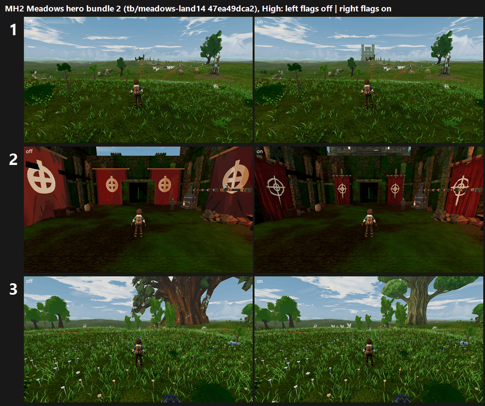

# MH2: Meadows hero bundle 2 on GPU, tb/meadows-land14 47ea49dca2 (from main c361f575e), flags on vs off (25 Oct 2026)

**Verdict: turn the giant ironwood ON (+0.84 / +0.88, scoring 6.53 at both presets). The lit keep and war banners gain +0.09 to +0.32 and stay OFF.**

- **Control:** the three flags off (`--f38-baseline`).
- **Candidate:** `stronghold.hero_gatehouse` (now the lit keep), `stronghold.banner_model_candidate` and `ironwood_grove_presentation.hero_tree.model_candidate` on (`--f38-candidate`).
- **Capture:** the same SHA for both, 48 frames per arm per preset. The control's High run lost one rain reverse frame at ironwood_0 ("no supported production-camera stand"); that frame is not among the judged views.
- **Judging:** the keep and banners were judged on band5_stronghold_approach_0/1 and the tree on ironwood_0. That was 6 sets in 2 batches, three code-blind judges each. Both fits confirm: r 0.88 / 0.96, RMSE 0.52 / 0.37.

| Flag (stand) | Medium off → on | High off → on | Recorded defect (3 judges) | Call | Tier (on, lower preset) |
|---|---|---|---|---|---|
| **giant ironwood** `hero_tree.model_candidate` (ironwood_0) | 5.69 → **6.53 (+0.84)** | 5.65 → **6.53 (+0.88)** | faceted canopy shards PRESENT 6/6 → PARTIAL 4 / FIXED 2 | **ON** | 6–7 (6.53) |
| lit keep + war banners, open approach (approach_0) | 5.87 → 6.09 (+0.22) | 5.75 → 6.05 (+0.30) | P2-003 PRESENT 6/6 on both arms; banners not visible at this distance | OFF | — |
| lit keep + war banners, courtyard (approach_1) | 4.98 → 5.07 (+0.09) | 3.73 → 4.05 (+0.32) | P2-003 PRESENT 6/6 both; flat banners PRESENT 6/6 → PARTIAL 4 / PRESENT 2 | OFF | — |

`_sheet_mh2.png`, at High, flags off on the left and on on the right:
1. Approach 0: the keep appears on the horizon.
2. Courtyard: crimson war banners on poles.
3. Ironwood Grove: a broad leafy crown replaces the faceted canopy.

## Why each flag landed where it did

- **Giant ironwood (ON):** all six judges read the candidate's crown as broad, rounded and leafy. Two called it "a real landmark" (FIXED); four said it was still slightly lumpy (PARTIAL). The control's canopy reads as "dark faceted shards", and two judges saw some of them floating. The gain is driven by the tree alone, so it matches the CPU +0.90 mapped.
- **Keep (no gain):** from the open approach the keep is now visible. Judges described it as "a small pale-grey block castle behind the pylons", and most marked it as placeholder material. P2-003 stays PRESENT 12 of 12, because it is not tall, not lit and does not dominate the pylons from this stand. In the courtyard it is not in frame at all.
- **War banners (small gain):** at High the courtyard banners read as cloth on poles (PARTIAL in 3 of 3), but the near-black courtyard sinks the whole stand at about 3.6–4.0. The grade and the clipped foreground plank and beam props dominate the judges' notes on both arms.

## Path to 7.5 (Meadows)

1. **Turn the giant ironwood ON.** Next comes the grove around it (*scene*): cluster the evenly spaced, same-size saplings into groves and edges, break up the grass carpet, add distance haze and a warm sun grade. The judges' note: "B's crown is a real landmark, but … cloned saplings and flat light".
2. **Make the keep read from the approach** (*new_art* / placement). It needs to be several times larger in frame, warm-lit (windows, braziers) and tall enough to dominate the pylons. Bring it closer, scale it up, or push the pylons back and shrink them. On CPU it scored +0.70 raw, but at GPU resolution and with the same framing it is too small to register.
3. **Fix the courtyard grade** (*scene*), which is now the lowest stand at about 3.6:
   - real daylight and sky;
   - remove the foreground plank and beam props that the camera clips;
   - keep the war banners, which the judges did notice.

   Re-judge the banners after the grade, because right now the grade masks them.

## Files

- `_sheet_mh2.png`, `build_yard_MH2.ps1.txt`, `sheet_MH2.ps1.txt`, and `meadows_flags2.py.txt` (the flag toggle, which re-parses to verify).
- `yardstick/`: `coverage.json` and `MH2_rows.json`.
- `MH2b1` and `MH2b2` folders, each with `key`, `sets.md`, `candidates`, `j1`–`j3`, `batch` and `mapped`.

Capture command: `capture_f38_matrix.gd --seed=2042 --f38-preset=<Medium|High> --f38-baseline|--f38-candidate --times=day,night --subset=band5_stronghold_approach --subset=band4_upper_meadows_ironwood_0`, Forward+ on a GTX 1060, 1920x1080.
