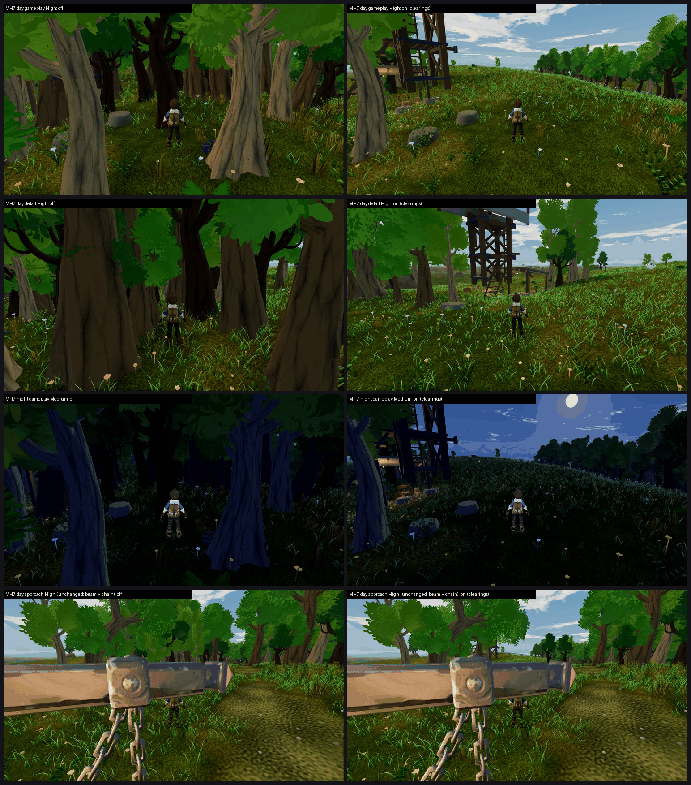

# MH7: Meadows Ridgeline Watch authored clearings on GPU, tb/meadows-land18 bcb954b31, clearings on vs off (26 Oct 2026)

**Verdict: turn it ON.**
- Ridgeline Watch maps **4.76 → 6.40 (+1.64)** at both presets.
- The recorded defect ("the gameplay and detail views stand inside a dark wall of tree trunks, so the watch reads as no place at all") goes **PRESENT 3/3 → FIXED 3/3**.
- **Tier 6–7, not met** (6.40 / 6.40): about 1.1 short.

**Method:**
- **Arms:** one commit (bcb954b31, on main f876b1749). `meadows_hero_pieces.json` `clearings.enabled` was flipped locally with `meadows_flags7.py` (byte-identical restore). Both arms used `--f38-baseline`.
- **Capture:** `capture_f38_matrix.gd --seed=2042 --times=day,night --subset=band4_upper_meadows_ironwood_1`, Medium and High, 16 frames per arm per preset, no crashes.
- **Note:** MH7 was added to queue 31 after that queue had started, so it ran from its own hook (queue 44) after the Meadows block.
- **Sets:** one per preset with six standard views (day clear approach / gameplay / reverse / detail, night clear gameplay, day rain gameplay). Three code-blind judges, high anchors. Fit r 0.89, RMSE 0.48, confirming.
- **Caveat:** the judges scored Medium and High identically. Both were in one batch and look alike at thumbnail size.
- **Scale:** the off arm maps 4.76 here, against the board's 5.97 / 6.12. That's the high-anchor scale; the delta in this batch is what counts.

| Preset | off → on | Dark trunk wall | Clipping (approach camera) | Placeholder | Floating | MET |
|---|---|---|---|---|---|---|
| Medium | 4.76 → **6.40 (+1.64)** | PRESENT 3/3 → **FIXED 3/3** | PRESENT 3/3 on both | PARTIAL 3/3 on both | PARTIAL 1 → PARTIAL 2 | not met |
| High | 4.76 → **6.40 (+1.64)** | PRESENT 3/3 → **FIXED 3/3** | PRESENT 3/3 on both | PARTIAL 3/3 on both | PARTIAL 1 → PARTIAL 2 | not met |

`_sheet_mh7.png`: off on the left, on on the right.
1. Day gameplay, High.
2. Day detail, High.
3. Night gameplay, Medium.
4. Day approach, High (unchanged on both arms).

## What the judges saw

- **On:** "the ridge is open and the watchtower reads in the gameplay, reverse, detail and night views". The tower stands against the sky in a sunlit glade.
- **Off:** "a dark wall of tree trunks"; "the night view becomes a blue-black mass".
- **What remains on the on arm:**
  - **Approach camera** (all 3 judges, both arms): the camera sits "right against a giant beam, chain and padlock prop that fills the frame" (clipping PRESENT 3/3).
  - **Rocks:** the grey boulders are smooth and faceted (placeholder PARTIAL 3/3).
  - **Horizon trees:** "a regular, evenly spaced wall" of cel-shaded cartoon trees next to realistic grass.
  - **Light:** flat, with no depth fog.
  - **Floating:** a pale V-shaped object hangs in the sky in the day detail view (2 judges; possibly a bird).

## Path to 7.5 (on 6.40; about 1.1 short)

1. **Approach camera** (*scene*): move it off the beam and chain so the first view shows the tower and the ridge. This is the one defect every judge calls PRESENT.
2. **Grove edges and depth** (*scene*): break the even horizon tree wall into groves with edges, and add depth fog and blue distance with a warmer sun grade.
3. **Rocks** (*new_art* / *scene*): swap the faceted grey boulders for the textured rock family.
4. **Check** the hovering V-shape in the day detail view.

## Files

- `_sheet_mh7.png`, `meadows_flags7.py.txt`, `cand_queue44.ps1.txt`.
- `yardstick/MH7_rows.json`.
- `yardstick/MH7b1/`: `key`, `sets.md`, `candidates`, `j1`–`j3`, `batch`, `mapped`.
