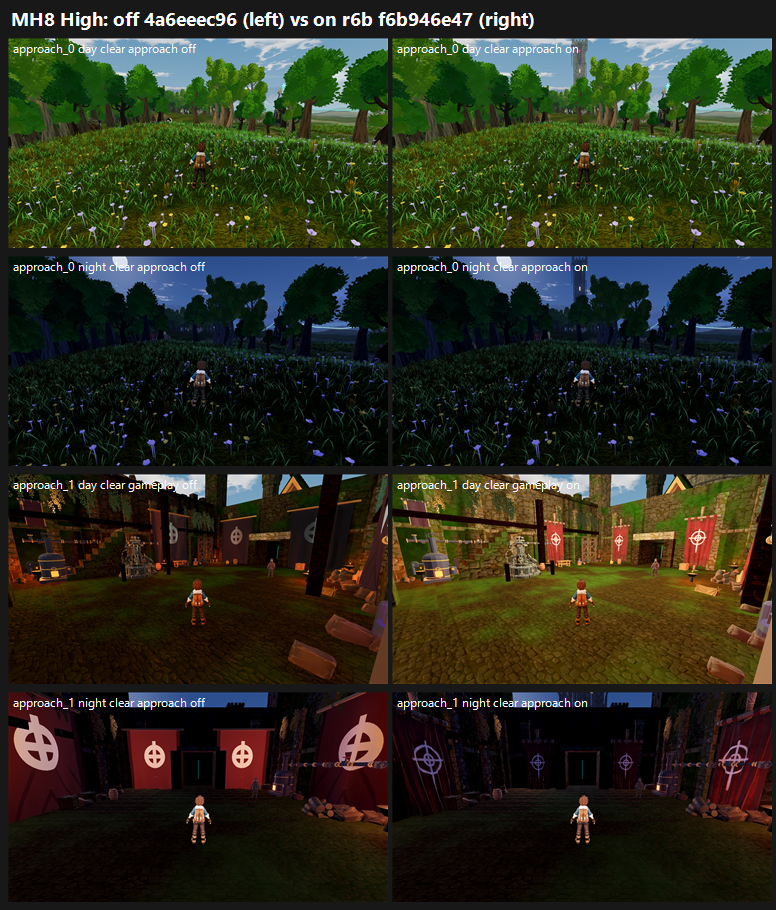

# MH8: Meadows stronghold spire r6b + MH3 on GPU, f6b946e47 vs tb/meadows 4a6eeec96 (27 Oct 2026)

**Verdict: no qualifying gain overall** (mean +0.33 Medium, +0.35 High). The parts behave differently:

- **Courtyard and banners (MH3 part):** a real gain at `approach_1`, the courtyard:
  - Day: +0.69 Medium, +1.16 High.
  - Night: +0.44 Medium, +0.30 High.
  - Flat banners: PRESENT 3/3 → PRESENT 1 / PARTIAL 2 at every courtyard set. Red outside the banners improves at the day courtyard (PRESENT 1 / PARTIAL 2 → PARTIAL 3).
- **Spire (hero_gatehouse):** it does not land. At `approach_0`, the meadow approach, the change is −0.03 / −0.17 by day and +0.22 / +0.11 at night.
  - **P2-003 is still PRESENT 3/3** on both arms at every approach_0 set.
  - The spire shows only as a small pale tower above the treeline in the day approach view, and barely at night.
- **Lit windows at night:** PRESENT on 3 of 3 judges on both arms at approach_0, and 2–3 of 3 at the courtyard. The windows don't read as lit from these cameras.
- **Tier:** below 6. The on arm's means are 5.58 / 5.52, and its best set is the day courtyard at Medium, 6.03.
- **MET:** not met at any set.
- **CPU vs GPU:** CPU was 4.93 → 5.72 with P2-003 PARTIAL 3/3. On GPU the courtyard gain holds, but P2-003 does not move at the approach.

| Set | Medium off → on | High off → on | P2-003 | Flat banners | Lit windows (night) |
|---|---|---|---|---|---|
| approach_0 day | 5.79 → 5.76 (−0.03) | 5.81 → 5.64 (−0.17) | PRESENT 3 on both arms | — (not in frame) | — |
| approach_0 night | 5.05 → 5.27 (+0.22) | 4.90 → 5.01 (+0.11) | PRESENT 3 on both arms | — | unlit 3/3 on both arms |
| approach_1 (courtyard) day | 5.34 → **6.03 (+0.69)** | 4.60 → **5.76 (+1.16)** | PRESENT 3 → PRESENT 1 / PARTIAL 2 (Medium); PRESENT 2 / PARTIAL 1 on both arms (High) | PRESENT 3 → PRESENT 1 / PARTIAL 2 | — |
| approach_1 (courtyard) night | 4.83 → 5.27 (+0.44) | 5.36 → 5.66 (+0.30) | unchanged (PRESENT 2–3) | PRESENT 3 → PRESENT 1 / PARTIAL 2 | unlit 2–3 of 3 on both arms |
| **Mean** | **5.25 → 5.58 (+0.33)** | **5.17 → 5.52 (+0.35)** | | | |

**Method:**
- **Capture:** `capture_f38_matrix.gd --seed=2042 --f38-baseline --times=day,night --subset=band5_stronghold_approach`, Medium and High, each arm at its own verified SHA on a clean tree. 32 frames per run on all 4 runs.
- **Arms:** the only diff is three `stronghold.json` flags.
- **Sets:** one set per stand per time of day per preset (clear approach, gameplay, reverse and detail, plus rain approach and gameplay). 8 sets in 2 batches, three code-blind judges each, high anchors. Fits r 0.95 / 0.90, RMSE 0.26 / 0.47, both confirming.
- **Defect checks:** red outside the banners, and lit windows at night (night sets), as the coordinator asked.

**Caveat:** at approach_0 the banner, red and clipping calls are FIXED only because the stronghold barely shows in frame (all judges noted this). They are untested there, not fixed.

`_sheet_mh8.png`, High: off on the left, on on the right.
1. approach_0, day clear approach: the spire is the small pale tower at top centre.
2. approach_0, night clear approach.
3. Courtyard, day gameplay: brighter, with draped banners on poles.
4. Courtyard, night approach.

## What the judges saw (paraphrased from their reports)

- **Approach_0:** no stronghold reads in any frame, only "a faint thin tower" or "a pin-thin tower behind the trees". A wall of blob-canopy trees blocks the view.
- **Courtyard, on arm:** narrower banners hung from crossbars with some drape, and a brighter grade.
- **Courtyard, off arm:** "wall-sized flat banners", and the day reads as murky dusk.
- **Both arms, courtyard:**
  - Floating, salmon-pink foreground planks clip the gameplay and reverse cameras (clipping PRESENT 3/3). Several judges also flag them as red outside the banners.
  - The trainer reads as self-lit at night.
- **Night rain frames:** graded as flat grey daylight on both arms.

## Path to 7.5 (on arm 5.0–6.0; about 1.5–2.5 short)

1. **Make the spire read from the approach cameras** (*scene* / *new_art*):
   - Open the tree line on the approach_0 sightline, or move the camera, so the spire stands against the sky.
   - Give it a darker, higher-contrast silhouette, so it doesn't fade into the haze.
   - Make the lit-window emission bright enough to read at night from this distance.
   - All six judges' first change is "a tall keep or spire with warm lit windows, visible from the approach".
2. **Courtyard** (*scene*): keep the banner models and daylight. Remove the floating salmon planks from the camera edge, and seat the trainer's light at night.
3. **Grade** (*scene*): keep night rain dark-blue instead of grey daylight, and add distance fog.

## Files

- `_sheet_mh8.png`, `build_yard_MH8.ps1.txt`, `cand_queue51.ps1.txt`.
- `yardstick/MH8_rows.json`, `yardstick/coverage.json`.
- `yardstick/MH8b1/`, `MH8b2/`: `key`, `sets.md`, `candidates`, `j1`–`j3`, `batch`, `mapped`.
