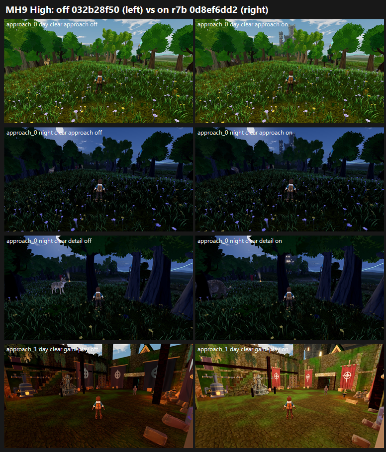

# MH9: Meadows stronghold r7b on GPU, 0d8ef6dd2 vs tb/meadows 032b28f50 (27 Oct 2026)

**Verdict: land it.** Mean **+0.53 Medium, +0.71 High** (about +0.62 overall). For the first time, the lit keep moves P2-003 at the approach.

- **Approach_0, the meadow approach:**
  - **P2-003 ("no tall lit landmark"): PRESENT 3/3 → PARTIAL 3/3** at all four approach_0 sets, day and night.
  - **Night windows unlit: PRESENT 3/3 → PARTIAL 3/3** at both presets.
  - Scores: day +0.48 / +0.41, night +0.61 / +0.43.
- **Approach_1, the courtyard:** day +0.58 / +1.30, night +0.48 / +0.72.
  - Flat banners: PRESENT 3/3 → PARTIAL at every courtyard set (PARTIAL 3 at Medium; PRESENT 1 / PARTIAL 2 at High).
  - Red outside the banners improves on every courtyard set.
  - Clipping on the courtyard camera edge stays PRESENT 3/3 at Medium (PARTIAL 3 at High).
  - P2-003 is still PRESENT 2–3/3 inside the courtyard: the keep isn't visible from there.
- **Tier:** below 6 on the lower preset (on-arm mean 5.33 Medium / 5.96 High). The best set is the High day courtyard, 6.33.
- **MET:** not met at any set.

| Set | Medium off → on | High off → on | P2-003 | Lit windows (night) | Flat banners |
|---|---|---|---|---|---|
| approach_0 day | 5.45 → 5.93 (+0.48) | 5.62 → 6.03 (+0.41) | PRESENT 3 → **PARTIAL 3** | — | — (not in frame) |
| approach_0 night | 4.82 → 5.43 (+0.61) | 5.00 → 5.43 (+0.43) | PRESENT 3 → **PARTIAL 3** | unlit PRESENT 3 → **PARTIAL 3** | — |
| approach_1 (courtyard) day | 4.54 → 5.12 (+0.58) | 5.03 → **6.33 (+1.30)** | PRESENT 3 on both arms (Medium); PRESENT 2 / PARTIAL 1 on both arms (High) | — | PRESENT 3 → PARTIAL 3 (Medium); PRESENT 1 / PARTIAL 2 (High) |
| approach_1 (courtyard) night | 4.37 → 4.85 (+0.48) | 5.32 → 6.04 (+0.72) | unchanged (PRESENT 2–3) | unlit PRESENT 3 → PARTIAL 3 (Medium); PARTIAL 3 on both arms (High) | PRESENT 3 → PARTIAL 3 (Medium); PRESENT 1 / PARTIAL 2 (High) |
| **Mean** | **4.80 → 5.33 (+0.53)** | **5.24 → 5.96 (+0.71)** | | | |

**Compared with MH8 (r6b, same stands, different batch):** r6b moved only the courtyard and left P2-003 at PRESENT 3/3 at the approach. r7b's lit keep in front of the spire is what turns the approach to PARTIAL. This matches the lane's CPU ranking (r7b +0.69 vs r6b +0.27).

**Capture integrity:**
- **Crash:** the first on-arm Medium run crashed after 11 of 32 frames, right after `approach_0 night clear reverse`. Exit 0xC0000094 in `nvoglv64.dll` at offset 0xe93647 (driver 32.0.15.6094), with no TDR in the System log. This is the same signature as K5's two Medium crashes at the stronghold on 26 Oct.
- **Re-run:** the re-run (queue 54) was clean, 32 of 32 frames, and is used here. The crashed run is kept on the GPU machine as `out\MH9-cand-Medium-crash1`.
- **Pattern:** three of these crashes, all at the Meadows stronghold on Medium, all clean on re-run. Updating the NVIDIA driver is the owner's call.

**Method:**
- **Capture:** `capture_f38_matrix.gd --seed=2042 --f38-baseline --times=day,night --subset=band5_stronghold_approach`, Medium and High, each arm at its own verified SHA on a clean tree.
- **Arms:** the only diff is three `stronghold.json` flags.
- **Sets:** layout as MH8: 8 sets in 2 batches, three code-blind judges each, high anchors. Fits r 0.91 / 0.93, RMSE 0.49 / 0.45, both confirming.

**Caveat:** at approach_0 the banner, red and clipping calls are FIXED only because none of those things are in frame. They are untested there.

`_sheet_mh9.png`, High: off on the left, on on the right.
1. approach_0, day clear approach: the keep stands above the treeline.
2. approach_0, night clear approach.
3. approach_0, night clear detail: the keep's lit windows.
4. Courtyard, day gameplay: draped banners on poles, brighter grade.

## What the judges saw (paraphrased from their reports)

- **Approach_0, on arm:** "a small castle with warm windows" in the night approach and detail views, or a "small dim tower behind the trees". It reads, but still small, which is why the calls are PARTIAL and not FIXED.
- **Courtyard, on arm:** smaller banners, some draped. The off arm's courtyard reads as "dusk" with "giant flat banner slabs".
- **Both arms:** a uniform grass carpet with evenly spaced blob-canopy trees on the approach. In the courtyard, salmon slabs and a beam clip the camera edge in the gameplay and reverse frames. The night rain frames go grey.

## Path to 7.5 (on arm 4.85–6.33; about 1.2–2.6 short)

1. **Make the keep dominate** (*scene* / *new_art*):
   - Scale it up, or open a sightline through the trees on the approach_0 cameras, so it reads as the landmark rather than "small".
   - Make it visible from inside the courtyard too; P2-003 is still PRESENT there.
   - All six judges' first change is this.
2. **Courtyard cleanup** (*scene*):
   - Remove the salmon slabs and the beam at the camera edge (clipping still PRESENT 3/3 at Medium).
   - Break up the uniform green moss ground.
3. **Approach composition** (*scene*): break the meadow carpet into groves and clearings, add a worn path toward the keep and blue distance haze. Keep the night rain dark-blue.

## Files

- `_sheet_mh9.png`, `build_yard_MH9.ps1.txt`, `cand_queue53.ps1.txt`, `cand_queue54.ps1.txt` (the Medium re-run).
- `yardstick/MH9_rows.json`, `yardstick/coverage.json`.
- `yardstick/MH9b1/`, `MH9b2/`: `key`, `sets.md`, `candidates`, `j1`–`j3`, `batch`, `mapped`.
