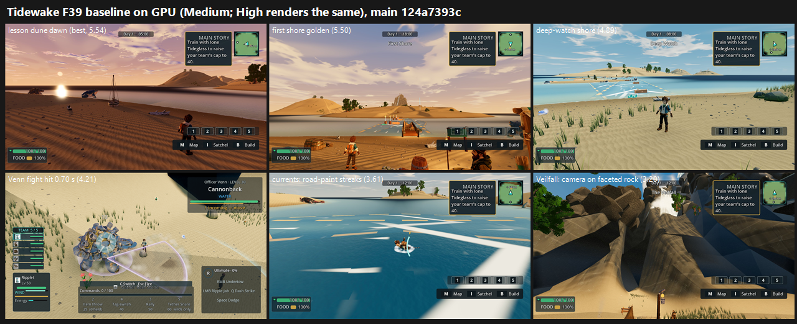

# Tidewake F39 baseline on GPU: High and Medium, main 124a7393c (24 Oct 2026)

**Verdict: every Tidewake destination and the Venn fight FAIL. All six are in the below-6 tier.**

- **Best:** lesson dune 5.54 and the first shore 5.50.
- **Worst:** **Veilfall 3.20** and **the currents and docks 3.61**.
- **High vs Medium:** identical on every location set. Only the fight differs: 4.86 at High, 4.21 at Medium.

## Tier

Tiers follow the owner's direction of 24 Oct, using the lower preset.

| Tier | Items |
|---|---|
| **below 6** (6) | lesson-dune 5.46, first shore 5.50, deep-watch shore landforms 4.89, Venn fight 4.21, currents and docks 3.61, Veilfall 3.20 |
| 6–7 / 7–7.5 / 7.5 and above | none |

## Run

- **Source:** main 124a7393c, in the lane checkout (HEAD 9c16d6b70c = 124a7393c plus GPU-PASS report files only).
- **Capture:** the lanes' exact commands, Forward+ on a GTX 1060, Medium and High.
  - `tools/capture_tidewake_f13_5.gd --camera-set=…/F39-look.json` (9 views).
  - The same with `T2-current.json` (4 views) and `P2-008-shore.json` (2 views).
  - Each with `--capture-size=1920x1080 --preset=
 --source-sha=124a7393c…`.
  - `tools/phase2_capture_tidewake_fights.gd --trainer=water_trainer_venn --seed=2042 --expected-resolution=1920x1080`, written to a fresh Phase 2 directory and moved out afterwards.
- **Coverage:** F39-look 9/9, T2-current **3/4**, P2-008 shore 2/2 at each preset (`coverage.json`).
  - `swim-brine-day` failed closed: "Fixed swim view missed the authored current".
  - The Venn fight has 40 frames at each preset.
- **Venn timing:** judged on the matched states the lane asked for. The tell starts at 0.65 s at Medium and 0.63 s at High; the hits at 0.70 and 1.08 s; the tell ends at 1.32 s at Medium and 1.30 s at High. Three live beats were added (6, 12 and 20 s).
  - The second tell differs between runs (3.73 s at Medium, 4.12 s at High), so it is left out.

`_sheet_tidewake_base.png` (1.27 MB): Medium, from best to worst:
- lesson dune at dawn;
- the first shore at golden hour;
- the deep-watch shore;
- the Venn hit;
- the currents;
- Veilfall.

## Yardstick (one batch, twb1)

- **Sets:** 6, High vs Medium per destination (`build_yard_tw.ps1.txt`), with 4 anchor pairs.
- **Judges:** three fresh code-blind judges, each given `JUDGE_PROMPT.md` verbatim.
- **Recorded defects:**
  - the four generic defects;
  - catalog items per destination: P2-008/009/011 for the shore and dunes, P2-010/009 for Veilfall, P2-066/071/072/009 for the currents, P2-008/009 for the landforms;
  - for the fight: magenta, P2-062/063/016/101/090.
- **Fit:** slope 1.133, intercept 0.212, **r 0.96**, RMSE 0.40, confirming.
  - One warning: Veilfall and the currents are extrapolated below the lowest anchor. That cannot change a FAIL.

| Destination | High | Medium | j1 / j2 / j3 (Medium) | Defect states (majority) |
|---|---|---|---|---|
| lesson dune | 5.46 | 5.54 | 6.10 / 5.31 / 5.20 | placeholder FIXED, **P2-008 PARTIAL**, **P2-011 PRESENT** |
| first shore | 5.50 | 5.50 | 6.22 / 5.31 / 4.97 | P2-008 PARTIAL, **P2-009 PRESENT**, **P2-011 PRESENT** |
| deep-watch shore landforms | 4.89 | 4.89 | 5.65 / 4.74 / 4.29 | placeholder PARTIAL, **P2-008 PRESENT**, **P2-009 PRESENT** |
| Venn fight | 4.86 | 4.21 | 4.97 / 3.61 / 4.06 | magenta PARTIAL, **P2-062 PRESENT** (2/2/2 tie), **P2-063 PRESENT**, **P2-016 PRESENT**, P2-101 FIXED, P2-090 FIXED |
| currents and docks | 3.61 | 3.61 | 4.18 / 3.04 / 3.61 | **P2-066 PRESENT**, **P2-071 PRESENT**, P2-072 PARTIAL, P2-009 PARTIAL |
| Veilfall | 3.20 | 3.20 | 3.61 / 3.04 / 2.93 | **placeholder PRESENT**, clipping PARTIAL, **P2-010 PRESENT**, P2-009 PRESENT |

## F39 defect scan: catalog items on GPU

| Item | State |
|---|---|
| **P2-066** current streaks | PRESENT. All three judges: "giant opaque white bars and yellow dashes… like road markings". The worst single defect in Tidewake. |
| **P2-010** Veilfall silhouette | PRESENT. In both Veilfall views the camera sits on huge faceted low-poly rock, with no falls and no sea. |
| **P2-009** flat cyan water | PRESENT at 3 of 4 destinations, PARTIAL at the currents. |
| **P2-011** generic named destinations | PRESENT at the shore and the lesson dune. |
| **P2-008** shore landforms | PRESENT at the deep-watch shore, PARTIAL at the shore and dune. |
| **P2-071** wading swimmer | PRESENT. |
| **P2-072** wake and splash | PARTIAL. |
| **P2-062 / P2-063 / P2-016** (Venn fight) | PRESENT. The Cannonback ally and the HUD swamp the frame, the hits are thin pale-lilac arcs, and the poses stay idle. |
| **P2-101 / P2-090** | FIXED or not visible at sheet size. Judges said this is low-confidence. |

**New defect, not in the catalog:** in the Venn fight's live frame at **t = 6.02 s at Medium**, the camera drops into a near-black close-up of the seabed. All three judges flagged it.

## Path to 7.5 (judge of record's advice)

These come from the judges' notes and top changes, plus my review of the frames. Every Tidewake item is below 6, so under the owner's direction these lead the queue.

### Shared levers

| # | Fix | Kind | Lifts |
|---|---|---|---|
| T1 | **Replace the current streaks** (P2-066) with subtle flow foam and organic flow cues, so no evenly spaced white bars or yellow dashes remain. | scene (material) | currents 3.61, and every frame with live water |
| T2 | **Depth-graded water** (P2-009): navy offshore through cyan to turquoise shallows, with foam only at shorelines and wakes. | scene (material) | shore, landforms, currents, Veilfall approach |
| T3 | **Re-seat the Veilfall cameras** so they show the mountain, falls and sea instead of pressing against rock. Then replace the faceted cone (P2-010) with a terraced green cliff mountain and broad white falls. | scene, then new_art | Veilfall 3.20 |
| T4 | **Dress the shores** (P2-008 and P2-011): grass-to-sand bands, dune-grass groves, driftwood, rock clusters, nets and huts in authored clumps rather than an even scatter, plus a landmark at each named destination. | scene, then new_art for landmarks | shore, dune, landforms |
| T5 | **Fight camera and HUD:** pull back so both fighters read, cap the ally's framing (P2-062), slim the HUD, and fix the camera drop at t = 6 s. | scene | Venn fight |

### Per destination

| Destination | Gap | Order of work |
|---|---|---|
| Veilfall | 4.30 | T3 cameras first: the frames are camera-on-rock today. Then the mountain (new_art). T2 for the approach water. |
| currents and docks | 3.89 | T1 is the whole first step. Then a swim pose (P2-071, the trainer stays upright) and a wake ring (P2-072). |
| Venn fight | 3.29 | T5. Real-object telegraphs instead of lilac arcs (P2-063). A hit-react layer (P2-016, the same work as G/G2). |
| deep-watch shore landforms | 2.61 | T4 (layered shore ecology at the domes), T2. |
| first shore | 2.00 | T2, then T4 with a landmark (P2-011). The golden and night grades already help. |
| lesson dune | 1.96 | T4: break the bare dune with grass groves and props, plus a destination landmark. The dawn light is already the best in the batch. |

**Suggested order:**
1. T1 and the T3 cameras: both are scene-only, and they lift the two lowest items by the most.
2. T2.
3. T5.
4. The T4 dressing.
5. The new art: the Veilfall mountain and destination landmarks.

## Files

- `_sheet_tidewake_base.png`, `coverage.json`, `defect_states.json`, `venn_frames_Medium.json`, `build_yard_tw.ps1.txt`.
- `yardstick/`:
  - `key.json`, `sets.md`, `candidates.json`, `recorded_defects.txt`, `judge_prompt_filled.txt`;
  - `j1`–`j3` (the judges' own blocks);
  - `batch.json`, `mapped.json`.
- Per-frame captures stay local.
