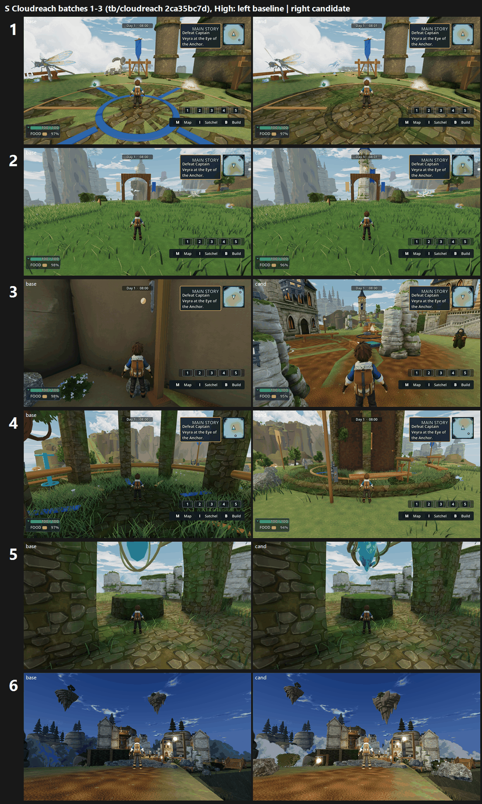

# S: Cloudreach batches 1-3 on GPU, tb/cloudreach 2ca35bc7d (25 Oct 2026)

**Verdict: six items gain more than 0.5 on at least one preset; nothing reaches 7. Whole chapter tier: below 6 to 6–7, depending on the stand.**

The flag items compare candidate (flag on) with control (flag off) from the same build. The camera and stand fixes have no flag, so they compare this build's control with the F40 main baseline (d71bd31). Scores are mapped means of three code-blind judges per set, across 28 sets in 6 batches. Every batch's fit confirms: r 0.85–0.91, RMSE 0.50–0.58.

| Item | Medium base → cand | High base → cand | Recorded defect (3 judges, cand) | Tier (lower preset) |
|---|---|---|---|---|
| High Perches compass + tidy (flag) | 5.41 → **6.21 (+0.80)** | 5.89 → **6.39 (+0.50)** | F40#5 **FIXED 6/6**; P2-025 fixed on both arms | 6–7 |
| Cliffhold approach camera | 5.58 → **6.10 (+0.52)** | 5.62 → **6.62 (+1.00)** | blocked view PRESENT → PARTIAL | 6–7 |
| Settlement nights (flag) | 5.93 → **6.52 (+0.59)** | 5.84 → **6.55 (+0.71)** | F08#3 PRESENT → PARTIAL 6/6 | 6–7 |
| Settlement days (flag) | 6.40 → **6.98 (+0.58)** | 6.21 → 6.65 (+0.44) | F08#3 PRESENT → PARTIAL 6/6 | 6–7 |
| Windscar Beacon spire (flag) | 5.49 → **6.11 (+0.62)** | 5.63 → 6.04 (+0.41) | P2-024 PRESENT → PARTIAL 5/6 | 6–7 |
| Old Wind Observatory stand | 4.34 → **5.51 (+1.17)** | 5.18 → 5.67 (+0.49) | blocked view → PARTIAL; P2-024 still PRESENT | below 6 |
| Windscar Flight Aerie heading | 4.33 → **5.25 (+0.92)** | 5.16 → 4.94 (−0.22) | blocked view → PARTIAL; P2-024 PRESENT | below 6 |
| Sky Shrine heartstone (flag, tool views) | 4.93 → 5.31 (+0.38) | 4.73 → 5.11 (+0.38) | P2-021 **FIXED 3/3 High**, 1 FIXED + 2 PARTIAL Medium | below 6 |
| Realm Gate Crag island shell (flag) | 5.18 → 5.64 (+0.46) | 5.69 → 5.87 (+0.18) | P2-023 mostly still PRESENT | below 6 |
| Windscar Aerie perch platforms (flag) | 5.25 → 5.48 (+0.23) | 5.50 → 5.96 (+0.46) | P2-024 → PARTIAL | below 6 |
| Galefoot Waycamp camera | 6.08 → 6.44 (+0.36) | 6.13 → 6.42 (+0.29) | PARTIAL on both arms | 6–7 |
| Three Bells Bridge camera | 6.07 → 6.18 (+0.11) | 6.13 → 6.17 (+0.04) | no change | 6–7 |
| High Perches island shell (flag) | 6.06 → 5.48 (−0.58) | 5.74 → 5.88 (+0.14) | P2-023 PARTIAL on both arms; no gain | below 6 |
| Sky Shrine heartstone (flag, matrix views) | 5.62 = 5.62 | 5.41 = 5.41 | not measurable: the matrix views don't show the shrine | — |

`_sheet_s.png`, at High, left baseline and right candidate:
1. High Perches compass
2. Windscar Beacon spire
3. Cliffhold approach (F40 → this build)
4. Old Wind Observatory (F40 → this build)
5. Heartstone tool, close-up
6. Cliffhold settlement court at night

## What did not run

- **High Perches live tool:** fails "Jump in the air did not launch the glide" on GPU at both presets, so there are no frames. The island shell is covered by matrix pieces 57–64 instead.
- **The arch stand:** refused by the matrix, so there are no frames for it.
- **S-ctl High run 1–40:** crashed at piece 9 (0xC000001D). A catch-up run of pieces 9–40 produced 96 frames, and those cover the stands judged here.

## Path to 7.5

Every S set fails Bar B. Only some anchor sets passed it. The judges' notes point to four cross-cutting fixes that should each be worth more than 0.5:

1. **Re-aim every fixed camera at its named landmark** (*scene*).
   - Sky Shrine, both views: the approach camera is pressed into a boulder and the close camera half-filled by a wall, with the heartstone cut off at the top. The matrix views miss the shrine entirely.
   - Windscar Flight Aerie: the view looks at an empty slope, and the tower is cropped at the frame top.
   - Old Wind Observatory: there is no observatory in any frame, only a ring around a trunk.
   - Three Bells Bridge: the bridge is small and sits under the quest panel.
   - Clear trunks, walls and boulders from the near third of the frame.
2. **Hero landmark meshes** (*new_art*): the Sky Shrine and heartstone pedestal, the Old Wind Observatory, a Windscar aviary-style aerie and the beacon top. Build them in the Sky Aviary board's language: pale stratified stone, gold accents, blue banners.
3. **Layered sky realm in every view** (*scene* / *new_art*).
   - Show floating islands at mid and far distance with tapered, eroded undersides.
   - Add a cloud sea below the rim and aerial-perspective fog.
   - Replace the flat green lawn domes, smeared dirt and faceted grey/black boulders with textured ground, groves and rock outcrops.
   - The Realm Gate's brown mushroom-cap slab (gate shell flag on) reads as the P2-023 defect itself and cuts across the gate.
4. **Settlements and nights** (*scene*): villagers and props in the near foreground, warm lamp pools instead of the moon-blue wash, and no empty dirt foregrounds. The candidate's clouds, lamps and rocks moved F08#3 only to PARTIAL.

Debug leftovers to clear in the same pass: the cut-off white "le" world label at the left edge of the High Perches frames, and the floating "footing / follow the side path" text in the approach frame.

## Files

- `_sheet_s.png`, `build_yard_S.ps1.txt`, `sheet_S.ps1.txt`.
- `yardstick/`:
  - `coverage.json`, `S_rows.json`;
  - `Sb1`–`Sb6`, each with `key.json`, `sets.md`, `candidates.json`, `j1`–`j3`, `batch.json` and `mapped.json`.

One judge (Sb2 j2) missed set Vz on the first pass and added it on request, with the same references.
