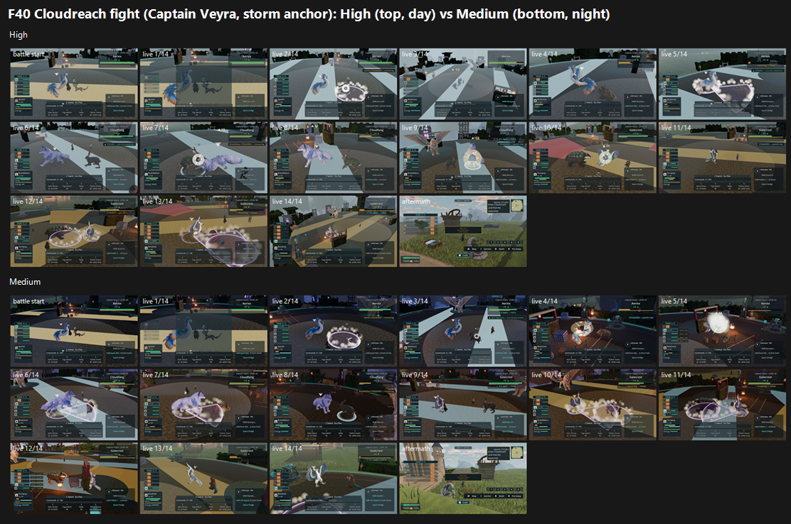

# F40 Cloudreach fight on GPU: High and Medium (24 Oct 2026)

**Verdict: FAIL. 4.45 at High and 4.73 at Medium.** All four recorded defects are PRESENT by majority.

## Run

- **Source:** main 24dfec7b9.
- **Capture:** `tools/capture_cloudreach_f40_fight.gd --preset=<High|Medium> --source-commit=24dfec7b9… --seed=2042`. The tool only writes under `res://ralph/reports/VISUAL/phase2/cloudreach/`, so the frames were moved out after capture and nothing was committed there.
- **Frames:** the Captain Veyra storm-anchor battle, live input. High has 52 live frames, Medium 62, plus the battle start and the aftermath.
- **Result:** in `events_*.json` both runs report `passed: false`, with 18 events at the `battle_captain_veyra_storm_anchor` stage. The fight is evidence of how combat looks, not of how the fight completes.
- **Time of day differs between runs:** High ran in daylight, Medium at night (torch-lit). So the two sides are the same fight at different times of day, not a clean comparison of presets.

`_sheet_f40_fight.png` (1.47 MB): High on top, Medium below. Each shows the battle start, 14 evenly spaced live frames and the aftermath.

## Yardstick (batch b4)

- **Set:** one set (Ft), High vs Medium, with 4 anchor pairs.
- **Judges:** three fresh code-blind judges, each given `JUDGE_PROMPT.md` verbatim.
- **Fit:** slope 0.927, intercept 1.551, r 0.90, anchor RMSE 0.61, confirming, no warnings.

| Side | j1 | j2 | j3 | Mapped mean |
|---|---|---|---|---|
| High (day) | 4.52 | 4.61 | 4.24 | **4.45** |
| Medium (night) | 4.79 | 4.89 | 4.52 | **4.73** |

| Defect | State | Judges (A+B) |
|---|---|---|
| Flat magenta slabs or rings | **PRESENT** | 4 PRESENT, 2 PARTIAL. The floor rings are paler, pink-white rather than full magenta. |
| P2-062 oversized ally | **PRESENT** | 6/6. The blue-white wolf ally fills the centre in live 6–8 and 10–11. |
| P2-063 tells on text, flat marks and flashes | **PRESENT** | 6/6. A bright white flash with no object behind it (Medium, live 5) and a cyan disc (Medium, live 8). |
| P2-016 hurt and moving frames keep the idle silhouette | **PRESENT** | 6/6, flagged as low-confidence at sheet size. G (#733) is the targeted P2-016 check. |

## What the judges saw

- **Daylight arena (High):** a flat grey slab plaza with no sky visible in any live frame. Flat white diagonal light-shaft planes wash out live 1–4 and 7. This is the same opaque shaft-quad defect as the Meadows Hall (F38 lever L2).
- **Night (Medium):** a dim, torch-lit plaza; nothing reads as Cloudreach's bright sky realm.
- **HUD:** full-height panels on the left and right cover about a third of every frame.
- **Aftermath:** the aftermath frame looks like the Meadows, not Cloudreach.

## Path to 7.5 (gap 2.77 at Medium, the better side)

1. **Remove the opaque white shaft planes** from the arena (*scene*, the same fix as F38 L2).
2. **Stage the arena in the sky realm** (*scene*): open sky and cloud sea behind the fight, and pale stratified stone instead of the grey slab.
3. **Real-object telegraphs and impacts** instead of the floor rings, flashes and discs (P2-063), for example gusts, lightning and cracking stone (*new_art* VFX).
4. **Cap the ally's size and framing** so the opponent and the player's creature stay visible (P2-062, *scene*, camera and ally scale).
5. **Slim the HUD** into compact corner widgets (*scene*, UI).
6. **Distinct hurt and moving poses** (P2-016). G, which is next in the queue, measures #733 against exactly this.

## Files

- `_sheet_f40_fight.png` and `events_High.json` / `events_Medium.json`.
- `yardstick-b4/`:
  - `key.json`, `sets.md`, `candidates.json`, `recorded_defects.txt`, `judge_prompt_filled.txt`;
  - `j1`–`j3` (the judges' own blocks);
  - `batch.json`, `mapped.json`.
