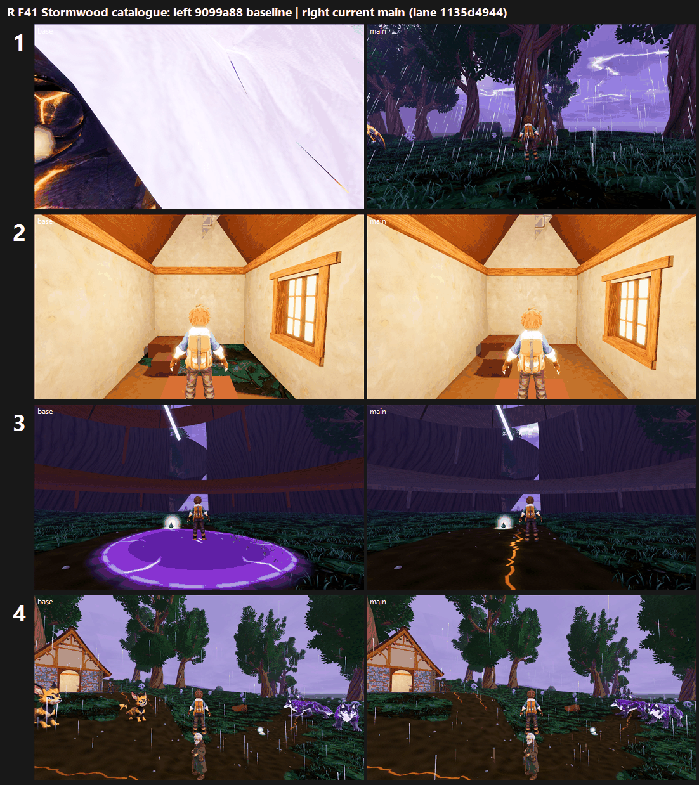

# R: F41 Stormwood catalogue on current main (lane 1135d4944, main 1d5faebac) vs the 9099a88 baseline (25 Oct 2026)

**Verdict: overall +0.23 Medium and +0.28 High, but three stands gain more than 0.5 by fixing broken frames. Stormwood is still below 6.**

- **Chapter mean:** 5.14 → **5.37** at Medium and 4.78 → **5.06** at High, across 12 stands.
- **Comparison with the first F41 round:** the baseline arm lands where it did before (5.07 / 4.80).
- **Tier: below 6.** No stand reaches 7. The best is Deepwood Lantern Hollow at Medium, which has the same score on both arms.
- **Capture:** 200/200 frames at both presets, with both F41 clean-tree guards passing.

The baseline arm had only 196 frames: the 4 Ashfoot Shelter *outside* frames are new on main, so they have no pair and were not judged. Each set compared 6 matched view ids per stand per preset (24 sets in 5 batches), scored by three code-blind judges each. Every batch fit confirms: r 0.85–0.97, RMSE 0.28–0.76.

| Stand | Medium base → main | High base → main | What changed (3 judges) |
|---|---|---|---|
| Conductor Run, capacitor grove | 3.37 → **5.93 (+2.56)** | 2.46 → **5.14 (+2.68)** | Baseline camera was inside a creature in 4 of 6 views; on main clipping is FIXED, at High 5 of 6 |
| Ashfoot Shelter, inside | 3.53 → **4.21 (+0.68)** | 3.53 → **4.21 (+0.68)** | Terrain grass through the floor: **FIXED** (was PRESENT, 6/6) |
| Dynamo, Stormheart tree | 3.80 → **4.44 (+0.64)** | 4.45 → 4.88 (+0.43) | Flat magenta disc gone (PRESENT → FIXED, Medium 3/3); the oxblood-red walkway rings are gone too; gap 2 (the tree itself) still PRESENT 12/12 |
| Glowmoss, lantern pools | 5.40 → 5.62 (+0.22) | 5.30 → 5.37 (+0.07) | no change |
| Dynamo, glass field | 5.63 → 5.22 (−0.41) | 5.32 → 5.45 (+0.13) | Main's Medium v04 has a white ground-lightning web (gap 3 PRESENT 3/3) |
| Conductor Run, rodline post | 6.02 → 5.68 (−0.34) | 5.80 → 5.44 (−0.36) | Same scene with fewer wild creatures in frame (spawn variance, sheet row 4), not an art change |
| Cinder Verge, rod station | 5.51 → 5.29 (−0.22) | 5.45 → 5.36 (−0.09) | no change |
| Hollow Crown, crown heartstone | 5.33 → 5.12 (−0.21) | 4.56 → 4.39 (−0.17) | no change; still no heartstone in view |
| Deepwood, the fallen giant | 4.73 → 4.64 | 4.77 → 4.69 | no change |
| Deepwood, lantern hollow | 6.81 → 6.81 | 5.40 → 5.37 | identical frames |
| Cinder Verge, struck sentinel | 5.51 → 5.51 | 5.44 → 5.44 | identical frames |
| Glowmoss, crown overlook | 5.99 → 5.99 | 4.93 → 4.97 | identical frames |

`_sheet_r.png`, left is the baseline and right is main:
1. Capacitor grove, v05 break, High: the baseline camera sits inside a creature.
2. Shelter inside, calm, High: grass no longer shows through the floor.
3. Stormheart tree, v03 break, Medium: the magenta disc is gone.
4. Rodline post, v01 calm, High: fewer creatures in frame on main.

**Caveat:** the capacitor-grove gain comes from creature placement. Whether a wild creature sits on the camera may depend on spawns, so treat it as "the camera was not blocked this run" rather than a guaranteed fix. The production cameras need a creature-exclusion guard (path item 4).

## Path to 7.5

Stormwood is the lowest chapter. Each fix below applies to every stand, and the judges' notes point to each being worth more than 0.5:

1. **Ground** (*scene*, every stand, F41 gap 1 PRESENT in nearly all 72 calls): break the uniform dark grass carpet and smooth brown mud into authored soil, moss, rock and root transitions. Add black pools with readable surfaces, and groves and clearings.
2. **Atmosphere** (*scene*):
   - Replace the camera-hugging lilac fog-puff sprites in the fading phase with height and depth fog plus light shafts.
   - Lift the single dark mid-tone with storm-light key and rim light.
   - Give each phase its own grade.
   - Replace the black or flat-grey horizon with layered ridge and tree silhouettes.
3. **Hero landmarks** (*new_art*): build the following to the boards, each readable at 30% size:
   - the Stormheart tree: carved bark, crown, lightning-split core, railed platforms with lanterns;
   - the Hollow Crown heartstone (not in any view);
   - the Deepwood fallen giant;
   - a capacitor structure for the grove;
   - a vista for the crown overlook.

   Also replace the Meadows cottages with Stormwood architecture.
4. **Camera hygiene** (*scene*):
   - Keep creatures out of the production camera volumes.
   - Remove the floating debug text in the capacitor grove (v03/v04).
   - Remove the hanging cyan cable, the translucent sky panels at Hollow Crown and the flat white ground-lightning decals.
5. **Shelter interior** (*scene*): it is floor-clean now but still a bare cream box at 4.2. Show the storm through the window, grade it cool with warm lantern pools, and dress it with a hearth, bedding and Stormwood props.

## Files

- `_sheet_r.png`, `build_yard_R.ps1.txt`, `sheet_R.ps1.txt`.
- `yardstick/`:
  - `coverage.json` and `R_rows.json`;
  - `Rb1` to `Rb5`, each with `key`, `sets.md`, `candidates`, `j1`–`j3`, `batch` and `mapped`.

Fit warnings: batches 2 to 5 have some candidates extrapolated more than 0.5 outside the anchors (the broken frames score low). Batch 4's anchor RMSE is 0.76 against a 0.75 limit, so read its scores with that caveat.

Capture: `capture_f41_stormwood_catalog.gd --phases=calm,building,break,fading --no-aftermath`, Forward+ on a GTX 1060, 1920x1080. The owner-approved per-path clean-up for line-ending-only changes ran before each preset.
