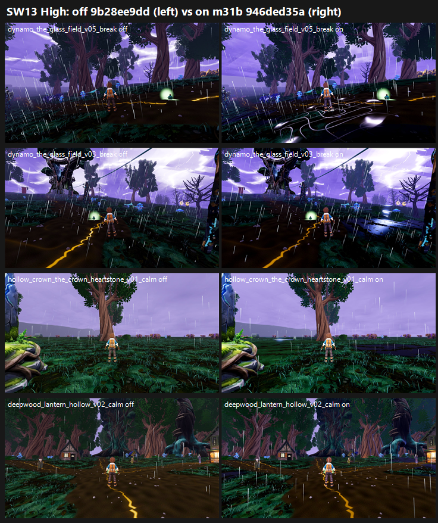

# SW13: Stormwood m31b ground pass 2 + storm light on GPU, 946ded35a vs merged lane 9b28ee9dd (26 Oct 2026)

**Verdict: no gain. Don't land it as is.** This is the first real GPU measure of r31: the CPU numbers came from a stale bake.

- **Mean across all 12 outdoor stands:**
  - Medium: 5.93 → 5.88 (−0.05).
  - High: 5.91 → 5.83 (−0.08).
- **Per stand,** changes range from −0.46 to +0.19. No stand gains more than +0.2.
- **Ground carpet (F41 gap 1):** unchanged. It is PRESENT on 33 of 36 calls on both arms at Medium, and 29 → 31 of 36 at High.
- **Storm light defect:** unchanged. It is PARTIAL on 33–34 of 36 calls on both arms. The judges see no cool rim light on trunks or figures on either arm.
- **New problem on the on arm:** the black pools carry hard white or cyan edge strips. The judges score these as F41 gap 3 ("rigid glass slabs or white strips"):
  - Medium: PRESENT 1 → 11 of 36 calls.
  - High: PRESENT 3 → 11 of 36 calls.
  - This drives the two biggest drops: the Glass Field at High (−0.46) and the Stormheart tree at High (−0.31).
- **Tier:** below 6. The on arm's means are 5.88 / 5.83; its best stand is the Stormheart tree, 6.47 Medium / 5.96 High.
- **MET:** not met at any stand on either arm.

| Stand | Medium off → on | High off → on |
|---|---|---|
| deepwood_lantern_hollow | 6.09 → 6.23 (+0.14) | 6.06 → 6.23 (+0.17) |
| glowmoss_hollows_the_lantern_pools | 5.98 → 6.17 (+0.19) | 6.03 → 6.00 (−0.03) |
| conductor_run_rodline_post | 5.97 → 6.04 (+0.07) | 5.76 → 5.73 (−0.03) |
| ashfoot_shelter_outside | 5.81 → 5.85 (+0.04) | 6.17 → 6.14 (−0.03) |
| deepwood_the_fallen_giant | 5.59 → 5.42 (−0.17) | 5.94 → 6.00 (+0.06) |
| cinder_verge_the_struck_sentinel | 5.94 → 5.80 (−0.14) | 5.29 → 5.29 (0.00) |
| glowmoss_hollows_crown_overlook | 5.55 → 5.51 (−0.04) | 5.92 → 5.89 (−0.03) |
| hollow_crown_the_crown_heartstone | 5.68 → 5.57 (−0.11) | 5.93 → 5.86 (−0.07) |
| dynamo_the_stormheart_tree | 6.51 → 6.47 (−0.04) | 6.27 → 5.96 (−0.31) |
| dynamo_the_glass_field | 6.23 → 6.14 (−0.09) | 6.20 → **5.74 (−0.46)** |
| cinder_verge_verge_rod_station | 5.65 → 5.48 (−0.17) | 5.65 → 5.48 (−0.17) |
| conductor_run_the_capacitor_grove | 6.20 → 5.92 (−0.28) | 5.69 → 5.65 (−0.04) |
| **Mean** | **5.93 → 5.88 (−0.05)** | **5.91 → 5.83 (−0.08)** |

**Method:**
- **Capture:** F41 catalogue (`capture_f41_stormwood_catalog.gd`) with `--source-commit` at each arm's own SHA on a clean tree. All four phases, Medium and High, 200/200 frames on all 4 runs.
- **Arms:** the off arm is the merged lane 9b28ee9dd; the on arm is tb/stormwood-m31b-on 946ded35a.
- **Sets:** layout as SW8, one set per stand per preset, with 6 views across the phases on both arms. All 12 outdoor stands; the shelter interior is excluded.
- **Judging:** 24 sets in 5 batches, three code-blind judges each, high anchors. Fits r 0.90 / 0.86 / 0.95 / 0.93 / 0.86, RMSE 0.42–0.63, all confirming.
- **Re-saves:** three judges (b1 j2, b3 j2, b5 j3) each left one set out of their first file. Each re-saved the file once with that set added, and their other entries were unchanged. The missing sets were the Lb and Ta anchors and the Tp stand (crown overlook, Medium).

**Caveats:**
- **Scale:** several stands moved by less than 0.1. At this batch's RMSE, only the pool edges (Glass Field and Stormheart at High) are a clear signal.
- **Pixel difference:** the arms differ by 8.7% of pixels on average per frame, mostly at the pools and the ground.

`_sheet_sw13.png`, High: off on the left, on on the right.
1. Glass Field v05 break: the white contour strips on the on arm.
2. Glass Field v03 break: a dark pool with a bright edge.
3. Crown heartstone v01 calm: a dark pool slab on the horizon.
4. Lantern hollow v02 calm: the one stand with a small gain.

## What the judges saw

- **On, the pools:** the judges describe cyan-rimmed discs sitting on top of the terrain, and dark pool slabs with a hard cyan or white edge (paraphrased from their reports). One verdict file names "a bright glass slab (v03) and loose white strips scribbled across the ground (v05)" at the Glass Field, and asks for pools "sunk into the terrain (sunken banks, no bright cyan rim discs)". The pools do add a little Stormwood read: one judge credits them at the crown heartstone, and another calls the capacitor grove ground PARTIAL rather than PRESENT.
- **Both arms:**
  - Ground: a dark-green carpet with smooth brown mud paths.
  - Fog: cotton-ball fog sprites in the fading frames.
  - Sky: a flat lilac sky and an empty grey horizon.
  - Lightning: shows only in the sky, so trunks, the trainer and the ground keep the same light in every phase (storm light PARTIAL).
  - Ground cracks: some judges flag "orange lava-like cracks" as off-palette.

## Path to 7.5 (best stand 6.47 Medium / 5.96 High, about 1.0–1.5 short; most stands about 1.5–2.2 short)

1. **Sink the pools** (*scene*): drop the hard white or cyan rim, blend the edges into soil and moss, and avoid flat reflective planes. This removes the new gap-3 calls, which are the main reason this candidate scores lower.
2. **Ground** (*scene*): break the carpet into blended soil, moss, rock and root patches, with grass grouped into groves and clearings. All 15 judges list this in their top changes.
3. **Storm light** (*scene*): give each phase its own ground grade, with a cool white-violet rim light tied to the lightning and the break flash lighting the ground and trunks. Use layered height fog instead of the puff sprites. SW19's storm sky (next on the GPU) addresses the sky part only.
4. **Horizon** (*new_art*): layered tree ridges in place of the flat grey band.

## Files

- `_sheet_sw13.png`, `build_yard_SW13.ps1.txt`, `cand_queue36.ps1.txt`.
- `yardstick/SW13_rows.json`, `yardstick/coverage.json`.
- `yardstick/SW13b1/`–`SW13b5/`: `key`, `sets.md`, `candidates`, `j1`–`j3`, `batch`, `mapped`.
