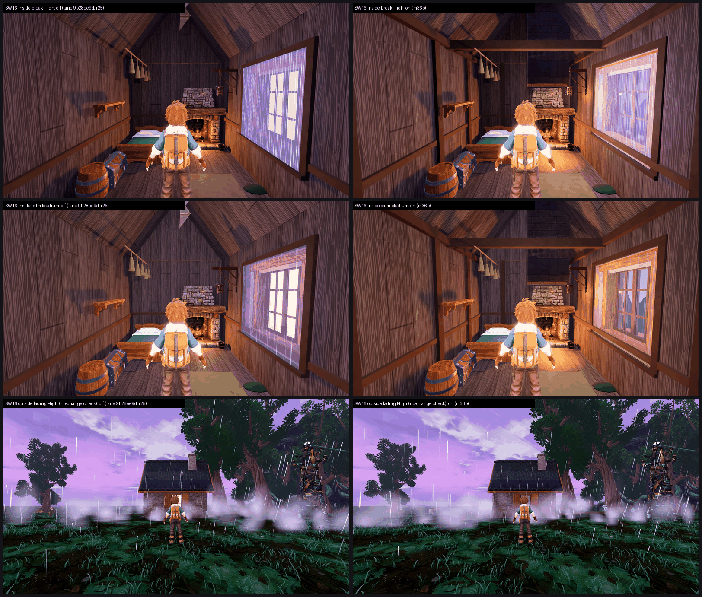

# SW16: Stormwood m36b Ashfoot seated + firelit + storm view, on GPU, 0a633e222 vs merged lane 9b28ee9dd (26 Oct 2026)

**Verdict: turn it ON.**
- **Interior:** 5.83 → **6.96 (+1.13)** at both presets.
- **Window:** the storm-window defect drops PRESENT 3/3 → **PARTIAL 2 / FIXED 1**, and the roof-apex light leak (clipping PARTIAL 2/3) is **FIXED 3/3**.
- **Outside check:** level (Medium 5.33 → 5.33, High 5.33 → 5.45). The clear glass doesn't change the exterior.
- **Tier 6–7, not met** (6.96 / 6.96): 0.54 short.

**Capture integrity.** The first candidate-Medium run lost the Vulkan device. Windows logged a driver timeout and recovery (nvlddmkm 153 + Display 4101) at 08:22, at frame 139, as the catalogue moved onto the Ashfoot stands. That was before any Ashfoot frame was shot.
- Per the coordinator, a repeat would have counted as a storm_view defect, and SW16 would not have landed.
- **The re-run was clean:** 200/200 frames, all 8 Ashfoot frames, no VkResult errors, and no TDR in the System log during the run.
- The candidate's High run was also clean. The one device loss is recorded as a single event, not a reproducible fault.

**Method:**
- **Capture:** F41 catalogue at each arm's own SHA on a clean tree. The off arm is the merged lane 9b28ee9dd (main #760, Fallen Giant on, r25 Ashfoot on); the on arm is tb/stormwood-m36b-on 0a633e222.
- **Sets:** `ashfoot_shelter_inside` in all four phases and `ashfoot_shelter_outside` as a no-change check, per preset. 4 sets, three code-blind judges, high anchors.
- **Fit:** r 0.93, RMSE 0.48, confirming.
- **Caveat:** the judges scored Medium and High identically on the interior. Both presets were in one batch and look alike at thumbnail size.
- **Scale note:** the off arm (r25) maps 5.83 here, against 6.57 / 6.12 for SW15's off arm in B5. That's a different batch and anchor mix; the delta in this batch is what counts.

| Stand | Medium off → on | High off → on | Storm-window defect | Clipping (roof apex) | Gap 3 (strips/slab) | MET |
|---|---|---|---|---|---|---|
| **ashfoot_shelter_inside** | 5.83 → **6.96 (+1.13)** | 5.83 → **6.96 (+1.13)** | PRESENT 3/3 → PARTIAL 2 / FIXED 1 | PARTIAL 2 → FIXED 3/3 | PRESENT 1 / PARTIAL 2 → PARTIAL 1 / FIXED 2 | not met (6.96 / 6.96) |
| ashfoot_shelter_outside (no-change) | 5.33 → 5.33 | 5.33 → 5.45 | — | same calls on both arms | same | level, as expected |

`_sheet_sw16.png`: off on the left, on on the right.
1. Inside, break, High.
2. Inside, calm, Medium.
3. Outside, fading, High (the no-change check).

## What the judges saw

- **On:** "the window is set into the wall with a sill and shows the outside; the sky changes from phase to phase". There's a timber-framed room with a lit hearth. Every judge credits it over the off arm's "glowing purple slab standing off the wall".
- **What remains:**
  - **Room light doesn't follow the storm.** It is "warm orange in every phase, not purple storm light". There's "no lightning flash on the walls" at break.
  - **Stormwood identity:** "sparse dressing, nothing specific to Stormwood". The bare-box defect stays PARTIAL 1/3 on both arms.
  - **Window frame:** still "stands off the wall slightly at the top right" (1 judge).
  - **Exposure:** the trainer's back and backpack are overexposed by the fire (1 judge).
- **Outside:** unchanged on both arms. The ground carpet is PRESENT, the fading fog is "a hard-edged sprite band", and the horizon is empty.

## Path to 7.5 (on 6.96; about 0.55 short)

1. **Storm-driven room light** (*scene*): let the window cast the phase colour into the room (cool violet at building and break, with a white-violet lightning flash on the walls at break), against the warm hearth. This is the change most judges name.
2. **Stormwood dressing** (*scene* / *new_art*): copper fittings, moss, storm-glass or lightning-rod motifs, so it stops reading as a generic cabin.
3. **Polish:** seat the frame's top-right corner flush, and pull the hearth's rim light off the trainer's back.

## Files

- `_sheet_sw16.png`.
- `yardstick/SW16_rows.json`.
- `yardstick/SW16b1/`: `key`, `sets.md`, `candidates`, `j1`–`j3`, `batch`, `mapped`.
