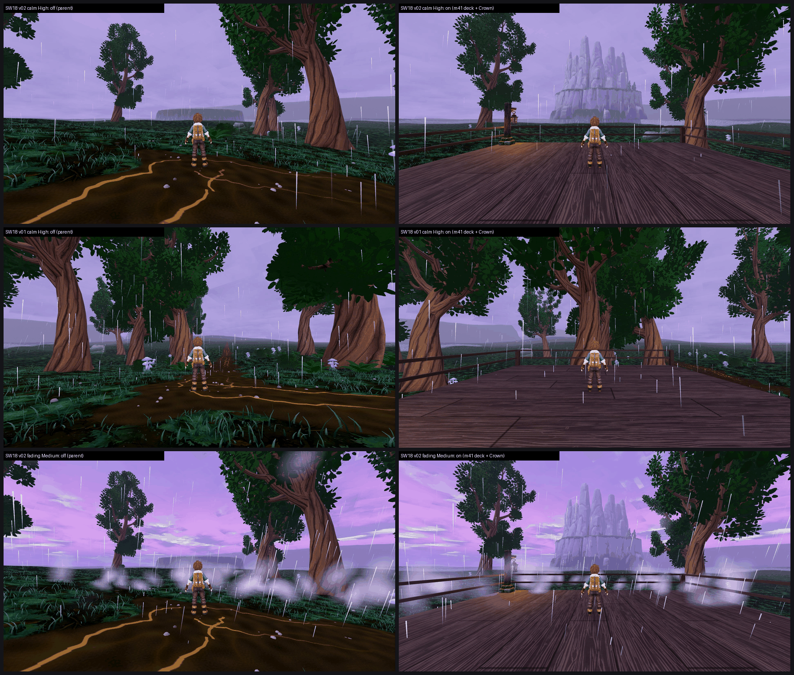

# SW18: Stormwood m41 Crown Overlook vista on GPU, tb/stormwood-m41-on aa74c9978 vs parent 5135aceb2 (26 Oct 2026)

**Verdict: turn it ON.**
- The raised lookout deck plus the Meshy Hollow Crown silhouette lifts the stand by about +0.87: calm 4.87 → 5.74, fading 5.10 → 5.96.
- Mean of calm and fading: **4.99 → 5.85 (+0.86)** at both presets.
- The "no vista / landmark" defect drops PRESENT 12/12 → **PARTIAL 12/12**, and the ground carpet (F41 gap 1) drops PRESENT 6 / PARTIAL 6 → PARTIAL 12/12.
- The stand stays below 6, and the gain is well under the CPU's +2.46. The Crown shows in only one of the three views.

**Method:**
- **Capture:** F41 catalogue at each arm's own SHA on a clean tree, Medium and High, 200/200 frames on all four runs.
- **On arm:** changes `stormwood_crown_overlook.json` (deck and massif) and `debug_teleport_spots.json` (moves the F41 survey stand onto the deck). The off arm's views also face heading 37°.
- **Sets:** `glowmoss_hollows_crown_overlook`, three views, one set for calm and one for fading per preset. 4 sets, three code-blind judges.
- **Anchors:** the high-anchor set. Fit r 0.96, RMSE 0.38, confirming.
- **Caveat:** the judges scored Medium and High identically. Both presets were in one batch and look the same at thumbnail size.

| Set | Medium off → on | High off → on | No vista / landmark | Ground carpet (gap 1) | Tier (on, lower preset) | MET |
|---|---|---|---|---|---|---|
| calm (3 views) | 4.87 → **5.74 (+0.87)** | 4.87 → **5.74 (+0.87)** | PRESENT 3/3 → PARTIAL 3/3 | PRESENT 2 / PARTIAL 1 → PARTIAL 3/3 | below 6 | not met |
| fading (3 views) | 5.10 → **5.96 (+0.86)** | 5.10 → **5.96 (+0.86)** | PRESENT 3/3 → PARTIAL 3/3 | PRESENT 2 / PARTIAL 1 → PARTIAL 3/3 | below 6 | not met |
| **Mean** | **4.99 → 5.85 (+0.86)** | **4.99 → 5.85 (+0.86)** | | | below 6 | **not met** (5.85 / 5.85) |

Also: clipping on the on arm goes PARTIAL 1 → FIXED 3/3 (calm). The flat painted gold path cracks are gone (gap 3 PARTIAL 1 → FIXED 3/3).

`_sheet_sw18.png`: off on the left, on on the right.
1. v02 calm, High (the Crown view).
2. v01 calm, High (no Crown in view).
3. v02 fading, Medium.

## What the judges saw

- **On arm:** "a wooden overlook deck with a railing", and the Crown spire shows in v02. All three judges credit it as the first real landmark at this stand. Two problems:
  - The Crown is **only in v02**, and it reads "pale and low-contrast against the sky".
  - There is **no sense of the ground dropping away** past the rail: v01 and v03 show "a grey fog plane with no sense of height".
- **Off arm:** a dirt path with flat painted gold cracks and no landmark in any view.
- **Unchanged on both arms:**
  - The calm sky is "a flat lavender wash with no cloud shape, lightning or light shafts".
  - The fading-phase mist is "floating white cotton-ball sprites".
  - The ground beyond the rail is a uniform dark-green carpet.
  - A flat grey slab or mesa sits on the horizon (placeholder PARTIAL 2/3).
  - The same blob tree model repeats at the same size.

## Path to 7.5 (on 5.85; about 1.65 short)

1. **The Crown in every view** (*scene*): re-aim v01 and v03, or place the massif so all three deck views frame it. Give it value contrast and a lit rim so it separates from the lavender sky.
2. **Height** (*scene* / *new_art*): show the ground falling away below the deck. Add a cliff edge, mid-ground treetops below eye level and layered depth fog, so it reads as an overlook.
3. **Sky and weather** (*scene*): storm cloud volume, lightning and light shafts in calm and break, and layered fog in place of the cotton-ball sprites. This is the same gap as SW8 / SW13.
4. **Ground** (*scene*): break the carpet beyond the rail and replace the grey horizon slab. SW13 (ground pass 2) is queued to test the ground.

## Files

- `_sheet_sw18.png`, `build_yard_SW1618.ps1.txt`.
- `yardstick/SW18_rows.json`.
- `yardstick/SW18b1/`: `key`, `sets.md`, `candidates`, `j1`–`j3`, `batch`, `mapped`.
