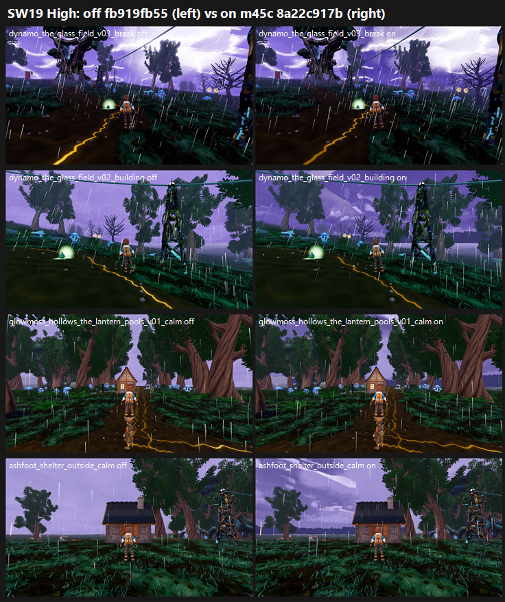

# SW19: Stormwood storm sky m45c on GPU, 8a22c917b (ceiling.form + ceiling.skyline on) vs tb/stormwood fb919fb55 (26 Oct 2026)

**Verdict: no gain. Don't land it as is.** Across all 12 outdoor stands the mean is flat:
- Medium 5.74 → 5.72 (−0.01).
- High 5.73 → 5.74 (+0.00).

The sky change does register in the defect calls, but it trades one defect for another:

- **Flat lavender sky (better):** PRESENT calls drop from 9 → 0 of 36 at Medium and 11 → 4 at High. Everything else is PARTIAL on both arms. The judges see some cloud form and a horizon treeline, but not enough to clear it.
- **"Lit rims read as white smear slabs" (worse; the lane's known risk does happen):** PRESENT calls rise from 16 → 27 of 36 at Medium and 19 → 27 at High. The off arm also draws smear calls, from its break lightning and crawlers.
- **Storm light:** PARTIAL on 33–36 of 36 calls on both arms (no change).
- **Ground carpet:** PRESENT on both arms (no change).
- **White-strip / glass-slab defect (F41 gap 3) at Medium:** PRESENT 2 → 10. The judges attribute it partly to fading-frame fog puffs and to pale cut-out shapes in the sky.

**Tier and MET:**
- Tier: below 6 (on-arm means 5.72 / 5.74). The best stand is the Stormheart tree, 6.15 Medium / 5.93 High.
- MET: not met at any stand.

**CPU vs GPU:** CPU r45b scored +0.83 with the flat sky FIXED 3/3. On GPU, the sky only moves from PRESENT to PARTIAL, and the lit rims cost that back.

| Stand | Medium off → on | High off → on |
|---|---|---|
| glowmoss_hollows_the_lantern_pools | 5.63 → 5.83 (+0.20) | 5.63 → 5.80 (+0.17) |
| ashfoot_shelter_outside | 5.47 → 5.76 (+0.29) | 5.72 → 5.43 (−0.29) |
| glowmoss_hollows_crown_overlook | 5.67 → 5.55 (−0.12) | 5.60 → 5.80 (+0.20) |
| hollow_crown_the_crown_heartstone | 5.90 → 5.73 (−0.17) | 5.85 → 5.96 (+0.11) |
| cinder_verge_verge_rod_station | 5.18 → 5.25 (+0.07) | 5.64 → 5.67 (+0.03) |
| conductor_run_rodline_post | 5.90 → 5.96 (+0.06) | 5.79 → 5.82 (+0.03) |
| cinder_verge_the_struck_sentinel | 5.63 → 5.69 (+0.06) | 5.57 → 5.57 (0.00) |
| deepwood_lantern_hollow | 6.15 → 6.15 (0.00) | 5.88 → 5.88 (0.00) |
| deepwood_the_fallen_giant | 5.72 → 5.72 (0.00) | 5.23 → 5.23 (0.00) |
| conductor_run_the_capacitor_grove | 5.93 → 5.77 (−0.16) | 5.90 → 5.86 (−0.04) |
| dynamo_the_stormheart_tree | 6.22 → 6.15 (−0.07) | 6.17 → 5.93 (−0.24) |
| dynamo_the_glass_field | 5.43 → 5.11 (−0.32) | 5.82 → 5.88 (+0.06) |
| **Mean** | **5.74 → 5.72 (−0.01)** | **5.73 → 5.74 (+0.00)** |

**Method:**
- **Capture:** F41 catalogue (`capture_f41_stormwood_catalog.gd`) with `--source-commit` at each arm's own SHA on a clean tree. All four phases, Medium and High, 200/200 frames on all 4 runs.
- **Arms:** the only diff between them is `stormwood_surge.json` `ceiling.form` and `ceiling.skyline` (false → true).
- **Sets:** layout as SW8/SW13, one set per stand per preset, all 12 outdoor stands. Two defects were added to the standard Stormwood list: the flat lavender sky, and lit rims reading as white smear slabs.
- **Judging:** 24 sets in 5 batches, three code-blind judges each, high anchors. Fits r 0.84–0.98, RMSE 0.23–0.63, all confirming. Every judge file had all its sets; no re-saves were needed this time.

**Caveats:**
- **Canopy-covered stands:** at stands where the canopy covers the sky (deepwood lantern hollow, the fallen giant), the arms scored identically.
- **Pixel difference:** the arms differ by 11.8% of pixels on average per frame (0.2–36%), almost all of it in the sky.

`_sheet_sw19.png`, High: off on the left, on on the right.
1. Glass Field v03 break.
2. Glass Field v02 building.
3. Lantern pools v01 calm.
4. Ashfoot outside, calm.

## What the judges saw (paraphrased from their reports)

- **On arm:**
  - The cloud masses and a horizon treeline show at the open stands. Several judges credit the B sides of the lantern pools and the crown overlook for adding a treeline.
  - The lit cloud edges in the break and building skies read as pasted white slabs or hard pale rectangular strips.
  - The calm-phase skies are still mostly a lavender wash.
- **Both arms:**
  - A dark-green ground carpet and flat mud paths.
  - Pasted white or lilac fog puffs in the fading frames.
  - No rim light on trunks or figures.

## Path to 7.5 (best stand 6.15, about 1.4 short; most stands about 1.7–2.3 short)

1. **Soften the lit rims** (*scene*):
   - Lower `ceiling.form` `lit` and/or widen `edge` so cloud edges glow softly, not as hard white slabs.
   - Keep the darker bases and the horizon treeline, which the judges do credit.
   - The judges' fix: layered cloud with soft lit edges and haze.
2. **Carry the sky into the scene light** (*scene*): the judges' top fix in every batch is a per-phase grade with a cool rim light on trunks and figures tied to the lightning. The sky alone doesn't move the score.
3. **Ground** (*scene*): break the carpet into soil, moss, rock and root patches with grove edges, and replace the fog puffs with soft ground mist. All 15 judges list this.

## Files

- `_sheet_sw19.png`, `build_yard_SW19.ps1.txt`, `cand_queue49.ps1.txt`.
- `yardstick/SW19_rows.json`, `yardstick/coverage.json`.
- `yardstick/SW19b1/`–`SW19b5/`: `key`, `sets.md`, `candidates`, `j1`–`j3`, `batch`, `mapped`.
