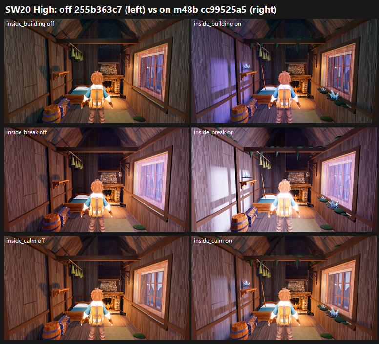

# SW20 CLOSE-OUT: Stormwood Ashfoot room m48b on GPU, cc99525a5 (storm_room + stormwood_dressing on) vs 255b363c7 (26 Oct 2026)

**Verdict: turn it ON.**
- **Interior:** 5.73 → **6.60 (+0.87)** at both presets.
- **Warm-room defect:** PRESENT 3/3 → **FIXED 3/3**.
- **Generic-cabin defect:** PRESENT 3/3 → PARTIAL 3/3.
- **Window-slab defect:** PRESENT 3/3 → PARTIAL 3/3.
- **Outside no-change check:** level (5.78 → 5.78 at both presets), as expected.
- **Tier:** 6–7.
- **MET:** not met (6.60 / 6.60), about 0.9 short in this batch.

| Stand | Medium off → on | High off → on | Warm room | Generic cabin | Window slab | F41 gap 3 | MET |
|---|---|---|---|---|---|---|---|
| **ashfoot_shelter_inside** | 5.73 → **6.60 (+0.87)** | 5.73 → **6.60 (+0.87)** | PRESENT 3 → **FIXED 3** | PRESENT 3 → PARTIAL 3 | PRESENT 3 → PARTIAL 3 | FIXED 3 → PARTIAL 3 (crystal clusters on flat pads) | not met |
| ashfoot_shelter_outside (no-change check) | 5.78 → 5.78 | 5.78 → 5.78 | — | — | — | PARTIAL 3, both arms | level |

**Scale note:** the coordinator's "6.96 on main" is SW16's on arm, scored in a different batch and anchor mix. In this batch the same lineage's control maps 5.73, so read the **+0.87** as the score of record. Adding +0.87 to SW16's 6.96 would cross 7.5, but scores from different batches don't add, so that is not a MET call. A re-judge in one batch beside SW16's on frames would settle it.

**Method:**
- **Capture:** F41 catalogue with `--source-commit` at each arm's own SHA on a clean tree. All four phases, Medium and High, 200/200 frames on all 4 runs.
- **Arms:** the only diff is `cottage_interior_finish.json`: two `enabled` flags, false → true.
- **Sets:** `ashfoot_shelter_inside` in all four phases and `ashfoot_shelter_outside` as a no-change check, per preset (layout as SW16). 4 sets in one batch, with three code-blind judges and high anchors. Fit r 0.95, RMSE 0.26, confirming.
- **Caveat:** the judges scored Medium and High identically.

`_sheet_sw20.png`, High: off on the left, on on the right. Rows are inside building, inside break and inside calm.

## What the judges saw

- **On:**
  - "cool violet window light and white wall flash at break"; "violet storm light raking the left wall" in building.
  - Storm-glass crystal clusters, moss and vines on the beams, and a leaning rod.
- **Off:** the room stays warm orange in all four phases.
- **What remains on the on arm:**
  - **Trainer:** "a blown-out backlit trainer" (all 3 judges: the hearth backlight overexposes the trainer's back in every frame).
  - **Window:** the frame still stands off the wall.
  - **Dressing:** still sparse, with no copper. The cyan crystal clusters sit on flat disc pads (gap 3 PARTIAL).
  - **Floor:** flat green floor discs (placeholder PARTIAL, both arms).

## Path to 7.5 (on 6.60, about 0.9 short in this batch)

1. **Tame the trainer backlight** (*scene*): cap the hearth's rim or back light so the trainer's back isn't blown out. All 3 judges name this.
2. **Seat the window frame flush** in the wall (*scene*).
3. **More Stormwood dressing** (*scene* / *new_art*): copper bands or fittings and a clear lightning-rod or storm-glass motif. Seat the crystal clusters into the floor or shelves instead of flat pads, and replace the flat green floor discs.

## Files

- `_sheet_sw20.png`, `build_yard_SW20.ps1.txt`, `cand_queue50.ps1.txt`.
- `yardstick/SW20_rows.json`, `yardstick/coverage.json`.
- `yardstick/SW20b1/`: `key`, `sets.md`, `candidates`, `j1`–`j3`, `batch`, `mapped`.
