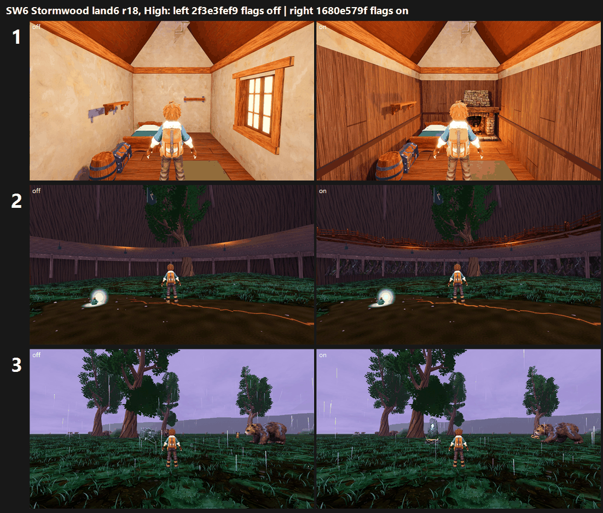

# SW6: Stormwood land6 r18 Meshy flags on GPU (25 Oct 2026)

**Arms:** tb/stormwood-land6-on `1680e579f` (flags on) vs tb/stormwood-land6 `2f3e3fef9` (flags off).

**Verdict: turn the Ashfoot interior ON (+0.99 / +1.71). The Stormheart interior splits by preset (−0.24 Medium / +0.59 High), so it does not clear 0.5 at both. The crown heartstone gains +0.42 / +0.28 and stays OFF.**

Each arm was captured with the F41 catalogue at its own SHA on a clean tree: 200/200 frames per arm per preset, at Medium and High. Only the three stands the flags touch were judged, using the same 6 view ids on both arms. That is 6 sets in 2 batches, with three code-blind judges each. Both fits confirm: r 0.91 / 0.97, RMSE 0.50 / 0.35.

| Flag (stand) | Medium off → on | High off → on | Stand defect (3 judges) | Call | Tier (on, lower preset) |
|---|---|---|---|---|---|
| **Ashfoot lining + Meshy hearth** (`ashfoot_shelter_inside`) | 4.83 → **5.82 (+0.99)** | 4.11 → **5.82 (+1.71)** | bare plaster box PRESENT 6/6 → **PARTIAL 6/6** | **ON** | below 6 (5.82) |
| Stormheart root-wall ring + deck walk (`dynamo_the_stormheart_tree`) | 5.18 → 4.94 (−0.24) | 4.63 → **5.22 (+0.59)** | gap 2 PRESENT 6/6 → PRESENT 3/3 at Medium, PARTIAL 2/3 at High | split: OFF by the both-presets rule | — |
| Meshy hero heartstone (`hollow_crown_the_crown_heartstone`) | 5.26 → 5.68 (+0.42) | 5.06 → 5.34 (+0.28) | missing/primitive PRESENT 6/6 → PARTIAL 5/6 | OFF (<0.5) | — |

`_sheet_sw6.png` is at High, with flags off on the left and flags on on the right:
1. Ashfoot interior, calm. Plank lining and a lit stone hearth replace the bare plaster.
2. Stormheart v02, calm. The deck walk gains railings and lantern edges; the trunk wall is unchanged.
3. Crown heartstone v02, calm. The hero stone is in frame but is a small blue crystal in the distance.

## Why each flag landed where it did

- **Ashfoot (ON):** all six judges read the candidate as a lived-in room (plank lining, hearth, bed, barrel, rug). They read the control as the bare plaster box. Two things stop it reaching Stormwood:
  - The room has no window or view of the storm, so calm, building, break and fading look the same.
  - The lining is a generic plank with no Stormwood copper, glass or moss. The upper gable is still plaster.
- **Stormheart (split):** the railings and warm lantern edges register: at High, 2 of 3 judges move gap 2 to PARTIAL. But the trunk wall stays a smooth, dark, murky drum with no crown or lightning core in frame. At Medium the change is lost in the low values and the fading fog sprites.
  - Pixel change outside the fading phase is only 1–4% of the frame.
  - This needs the hero interior (bark relief, core column, banners) rather than the walkway trim.
- **Heartstone (+0.42 / +0.28):** the second heading puts the stone in view, but at about 2% of the frame width. Judges call it "a small cyan glow, not a landmark". In two frames a wild bear stands in front of it on the candidate side.
  - The CPU gain (+0.71) needs the stone large in frame. Move the stand in, or scale the stone up so it reads at 30% of the frame.

## Path to 7.5 (Stormwood)

1. **Turn the Ashfoot interior ON.** Next, give it a window that shows the storm phases (purple light, rain, lightning flashes) and Stormwood dressing (copper, glass, moss, hanging herbs). Finish the gable lining. *(scene)*
2. **Heartstone framing.** Seat the camera closer, or scale the stone to read at 30% of the frame. Keep wild creatures out of the stand's view cone. Then re-judge; it should clear 0.5. *(scene)*
3. **Stormheart hero interior.** Build the bark relief, the lightning core column, banners and lanterns to the board. Remove the white strip at the top of v03 and the camera fog sprites in v04. *(new_art)*
4. **Ground.** Break up the carpet at all Stormwood stands, as in R's verdict: F41 gap 1 is PRESENT at every outdoor stand here too. *(scene)*

## Files

- `_sheet_sw6.png`, `build_yard_SW6.ps1.txt`, `sheet_SW6.ps1.txt`.
- `yardstick/`: `coverage.json` and `SW6_rows.json`.
- `yardstick/SW6b1` and `yardstick/SW6b2`, each with `key`, `sets.md`, `candidates`, `j1`–`j3`, `batch` and `mapped`.

Capture: `capture_f41_stormwood_catalog.gd --preset=<Medium|High> --source-commit=<arm SHA> --label=f41-land6-<arm>-<preset> --phases=calm,building,break,fading --no-aftermath`, Forward+ on a GTX 1060 at 1920x1080. Before each run the lane worktree was force-checked-out at the arm SHA, and stale Godot `.uid` files from this lane's own earlier imports were removed and logged.

The first queue attempt was refused by F41's clean-tree guard: 5 stale `.uid` files survived the narrower pattern. It was re-run with no other changes.
