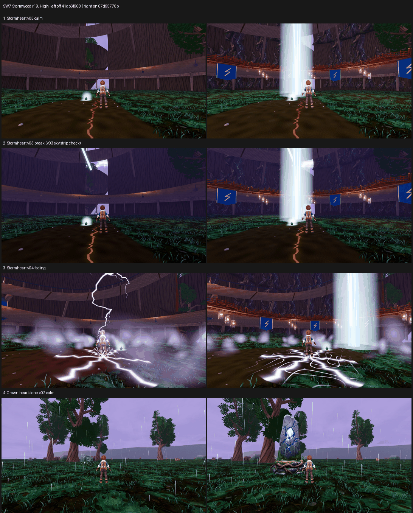

# SW7: Stormwood r19 on GPU, tb/stormwood-r19-on 67d95770b vs tb/stormwood 41db6f968 (25 Oct 2026)

**Verdict: turn both ON.**
- **Stormheart hero interior:** +0.95 Medium and +0.67 High, averaged over the calm and fading sets. Calm alone is +1.24 / +1.07; fading is +0.65 / +0.26.
- **Crown heartstone hero at the r19 stand:** +1.32 at both presets.

Both stay below 6. The new core column is the next fix: all 12 Stormheart calls read it as a "rigid white light column" (F41 gap 3 PRESENT on the candidate).

**Method:**
- **Arms:** both captured with the F41 catalogue at their own SHA on a clean tree, 200/200 frames per arm per preset, Medium and High. The two arms differ by one config commit (4 one-line changes).
- **Stormheart:** judged on all six views, one set for calm and one for fading.
- **Heartstone:** judged on its 6 standard picks. The on arm also moves the survey stand.
- **Batches:** 6 sets in 2 batches, three code-blind judges each. Both fits confirm: r 0.95 / 0.97, RMSE 0.42 / 0.33.

| Stand | Medium off → on | High off → on | Recorded defects (3 judges) | Call | Tier (on, lower preset) |
|---|---|---|---|---|---|
| **Stormheart, calm (6 views)** | 4.20 → **5.44 (+1.24)** | 3.90 → **4.97 (+1.07)** | gap 2 (tree below reference): PRESENT 6/6 → **PARTIAL 6/6**; gap 3: FIXED → **PRESENT 6/6** (core column) | **ON** | below 6 |
| Stormheart, fading (6 views) | 3.98 → 4.63 (+0.65) | 4.15 → 4.41 (+0.26) | gap 2 PRESENT → PARTIAL 6/6; gap 3 → PRESENT 6/6 | (counted in the Stormheart mean) | below 6 |
| **Crown heartstone (r19 stand)** | 4.16 → **5.48 (+1.32)** | 4.16 → **5.48 (+1.32)** | heartstone missing/primitive: PRESENT 6/6 → **PARTIAL 6/6**; clipping FIXED → PARTIAL/PRESENT (v01 camera against a foreground rock) | **ON** | below 6 |

`_sheet_sw7.png`: High, off on the left, on on the right.
1. Stormheart v03 calm.
2. Stormheart v03 break, the v03 sky strip check.
3. Stormheart v04 fading.
4. Heartstone v02 calm.

## What the judges saw

- **Stormheart on.** Every judge credits the blue lightning banners, the lantern ring with railings, and the bark with blue veins; one said it "starts to say Stormheart".
  - **Core column:** the new column reads as a free-standing, hard-edged white tube that stands on the grass and passes through the walkway line in v02–v04 (gap 3 PRESENT 12/12).
  - **Fading phase:** cotton-ball lilac fog puffs and flat white crack decals under the trainer (v04/v05) hold the gain down to +0.26 at High. The best weather moment in the set is the off arm's v04 white-violet bolt with a real impact.
- **Heartstone on.** All judges call the blue crystal monolith on a mossy base "a landmark".
  - It is in view in v02 and v03 but **missing from the v01 cameras**.
  - At the new stand, v01 calm/fading sit against a foreground rock cut by the frame edge (clipping PARTIAL/PRESENT).
  - Two judges noted small dark-red posts near the trainer in v03: a possible oxblood leak to check.
- **The v03 white sky strip** (your GPU check):
  - On the off arm it still shows as a thin white strip at the top of the Stormheart v03 break view (sheet row 2, left).
  - On the on arm the core column dominates the same view and reads as a larger version of the same "rigid white strip" defect.
  - So the strip is no longer the issue on its own; the column is.

## Path to 7.5

1. **Core column → a core built into the trunk** (*new_art*): a split, vein-lit trunk with branching white-violet bolts and an emissive crystal heart, instead of a free-standing light tube. It must not cross the walkway. This should turn gap 3 back to FIXED and lift both phases.
2. **Fading-phase atmosphere** (*scene*): replace the eye-height fog puffs and flat crack decals with layered ground mist, distance haze and bolts that land with an impact, like the v04 strike.
3. **Heartstone framing** (*scene*): move the v01 cameras off the foreground rock so the stone is in all three views. Check the dark-red posts near the stand.
4. **Ground** (*scene*): F41 gap 1 is PRESENT on every Stormwood set here (uniform grass carpet with a dirt band). SW8 is testing this next.

## Files

- `_sheet_sw7.png`, `build_yard_SW7.ps1.txt`.
- `yardstick/coverage.json`, `yardstick/SW7_rows.json`.
- `yardstick/SW7b1/` and `yardstick/SW7b2/`: `key`, `sets.md`, `candidates`, `j1`–`j3`, `batch`, `mapped`.

Capture: `capture_f41_stormwood_catalog.gd --preset=<Medium|High> --source-commit=<arm SHA> --label=f41-r19-<arm>-<preset> --phases=calm,building,break,fading --no-aftermath`, Forward+ on a GTX 1060 at 1920x1080. Before each run the lane worktree was force-checked-out at the arm SHA, and Godot-generated `.uid` files from this lane's imports were removed and logged.
