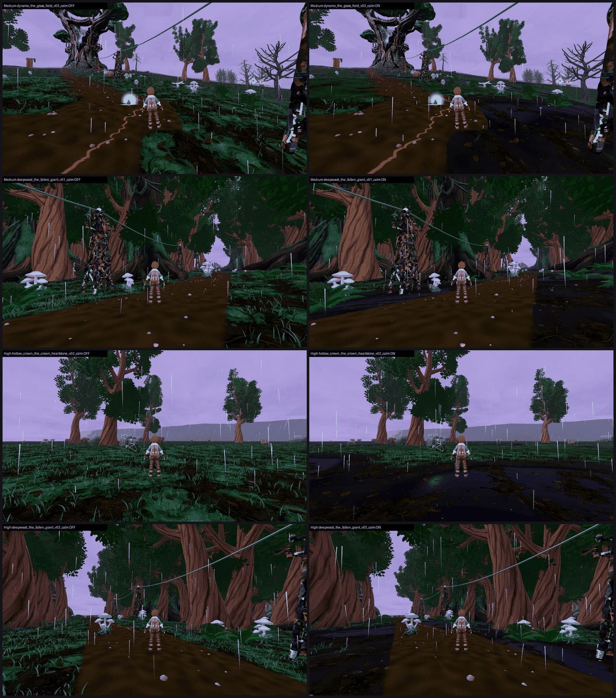

# SW8: Stormwood authored ground r22 on GPU, tb/stormwood-r22-on 311e00942 vs tb/stormwood f0803c995 (25 Oct 2026)

**Verdict: keep `ground_zones` OFF.**
- **High:** the mean over all 12 outdoor stands is flat, 5.47 → 5.46 (−0.01).
- **Medium:** it loses, 5.27 → 5.05 (−0.22).
- **F41 gap 1 is not fixed.** It gets slightly worse: across 72 calls per arm, PRESENT 49 → 57 and PARTIAL 23 → 15.
- **Where it works:** the moss and black-pool side of the zone field helps on High at four stands (+0.26 to +0.41).
- **Where it fails:** the bare-loam side reads as flat, near-black, smooth mud. That costs points everywhere on Medium, where the grass tufts thin out over loam and nothing replaces them.

**Arms:** these are the original r22 arms (311e00942 on, f0803c995 off), not the merged-head rebuild. The two arms differ by one line: `stormwood_ground_finish.json` `ground_zones.enabled` false → true.

**Method:**
- **Capture:** F41 catalogue at each arm's own SHA on a clean tree, Medium and High, 200 frames per arm per preset.
- **Sets:** every outdoor stand (`ashfoot_shelter_inside` skipped), 6 views per stand, 24 sets in 5 batches, three code-blind judges each.
- **Fits:** all 5 batches confirm, r 0.89–0.98, RMSE 0.29–0.65.
- **One judge fix:** batch 5 judge 3 left the glass-field High set out of its JSON. It was asked to add it from its own notes before aggregation.

| Stand | Medium off → on | High off → on | Tier (on, lower preset) | MET |
|---|---|---|---|---|
| hollow_crown_the_crown_heartstone | 4.62 → 4.41 (−0.21) | 5.12 → **5.53 (+0.41)** | below 6 | not met (4.41 / 5.53) |
| glowmoss_hollows_the_lantern_pools | 5.41 → 5.20 (−0.21) | 5.16 → **5.49 (+0.33)** | below 6 | not met (5.20 / 5.49) |
| deepwood_the_fallen_giant | 5.61 → **4.84 (−0.77)** | 5.28 → **5.60 (+0.32)** | below 6 | not met (4.84 / 5.60) |
| cinder_verge_the_struck_sentinel | 4.49 → 4.71 (+0.22) | 5.53 → 5.79 (+0.26) | below 6 | not met (4.71 / 5.79) |
| glowmoss_hollows_crown_overlook | 5.20 → 5.20 (0.00) | 5.46 → 5.61 (+0.15) | below 6 | not met (5.20 / 5.61) |
| ashfoot_shelter_outside | 5.49 → 5.72 (+0.23) | 5.37 → 5.24 (−0.13) | below 6 | not met (5.72 / 5.24) |
| dynamo_the_stormheart_tree | 5.08 → 5.28 (+0.20) | 5.19 → 4.74 (−0.45) | below 6 | not met (5.28 / 4.74) |
| conductor_run_rodline_post | 5.18 → 4.97 (−0.21) | 5.93 → 5.81 (−0.12) | below 6 | not met (4.97 / 5.81) |
| deepwood_lantern_hollow | 5.74 → 5.48 (−0.26) | 5.85 → 5.72 (−0.13) | below 6 | not met (5.48 / 5.72) |
| cinder_verge_verge_rod_station | 5.48 → 5.05 (−0.43) | 5.48 → 5.36 (−0.12) | below 6 | not met (5.05 / 5.36) |
| conductor_run_the_capacitor_grove | 5.51 → 5.18 (−0.33) | 5.51 → 5.14 (−0.37) | below 6 | not met (5.18 / 5.14) |
| dynamo_the_glass_field | 5.45 → **4.54 (−0.91)** | 5.76 → 5.47 (−0.29) | below 6 | not met (4.54 / 5.47) |
| **Mean (12 stands)** | **5.27 → 5.05 (−0.22)** | **5.47 → 5.46 (−0.01)** | below 6 | **0 of 12 met** |

**Medium glass-field caveat:** the −0.91 is partly a timing artefact. In the Medium on-arm's v03 break and v04 fading frames, a white branching lightning decal is painted on the ground, and all 3 judges called gap 3 PRESENT there (off arm: PARTIAL 3/3). The decal belongs to the storm phase, not to the ground zones.

`_sheet_sw8.png`: off on the left, on on the right.
1. Medium, glass field v03 calm.
2. Medium, fallen giant v01 calm.
3. High, crown heartstone v02 calm.
4. High, fallen giant v03 calm.

## What the judges saw

- **The loam side reads as bare mud.** On the on arm, judges describe the ground as:
  - "near-black smooth soil" (capacitor grove, Medium);
  - "bare smooth brown mud with flat gold vein lines" (lantern hollow, High);
  - "a flat brown smear" (lantern hollow);
  - "smooth dirt with gold veins" (glass field, High);
  - "crushed near-black lower frame" (capacitor grove).

  Placeholder calls rise with it: the Stormheart High on-arm gets a "smooth, nearly untextured" ground call (placeholder PRESENT 1/3, which the off arm never gets).
- **The moss and black-pool side is credited.** The fallen giant High and the crown heartstone High on-arms get "black pools at the path edges", "dark reflective black-pool ground" and "teal moss patches". Gap 1 drops to PARTIAL 3/3 at both stands, and these are the two largest gains.
- **On Medium, the off arm is the less carpeted one.** At the rod station, fallen giant, rodline post and lantern hollow, judges credit the off arm's "denser grass and fern clumps along path edges". The on arm thins those tufts over loam, so the same stands drop from PARTIAL to PRESENT.
- **Unchanged by the candidate, and still the main gap at every stand:**
  - The fading-phase fog arrives as lavender cotton-ball puffs at the camera, or a full white-out (fallen giant v04, Stormheart v04).
  - No hero landmark reads: the Stormheart is "a curved plank ring", there is no heartstone at hollow crown, no vista at crown overlook, and the fallen giant is not identifiable.
  - Flat gold ground "squiggles" and white lightning decals.
  - Evenly spaced blob-canopy trees.
- **Bugs to check:**
  - A block of **white text floats in the sky above the trainer** in the capacitor grove v03 break and v04 fading, on both arms and both presets; all 3 judges of that batch called it. It looks like a world label or debug text left visible.
  - **Grey placeholder blocks** sit on the capacitor-grove horizon in v05/v06.
  - At the rodline post and lantern hollow, the cottages are the **Meadows half-timber houses**, which judges flag as off-chapter.
  - Small reddish blocks on the crown-heartstone horizon. Several judges asked whether these are an oxblood leak; none could confirm at this size.

## Path to 7.5

Every stand is 1.6–3.1 short on its lower preset. In order of expected gain:

1. **Hero landmarks** (*new_art*): the Stormheart as the board's split trunk (SW11 is testing this), a crown heartstone that is visible in all three hollow-crown views, a fallen-giant log readable at 30% (SW10 is testing this), and a real crown-overlook vista. Every judge's top-3 list names this.
2. **Fading-phase atmosphere** (*scene*): replace the camera-height fog-puff sprites and the white-outs with layered height fog and distance haze, and give the near-black frames a rim or key light.
3. **Ground, second pass** (*scene*):
   - Keep the moss and black-pool zones.
   - Drop or rework the bare-loam zone: either give loam real surface detail (leaf litter, pebbles, roots, a normal map, value lift) or bias the field to moss.
   - On Medium, keep the grass tufts over loam instead of thinning them.
   - A moss-and-pools-only variant would likely keep the High gains (+0.3 to +0.4 at four stands) without the Medium losses. That is still under +0.5 on its own, so it should ride with item 1 or 2.
4. **Clean-up that rides along** (*scene*): hide the floating sky text in the capacitor grove, the grey horizon blocks and the flat gold ground squiggles, and swap the Meadows cottages for Stormwood buildings.

## Files

- `_sheet_sw8.png`, `build_yard_SW8.ps1.txt`, `tab_yard.py.txt`.
- `yardstick/SW8_rows.json`: one row per side, with mapped and per-judge scores and defect calls.
- `yardstick/SW8b1/` … `SW8b5/`: `key`, `sets.md`, `candidates`, `j1`–`j3`, `batch`, `mapped`.

Capture: `capture_f41_stormwood_catalog.gd --preset=<Medium|High> --source-commit=<arm SHA> --label=f41-r22-<arm>-<preset> --phases=calm,building,break,fading --no-aftermath`, Forward+ on a GTX 1060 at 1920x1080. Before each run the lane worktree was force-checked-out at the arm SHA, and Godot-generated `.uid` files from this lane's imports were removed and logged.
