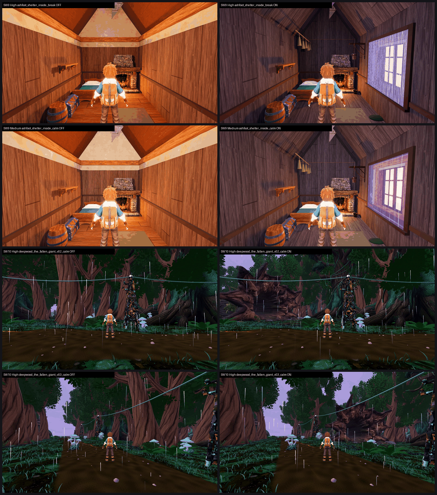

# SW9 + SW10: Stormwood Ashfoot r25 and Fallen Giant m28b on GPU (26 Oct 2026)

**Verdict: turn both ON.**
- **SW9, Ashfoot interior r25** (tb/stormwood-m25-on 72eaa19ca vs tb/stormwood 040903b16): Medium 5.41 → 6.11 (+0.70), High 4.71 → 6.23 (+1.52). It lifts the interior out of below-6. The outside stand is a no-change check and holds level (±0.04), as expected.
- **SW10, Fallen Giant hero m28b** (tb/stormwood-m28b-on 21a582478 vs a7048bc4): mean of calm and fading, Medium 4.49 → 5.05 (+0.56), High 4.51 → 5.09 (+0.59). Every set gains +0.53 to +0.59. The stand stays below 6, because the log shows in only two of six views.

**Method:**
- **Capture:** F41 catalogue at each arm's own SHA on a clean tree (0 dirty paths before every run), Medium and High, 200/200 frames per arm per preset. Both are rebuilt on the merged head.
- **Sets:**
  - SW9 inside: all four phases, one set per preset.
  - SW9 outside: all four phases, one set per preset.
  - SW10: all six views, one calm set and one fading set per preset.
- **Judging:** 8 sets in 2 batches, three code-blind judges each. Both fits confirm: r 0.99, RMSE 0.19 / 0.16.

| Item / stand | Medium off → on | High off → on | Recorded defects (3 judges per set) | Call | Tier (on, lower preset) | MET |
|---|---|---|---|---|---|---|
| **SW9 ashfoot_shelter_inside** (4 phases) | 5.41 → **6.11 (+0.70)** | 4.71 → **6.23 (+1.52)** | bare plaster box PARTIAL 6/6 → **FIXED 6/6**; placeholder (High) PARTIAL 3/3 → FIXED 3/3; new: window gap 3 PARTIAL 4/6, PRESENT 1/6; clipping PARTIAL 4/6 | **ON** | **6–7** | not met (6.11 / 6.23) |
| SW9 ashfoot_shelter_outside (no-change check) | 5.58 → 5.54 (−0.04) | 5.54 → 5.58 (+0.04) | identical calls on both arms | level, as expected | below 6 | not met (5.54 / 5.58) |
| **SW10 deepwood_the_fallen_giant**, calm (6 views) | 4.76 → 5.29 (+0.53) | 4.75 → 5.34 (+0.59) | fallen giant missing PRESENT 6/6 → **PARTIAL 6/6** | **ON** | below 6 | not met |
| SW10 deepwood_the_fallen_giant, fading (6 views) | 4.22 → 4.80 (+0.58) | 4.26 → 4.84 (+0.58) | fallen giant PRESENT 6/6 → **PARTIAL 6/6** | (in the mean) | below 6 | not met |
| **SW10 mean** | **4.49 → 5.05 (+0.56)** | **4.51 → 5.09 (+0.59)** | | **ON** | below 6 | not met (5.05 / 5.09) |

`_sheet_sw9_sw10.png`: off on the left, on on the right.
1. SW9 High, shelter inside, break.
2. SW9 Medium, shelter inside, calm.
3. SW10 High, fallen giant v02 calm.
4. SW10 High, fallen giant v03 calm.

## What the judges saw

**SW9, shelter interior.**
- The on arm is credited by all six judges: plank lining, hearth, bed, chest, barrel, shelf and hanging herbs, with storm light through the window. Every judge calls the bare plaster box FIXED.
- The off arm reads as "flat orange" under "a pale plaster gable", with no window and no visible storm. All four phases look identical.
- **Top defect on the on arm:** the storm window is "a rigid glowing slab that stands out from the wall at an angle" in all four phases (gap 3 PARTIAL/PRESENT 5/6, clipping PARTIAL 4/6). Several judges also say the phases "barely differ" through it.
- One judge sees a pale untextured shard poking through the roof apex on both arms.
- The trainer stands close enough to hide the hearth.

**SW10, fallen giant.**
- The on arm shows the log only in **v02 and v03**, as "a dark red-brown splintered root mass behind the trunks". It is not in v01 or v04–v06.
- Five of six judges flag its colour as **close to the oxblood reserved for Team Tether**, and say it lacks a rim light.
- Unchanged on both arms:
  - a flat brown path with a hard grass edge (gap 1 PRESENT 12/12);
  - waist-height lilac billboard fog puffs in the fading phase;
  - a small cyan sliver at the right edge of v03 (gap 3 PARTIAL);
  - a tall black-and-gold lattice figure in v01/v02 that judges cannot identify.
- No lightning reads in the fading phase.

## Path to 7.5

**SW9 interior** (on 6.11 / 6.23; 1.3–1.4 short):
1. **Seat the storm window in the wall** (*scene*): flush in the wall plane, smaller, with a frame and sill. Let the light through it change per phase (calm grey-violet, building darker, break white-violet flash, fading cool). This clears the gap 3 and clipping calls and makes the four phases read apart.
2. **Camera and dressing** (*scene*): move the trainer or camera so the hearth reads. Fix the roof-apex shard. Add warm hearth light against the cool window light for a two-tone interior.

**SW10 fallen giant** (on 5.05 / 5.09; about 2.4 short):
1. **Make it readable from more cameras** (*scene* / *new_art*): it needs to be in at least four of the six views, or have the views re-aimed. A moss- and copper-veined bark, kept away from oxblood, with a rim light so it separates from the trunks.
2. **Deepwood ground and fog** (*scene*): this is the same gap 1 and fog-puff fix that SW8 named. It is unchanged here and holds every Stormwood stand below 6. SW13 (ground pass 2 + storm light) is queued to test it.
3. **Identify or remove the black-and-gold lattice figure** in v01/v02 (it is also behind the Ashfoot exterior). Judges read it as noise.

## Files

- `_sheet_sw9_sw10.png`, `build_yard_SW910.ps1.txt`.
- `yardstick/SW910_rows.json`: one row per side.
- `yardstick/coverage.json`.
- `yardstick/SW910b1/` and `SW910b2/`: `key`, `sets.md`, `candidates`, `j1`–`j3`, `batch`, `mapped`.

Capture: `capture_f41_stormwood_catalog.gd --preset=<Medium|High> --source-commit=<arm SHA> --label=f41-<arm>-<preset> --phases=calm,building,break,fading --no-aftermath`, Forward+ on a GTX 1060 at 1920x1080. Before each run the lane worktree was force-checked-out at the arm SHA, and Godot-generated `.uid` files from this lane's imports were removed and logged.
