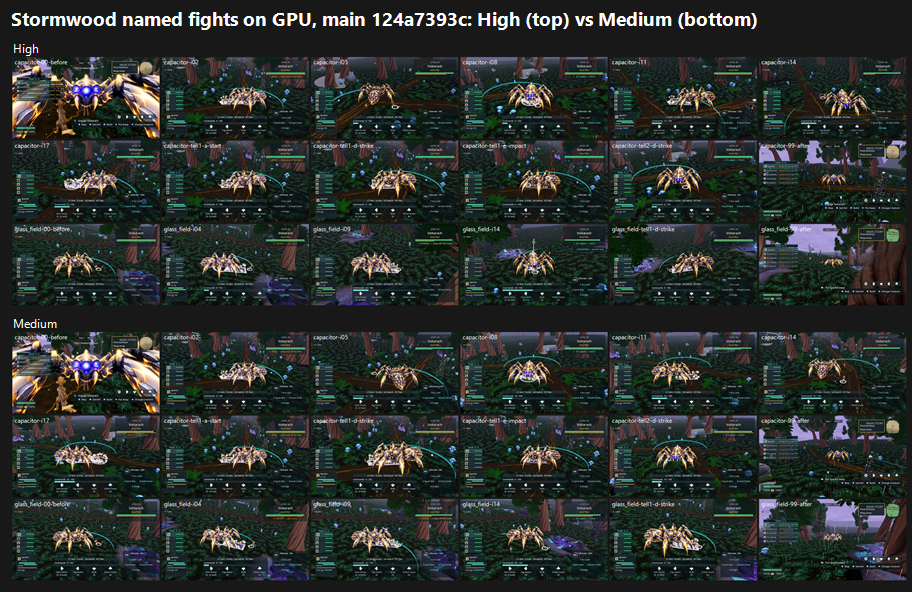

# Stormwood baseline on GPU, main 124a7393c: named fights scored; F41 matrix BLOCKED (24 Oct 2026)

**Verdict: the Stormwood named fights FAIL, at 4.74 High and 4.38 Medium.** Tier: below 6.

The F41 matrix was refused here by its own guards (see "F41 matrix status"). It has since been captured and judged on main 9099a88: see `../stormwood-matrix-9099a88/VERDICT.md` (FAIL, 5.07 High / 4.80 Medium).

## Named fights (F10#2)

### Run

- **Source:** main 124a7393c, in the lane checkout (HEAD = 124a7393c plus GPU-PASS report files only).
- **Capture:** `tools/capture_named_fights_f10_6.gd --ids=capacitor_alpha,glass_field_alpha --seconds=18 --interval=1.0 --camera-view=north` at 1920x1080. This is the same command as the 22 Oct F10#2 run, on Forward+ with a GTX 1060, Medium and High.
- **Frames:** 86 at Medium, 85 at High (before, i00–i17, tell1–4 at start/mid/late/strike/impact/recovery, after, per alpha).

### Yardstick (batch swb1)

- **Set:** one set, High vs Medium, 18 matched frames per side (both alphas: before, six interval frames, tell strikes and impacts, after).
- **Anchors:** 4 pairs, seed redrawn until the `f10_2_r3_capacitor` anchor was absent (it is this same fight).
- **Judges:** three fresh code-blind judges, each given `JUDGE_PROMPT.md` verbatim.
- **Fit:** slope 1.088, intercept 0.534, **r 0.96**, RMSE 0.38, confirming, no warnings.

| Side | j1 | j2 | j3 | Mapped mean |
|---|---|---|---|---|
| High | 5.00 | 4.89 | 4.34 | **4.74** |
| Medium | 4.89 | 4.45 | 3.80 | **4.38** |

| Defect | State (majority) |
|---|---|
| **P2-004** dark boxed HUD panels over a large share of the view | **PRESENT** (6/6) |
| **P2-016** hurt and moving frames keep the idle silhouette | **PRESENT** (6/6). The copper-and-glass alpha holds one pose across every interval, tell and strike frame. |
| **Clipping** / camera in geometry | **PRESENT** (4 PRESENT / 2 PARTIAL). The camera is jammed against the alpha in capacitor-00-before, and a trunk fills the edge of glass_field-99-after. |
| P2-063 tells on text, flat marks and flashes | PARTIAL (4/2). Teal arcs; some white-violet lightning at Medium in glass_field-i14. |
| Flat magenta slabs or rings | FIXED (6/6, low confidence at sheet size). |

**What the judges saw:**
- **Strength:** the copper-gold alpha pops.
- **Player's creature:** lost against a uniform dark moss carpet in every frame. None of the three judges could find it reliably.
- **Storm sky:** the fixed purple storm sky appears only in the *after* frames, not during the fight.

`_sheet_stormwood_fights.png` (1.25 MB): High on top, Medium below.

### Path to 7.5 (gap 2.76 at High)

1. **Camera and HUD** (*scene*): pull the combat camera back and up, so it clears the alpha and the trunks. Collapse the boxed HUD panels (P2-004) into compact corner widgets. This is the same lever as the F38, F40 and Tidewake fights.
2. **Make the player's creature readable** (*scene*): rim light or an outline, and value contrast against the moss. Break the moss carpet into a lit clearing.
3. **Storm sky during the fight** (*scene*, grade): keep the fixed purple storm sky and white-violet lightning in frame during combat, not only afterwards.
4. **Alpha animation** (*new_art*): real hurt, move and strike poses (P2-016, the same work as G/G2), plus physical telegraphs: lightning arcs, ground cracks, glass shards.

## F41 matrix status: BLOCKED

`tools/capture_f41_stormwood_catalog.gd --preset=
 --source-commit=<sha> --out=… --label=f41base-
 --phases=calm,building,break,fading --no-aftermath` was refused twice, by its own source guards.

1. **First refusal:** "F41 source commit must match the loaded project's Git HEAD", with `--source-commit=124a7393c`.
   - The checkout HEAD is a merge of 124a7393c with this lane's report files.
   - Re-run with `--source-commit=<HEAD>`.
2. **Second refusal:** "F41 capture requires a clean tracked and untracked source tree".
   - Godot's import on this Windows checkout leaves 1,919 `.import` files flagged as modified.
   - They are byte-identical to the committed blobs: LF in both the index and the worktree, with no attributes. This is a `core.autocrlf=true` phantom, not a source edit.
   - Clearing it needs a working-tree or index rewrite of the lane checkout. That needs the owner's permission, which has been requested.
   - The capture runs as soon as the tree can be cleaned.

The guard is correct. The tree only *looks* dirty, and that will be stated in the F41 verdict when it runs.

## Files

- `_sheet_stormwood_fights.png`, `defect_states.json`.
- `yardstick/`:
  - `key.json`, `sets.md`, `candidates.json`, `recorded_defects.txt`, `judge_prompt_filled.txt`;
  - `j1`–`j3` (the judges' own blocks);
  - `batch.json`, `mapped.json`.
- Per-frame captures stay local.
