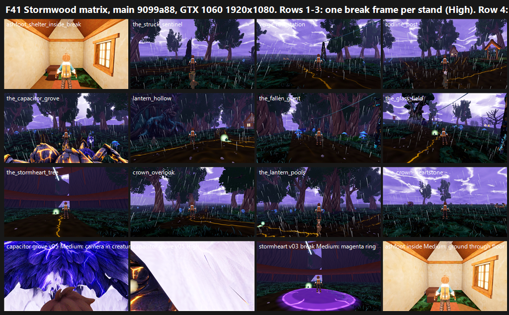

# F41 Stormwood matrix on GPU, main 9099a88 (25 Oct 2026)

**Verdict: FAIL.** The mapped means are **5.07 at High and 4.80 at Medium**, against the 7.5 bar.
- **Tiers** (lower preset per stand): 9 of 12 stands are below 6 and 3 are 6–7. None reaches 7.
- **Frames:** 196 per preset, not 200. The capture tool held back 4 views on its own guard (see "Tool refusal"), so the ≥200 count for F41#0 is **not met**.

## Tool refusal: a game-side shelter bug on main

Both presets exited 1 with the same failures:
- `ashfoot_shelter_outside_{calm,building,break,fading}`: "Ashfoot 11 m exterior incorrectly received roof/lightning shelter".
- So the phase counts fell short: "F41 phase 
 has 49 receipt-backed frames; expected 50" for each phase, and "196 frames; expected 200 matched views" overall.

The guard is correct. The player standing 11 m outside Ashfoot's shelter is being treated as roofed, which is a gameplay or presentation bug on main, not a GPU fault. The 196 receipt-backed frames were kept and judged; the 4 refused views are missing, not scored.

## Run

- **Tool:** `tools/capture_f41_stormwood_catalog.gd --preset=
 --source-commit=<HEAD> --out=… --label=f41base-
 --phases=calm,building,break,fading --no-aftermath`, at 1920x1080, Forward+ on a GTX 1060.
- **Source, Medium:** main 9099a88.
- **Source, High:** c0e8f8a, which is 9099a88 plus GPU-PASS report files only. The tool requires `--source-commit` to equal HEAD, and a lane report commit landed between the two presets.
- **Clean tree:** the tool also requires a clean tree. Godot's import had left 1,919 `.import` files flagged by git, all CRLF-only (byte-identical, checked with `git diff --ignore-cr-at-eol`). With the owner's approval they were stashed and restored per path. There were 0 dirty paths before and after each preset.
- **Layout:** 12 landmark stands. Each has 1, 3 or 6 authored survey headings, at the four storm phases.

## Yardstick (3 batches)

- **Sets:** 12, one per stand, High vs Medium on the same 6 view ids. The 6 frames cycle the headings through calm, building, break, fading, break, calm. Ashfoot inside has a single heading, so its set shows its 4 phases.
- **Anchors:** 4 pairs per batch.
- **Judges:** three fresh code-blind judges per batch, given `JUDGE_PROMPT.md` verbatim.
- **Recorded defects:**
  - the F38#5 generic four;
  - the F41 catalog rescore's largest gaps (`ralph/reports/F41/recapture-rescore/catalog-rescore.json`): gap 1 (ground carpet) and gap 3 (glass slabs and cyan cones) on every stand, and gap 2 (Stormheart finish) on the Stormheart.

| Batch | Stands | Slope | Intercept | r | RMSE | Notes |
|---|---|---|---|---|---|---|
| b1 | ashfoot inside, rodline post, fallen giant, crown overlook | 0.986 | 1.655 | 0.89 | 0.50 | confirming |
| b2 | struck sentinel, capacitor grove, glass field, lantern pools | 1.414 | −1.333 | 0.96 | 0.35 | confirming; the capacitor grove at Medium is extrapolated below the lowest anchor |
| b3 | crown heartstone, lantern hollow, rod station, Stormheart | 1.227 | −0.372 | 0.97 | 0.30 | confirming |

**Caveat on the 6–7 stands:** all three come from b1, whose fit adds about +1.6 at the low end. Their raw judge scores (4.2–4.8) are close to the b2 and b3 stands, which map to about 5. Treat the gap between "high 5s" and "low 6s" as within cross-batch spread (about ±0.3). The ranking at the bottom (capacitor grove, Stormheart, crown heartstone) is not in doubt.

## Per stand

| Stand | High | Medium | Tier | What sinks it (judge majority) |
|---|---|---|---|---|
| conductor_run_the_capacitor_grove | 3.10 | **1.07** | below 6 | **Camera inside a creature:** wild creatures wander into the fixed survey cameras. At Medium v03–v06 show only purple fur; at High v05 is flat white and v06 is jammed against the body. Clipping PRESENT 6/6. |
| dynamo_the_stormheart_tree | 4.25 | 3.51 | below 6 | The interior is smooth bare trunk walls with plain red ring rails and no visible supports. Gap 2 PRESENT 6/6. **Medium v03 break has a large flat magenta ground ring** (3/3 on that side). There is a hard sky seam and a rigid white lightning bar. |
| hollow_crown_the_crown_heartstone | 4.13 | 4.17 | below 6 | No heartstone visible in any frame. An empty green carpet runs to a flat grey horizon band, with small cyan objects on it. |
| ashfoot_shelter_inside | 4.88 | 4.65 | below 6 | Outdoor terrain grass **renders through the shelter floor** in every frame (clipping PRESENT). The room is a bare plaster box with a blown-out window, and no storm phase reads from inside. |
| glowmoss_hollows_the_lantern_pools | 5.03 | 4.70 | below 6 | No lantern pools read. The ground is one carpet, and sprite fog washes out the Medium v01 fading frame. |
| cinder_verge_the_struck_sentinel | 5.03 | 4.94 | below 6 | The sentinel reads as a glowing cyan strip on a trunk (gap 3 PARTIAL), on a uniform dark-green carpet. |
| dynamo_the_glass_field | 4.94 | 5.22 | below 6 | A faceted dark glass pylon, a cable through the canopy, rigid cyan panes and cones (gap 3 PARTIAL 6/6), and flat gold crack strips on the ground. |
| cinder_verge_verge_rod_station | 5.23 | 5.19 | below 6 | A smooth dirt path, thin undergrowth and a grey horizon gap. Opaque fog puffs cut through the trainer in v04 fading. |
| deepwood_lantern_hollow | 5.56 | 5.56 | below 6 | The best-placed stand (lit cottages, roots, lantern orb), but murky crushed values, flat mud and sprite fog puffs. |
| glowmoss_hollows_crown_overlook | 6.03 | 6.03 | 6–7 | No overlook vista: evenly spaced blob trees over a flat carpet, an empty horizon, and petal sprites at the camera. |
| conductor_run_rodline_post | 6.22 | 6.16 | 6–7 | No rodline post reads. Flat dark mud ground, blob trees and Meadows-style cottages. |
| deepwood_the_fallen_giant | 6.45 | 6.42 | 6–7 | The strongest mood (giant trunks, blue mushrooms, violet sky), but underlit, no readable fallen giant, and fog puffs in front of the camera. |

**Across all stands:**
- Gap 1 (ground carpet) is PRESENT on 10 of 12 stands and PARTIAL on the two Deepwood stands.
- Magenta slabs are FIXED everywhere except the Stormheart at Medium.
- Bar B is "no" for every Stormwood set. The purple storm sky, rain and white-violet lightning are the one thing every judge credits.
- High and Medium agree within 0.3 on every stand except the capacitor grove, where creatures move differently per run, and the Stormheart, where the magenta ring appears only at Medium.

`_sheet_f41.png` (1.42 MB): one break frame per stand at High, plus a defect row: capacitor grove v05 at Medium and High, the Stormheart's magenta ring at Medium, and the Ashfoot floor.

## Path to 7.5

The mean gap is 2.4 at High and 2.7 at Medium. In owner tier order:

**1. Lift the four lowest stands to 6.**
- **Capacitor grove** (gap 6.4 at Medium), *scene*: keep wild spawns and wander paths out of a clearance radius around every F41 survey camera, or add camera collision against creatures. This alone recovers most of the 4–5 points the stand loses to blocked frames. It is the same fix as the clipping complaints elsewhere.
- **Stormheart** (gap 4.0), *new_art*: a hero interior with deep bark relief, branching crown, visible glowing core, and timber walkways on posts with lanterns and blue banners. The **red rails sit close to the oxblood reserved for Team Tether**, so recolour them to aged timber or copper. *Scene*: find and remove the flat magenta ground ring in Medium v03 break, which looks like a lightning-strike telegraph decal. Fix the sky seam, and turn the rigid white lightning bar into a branching bolt with a ground impact.
- **Crown heartstone** (gap 3.4), *scene*: frame the heartstone in the authored headings (it is in none). Close the flat grey horizon with layered forest silhouettes.
- **Ashfoot inside** (gap 2.6), *scene*: cull or occlude terrain grass under shelter floors. Dress the room with props. Let the storm phase show through the window and in the interior light. Fix the shelter-volume bug that gives the 11 m exterior roof/lightning shelter; it also blocks 4 of F41's 200 views.

**2. Lift all stands from the 5s to 6–7, using the shared levers every judge named.**
- **Ground** (*scene*, gap 1): replace the uniform dark-green carpet and smooth mud with authored soil, cool blue-green moss, root, rock and black-pool transitions. Seat the gold crack decals into the terrain rather than laying them on top.
- **Values and fog** (*scene*): lift the crushed darks with rim and lantern light. Replace the billboard fog puffs (every fading frame) with height fog and depth layers that do not sit at the camera.
- **Landmarks in frame** (*scene* for cameras, *new_art* for meshes): each stand is named for a landmark that the judges could not find, including the rodline post, fallen giant, lantern pools, overlook vista and struck sentinel. Point the headings at them, and build hero meshes where the current one is a strip or primitive (sentinel, glass-field pylon).
- **Glass and cyan** (gap 3): seat the cyan cones and panes in the terrain, or replace them with authored crystal clusters.

**3. Reach 7 and 7.5.** The judges' Bar B notes put the remaining gap in density and finish: groves, clearings and set dressing at Palworld density, and Valheim-class light shafts during the break phase.

## Files

- `_sheet_f41.png`;
- `stand_scores.json`: per stand and preset, mapped score, per-judge scores, defect votes, tier, and the tool's failure list;
- `coverage.json`: frames per stand and the 6 judged ids;
- `build_yard_f41.ps1.txt`;
- `yardstick/b1`–`b3`:
  - `key.json`, `sets.md`, `candidates.json`, `recorded_defects.txt`, `judge_prompt_filled.txt`;
  - `j1`–`j3`;
  - `batch.json`, `mapped.json`.

Per-frame captures stay local.
