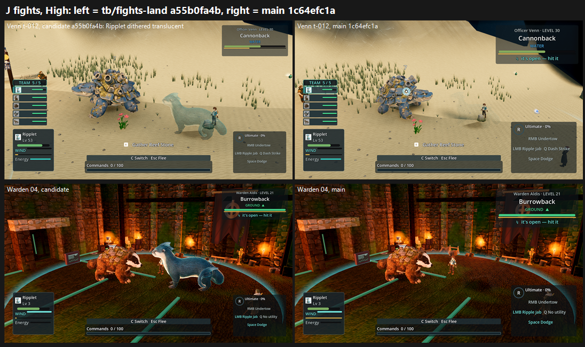

# J: fight presentation r6/r7 on GPU, tb/fights-land a55b0fa4b vs main 1c64efc1a (25 Oct 2026)

**Verdict: a real lift on the named fights (+0.71 mean at High, +0.20 at Medium), but none reaches 7.5. The pilot-ghost fix does NOT reach the Venn fight.**

- **Control:** main 1c64efc1a is a55b0fa4b's first parent, so this is exactly what the fights landing (#741) changed.
- **Means:**
  - Medium: candidate 6.41 vs main 6.21.
  - High: candidate 6.26 vs main 5.55.
- **Tiers (lower preset):**
  - 6–7: Warden, Riverwatch, Stormwood, Veyra, and the f38 Warden run.
  - Below 6: Venn and the f38 grunt run.

| Fight | Candidate Medium | Main Medium | Candidate High | Main High | Tier (cand) |
|---|---|---|---|---|---|
| Warden hall | **7.08** | 6.24 | **6.99** | 6.00 | 6–7 |
| Riverwatch | **6.98** | 5.69 | **6.83** | 5.88 | 6–7 |
| Stormwood glass_field | 6.48 | 6.70 | **6.09** | 5.57 | 6–7 |
| Veyra | 6.14 | 6.56 | **6.60** | 6.21 | 6–7 |
| Venn | 5.82 | 5.50 | 4.64 | 4.27 | below 6 |
| f38 grunt, f17–32 | 5.53 | **6.25** | **6.43** | 5.26 | below 6 |
| f38 Warden, f1–16 | **6.83** | 6.54 | **6.25** | 5.65 | 6–7 |

- **Where the candidate scores lower:** Stormwood, Veyra and the grunt run at Medium (−0.22 to −0.72).
- **Why the grunt run varies:** the f38 runs are live fights, so frames differ run to run. The Medium main arm happened to catch a cleaner exchange, and at High the order flips. Read the f38 rows as noisy.

## The three asks

### 1. The player's creature (pilot ghost fix)

- **Fixed in the Warden hall and at Riverwatch (Medium):**
  - Warden High: FIXED 3/3.
  - Riverwatch Medium: FIXED 3/3. "B shows a solid blue Ripplet".
  - On the main arm, Ripplet is missing or ghosted in the same frames.
- **NOT fixed in Venn (Tidewake):**
  - On the candidate, Ripplet is **dithered translucent in every frame** (PRESENT, 6/6). See the sheet and `venn/t-012.00`.
  - On the main arm it is missing entirely.
  - The frame shows an out-of-combat "Gather Reef Stone" prompt. So the Venn capture likely runs with the pilot still in its *following* state, which is exactly when the scoped follower fade still applies.
  - Worth checking `phase2_capture_tidewake_fights.gd`'s fight state, or scoping the fade on "in combat" rather than "following".
- **Too small, not ghosted, in Stormwood:** Sparkit is a speck under the Voltarach on both arms (PRESENT). This is a size floor issue, not opacity.

### 2. The stagger label

- **Fixed on Veyra:** on the main arm, "Terrapup STAGGERED" and "Brooktail STAGGERED" sat under the *enemy* panel (PRESENT 3/3). The candidate names its lines by owner (FIXED 3/3).
- **Still open:** the body doesn't show it.
  - Warden Medium: "Ripplet staggered — recovering" with no change in the body (PRESENT 2 / PARTIAL 1).
  - f38: "STAGGERED" with no body change.

### 3. Impacts at the feet

- **Mixed:** the contact flash moved down, but judges still see white puff rings, gold discs and spray bursts covering the struck creature in most fights (PRESENT or PARTIAL).
- **Venn:** flat cyan discs sit on Cannonback's shell.

## Also seen (both arms)

- Stormwood is dark brown with flat magenta floor shapes, and the camera goes inside canopy at i11–i15.
- The Tidewake arena is an empty sand plane with no water.
- The tells are carried by HUD text.

`_sheet_j.png` (1.36 MB), at High: Venn t-012 on top (the candidate's translucent Ripplet on the left), Warden 04 below. Candidate on the left, main on the right.

## Run

- **Candidate:** `tb/fights-land` a55b0fa4b (the 05:20 READY plus the review follow-up), verified.
  - An earlier capture on 3e028626f is kept locally for reference but not judged.
- **Capture:** the five named fights per the fights NOTE (Warden and Riverwatch `capture_named_fight.gd`, Stormwood `capture_named_fights_f10_6.gd --fixed-fps 20`, Veyra `phase2_capture_cloudreach_live_fight.gd`, Venn `phase2_capture_tidewake_fights.gd`), plus `capture_f38_fight.gd` grunt and Warden runs.
  - 1920x1080, Forward+ on a GTX 1060, Medium and High.
  - Veyra and Venn exit 1 on both arms after writing all their frames, as on CPU.
- **Frames judged:**
  - Warden and Riverwatch: t01-mid, t02-mid, 04, 08.
  - Stormwood: tell1-b-mid, tell2-b-mid, tell1-e-impact, tell3-c-late.
  - Veyra: four evenly spaced live frames (tick names differ per run).
  - Venn: tell-start, 006, 012, 024.
  - f38: one 16-frame half per trainer.

## Yardstick

- **Sets:** 14, in 3 batches, with 4 anchor pairs each.
- **Judges:** nine fresh code-blind judges.
- **Recorded defects:** the three asks plus P2-063.

| Batch | Slope | Intercept | r | RMSE | Confirming |
|---|---|---|---|---|---|
| Jb1 | 1.214 | −0.138 | 0.95 | 0.41 | yes |
| Jb2 | 0.801 | 2.374 | 0.83 | 0.59 | yes |
| Jb3 | 0.839 | 2.269 | 0.87 | 0.52 | yes |

## Path to 7.5

1. **Venn pilot opacity:** make the fight capture (and the game) treat the pilot as in combat. Do not fade the pilot while a fight is active, whatever the follow state.
2. **Stagger in the body**, not only in the label. This is the Creatures lane's wince and recoil (see the P2-016 G-series).
3. **Impacts:** retire the white puff rings and gold or cyan discs over the target. Keep effects at the feet and smaller than the creature.
4. **Stormwood:** a pilot size floor that actually applies (Sparkit is still a speck), canopy culling for the camera, and the purple storm grade.
5. **Tidewake arena:** water and composition instead of an empty sand plane.

## Files

- `_sheet_j.png`, `coverage.json`, `build_yard_J.ps1.txt`.
- `yardstick/b1`–`b3`:
  - `key.json`, `sets.md`, `candidates.json`, `recorded_defects.txt`, `judge_prompt_filled.txt`;
  - `j1`–`j3`;
  - `batch.json`, `mapped.json`.
