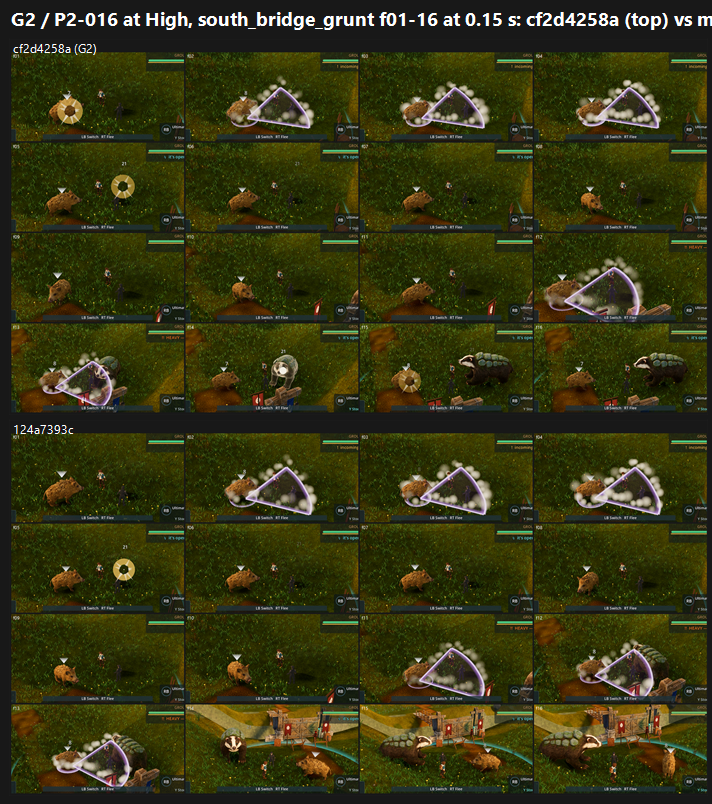

# G2 / P2-016 follow-up on GPU: tb/creatures-land cf2d4258a vs main 124a7393c (24 Oct 2026)

**Verdict: P2-016 is NOT fixed by G2. It is PARTIAL at High and PRESENT at Medium.**

- **High:** G2 is PARTIAL by majority (10 of 12 calls); the control is PRESENT (8 of 12). The same High-only improvement G saw for #733.
- **Medium:** both arms are PRESENT, 12 of 12 calls each.
- **Scores:** G2 6.21 vs 6.08 at High; **5.72 vs 5.98** at Medium, so at Medium G2 scores slightly below the control.
- **Tier: below 6.** The lower preset is 5.72 (owner direction, 24 Oct).
- **Batch variance:** the control arm is the same frames as G's candidate arm. Its Medium P2-016 calls moved from 8 PARTIAL / 4 PRESENT in G to 0 / 12 here, so the split between PARTIAL and PRESENT is within judge-to-judge variance. Across both rounds, no batch has marked P2-016 FIXED.

## Run

- **Candidate:** `tb/creatures-land` cf2d4258a. The stagger holds the wince for its whole length, and the Terrapup badger, Burrowback and Bramblebun get about double the recoil.
- **Control:** G's main 124a7393c arm: the same commit, the same flags, already captured, so not re-run.
- **Capture:** `tools/capture_f38_fight.gd --trainer=south_bridge_grunt,warden_aldis --frames=32 --interval=0.15 --attack --dodge --tell-frames --preset=
 --source-commit=<sha>` at 1920x1080, Forward+ on a GTX 1060.
- **Frames:** 78 at Medium and 82 at High for G2; 83 and 86 for the control.

## Yardstick

- **Layout:** the same 8 sets as G (trainer × half × preset, 4×4 grids of consecutive frames cropped to the field) and **the same judging brief, word for word**, so G and G2 compare directly (`build_yard_G2.ps1.txt`).
- **Judges:** six fresh code-blind judges, with 4 anchor pairs per batch.

| Batch | Slope | Intercept | r | RMSE | Confirming |
|---|---|---|---|---|---|
| G2b1 (Medium) | 1.083 | 0.864 | 0.88 | 0.67 | yes |
| G2b2 (High) | 0.791 | 2.278 | 0.84 | 0.67 | yes |

| Set | G2 | Control |
|---|---|---|
| Medium grunt f01–16 | 5.67 | 5.67 |
| Medium grunt f17–32 | 6.24 | 6.13 |
| Medium warden f01–16 | 5.70 | 6.32 |
| Medium warden f17–32 | 5.27 | 5.81 |
| High grunt f01–16 | 6.21 | 5.97 |
| High grunt f17–32 | 6.18 | 6.13 |
| High warden f01–16 | 6.13 | 6.23 |
| High warden f17–32 | 6.34 | 6.00 |

`_sheet_g2.png` (1.28 MB): High, grunt frames 01–16, G2 (top) vs control (bottom).

## What the judges saw

- **What reads:** all six judges see the large armoured badger **lunge and rear**: grunt f22–23, warden f04/f09–10/f13–14, f23–24, f27. These are attack poses.
- **What doesn't:** the creature that is **hit** keeps its idle silhouette in every frame, including the STAGGER frames ("a STAGGER label instead of a stagger").
  - Per the Creatures lane's role note, the large badger is the player's Terrapup and the small creature is the enemy Mudsnout.
  - So the doubled recoil on the badger shows up as attack energy, not as a hurt reaction. The creature taking the hits, Mudsnout, still has none.
- **Unchanged from G:**
  - lavender cone telegraphs and white puff clouds cover the creatures (P2-063);
  - a near-top-down camera in the grunt's opening frames;
  - foreground trunks and bushes in the warden run;
  - camera cuts in the second half.

## Path to FIXED

1. **Give the creature being hit a visible flinch, recoil or stagger pose** (*new_art*). Today that is the enemy Mudsnout and the wild or trainer creatures. The reaction has to be on the target, not only on the attacker. The G2 recoil work went on the badger, which is mostly the attacker in these runs.
2. **Hold the stagger pose while STAGGER is on screen.** G2 holds the *wince* for its length, but the judges still read idle under the label.
3. **Keep the telegraph shapes off the reacting creature** (P2-063), and **use a stable combat camera** (F38 L1), so a reaction is visible at all.
4. **Re-test plan:** with the hit-react layer on Mudsnout, re-run this exact G/G2 layout. The fight frames are cheap, about 5 minutes per preset per arm.

## Files

- `_sheet_g2.png`, `build_yard_G2.ps1.txt`.
- `yardstick/G2b1`, `yardstick/G2b2`:
  - `key.json`, `sets.md`, `candidates.json`, `recorded_defects.txt`, `judge_prompt_filled.txt`;
  - `j1`–`j3` (the judges' own blocks);
  - `batch.json`, `mapped.json`.
