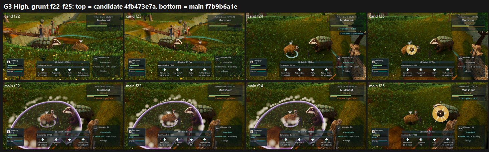

# G3 / P2-016 re-test on GPU: tb/creatures-land 4fb473e7a vs main f7b9b6a1e (25 Oct 2026)

**Verdict: P2-016 is NOT fixed by G3.** The candidate is PRESENT by majority at both presets. The main control is PRESENT at Medium and PARTIAL at High.

- **P2-016 calls, 24 per arm:**
  - Candidate: 18 PRESENT, 6 PARTIAL (Medium 10/2, High 8/4).
  - Main: 15 PRESENT, 9 PARTIAL (Medium 10/2, High 5/7).
  - No judge marked any side FIXED.
- **Scores:**
  - Medium: candidate **6.04** vs main 6.02.
  - High: candidate **5.30** vs main 5.48.
  - The candidate is level at Medium and slightly below at High.
- **Tier: below 6.** The candidate's lower preset is 5.30.
- **Batch variance:** across G, G2 and G3, the split between PARTIAL and PRESENT on unchanged frames has moved by up to 8 of 12 calls. So "main PARTIAL at High" here is within judge variance and is not a regression in the candidate. The firm result is that no batch has yet called P2-016 FIXED.

## The coordinator's three checks

1. **Does the enemy Mudsnout duck and turn away on damage frames? Partly yes, but it doesn't read across the fight.**
   - Visible in the candidate:
     - High grunt f24: Mudsnout drops its head as it takes 5 damage (see the sheet);
     - grunt f08: it turns away after being hit;
     - Medium grunt f17–20 and warden f17–24: it rears and turns.
   - Judges called these "only turns", "rears", or "a possible stagger" (3 of 3 noted f24).
   - The same turn at f08 is also on main, so the turn is not new.
   - Most hits still show a flat gold disc over an unchanged body.
2. **Does Mosshock's hit read as a cower? Not testable here.** Mosshock does not appear in either G3 fight: the grunt and the warden both field Mudsnout against the player's Terrapup. The Mosshock hit has to be judged on the roster stage instead; batch 2 at 4e5217f1b covers it.
3. **Does the "STAGGERED" label belong to the player's Terrapup? No, it reads as the enemy's.**
   - In the candidate, "STAGGERED — punish now" appears directly under the **enemy** panel (Tether Grunt · Mudsnout), next to "it's open — hit it", at High grunt f24.
   - "Punish now" is an instruction to the player, so on screen it says the *enemy* is staggered.
   - If the stagger is meant to be the player's Terrapup, either the label is in the wrong place or the wording is wrong. If the enemy is meant to be staggered, the label is right, and the body still has to show it.

## Run

- **Candidate:** `tb/creatures-land` 4fb473e7a. This is the batch 1 head: the Mosshock repaint, Mosshock's cower hit, item I and tier 1.
- **Control:** main f7b9b6a1e, merged into the lane checkout (lane HEAD bbca538f1 = that merge plus GPU-PASS reports).
- **Capture:** `tools/capture_f38_fight.gd --trainer=south_bridge_grunt,warden_aldis --frames=32 --interval=0.15 --attack --dodge --tell-frames --preset=
 --source-commit=<sha>` at 1920x1080, Forward+ on a GTX 1060.
- **Frames:**
  - Candidate: 84 at Medium, 82 at High.
  - Main: 86 at Medium, 83 at High.

## Yardstick

- **Layout:** the same 8 sets as G and G2 (trainer × half × preset, 4×4 grids of consecutive frames cropped to the field), with the same judging brief, word for word (`build_yard_G3.ps1.txt`).
- **Judges:** six fresh code-blind judges, with 4 anchor pairs per batch.

| Batch | Slope | Intercept | r | RMSE | Confirming |
|---|---|---|---|---|---|
| G3b1 (Medium) | 1.035 | 0.812 | 0.88 | 0.59 | yes |
| G3b2 (High) | 1.574 | −2.393 | 0.97 | 0.35 | yes |

| Set | Candidate | Main |
|---|---|---|
| Medium grunt f01–16 | 5.68 | 5.44 |
| Medium grunt f17–32 | 5.99 | 6.13 |
| Medium warden f01–16 | 6.44 | 6.26 |
| Medium warden f17–32 | 6.06 | 6.23 |
| High grunt f01–16 | 4.74 | 4.79 |
| High grunt f17–32 | 5.42 | 5.32 |
| High warden f01–16 | 5.63 | 5.95 |
| High warden f17–32 | 5.42 | 5.84 |

`_sheet_g3.png` (1.38 MB): High, grunt f22–25. The candidate is on top, with the STAGGERED label and Mudsnout's head dip at f24. Main is below.

## What the judges saw (both arms)

- **Hits:** the armoured badger (the player's Terrapup) holds one pose through every hit. Hits read only as flat gold discs, plus lavender cone or dome telegraphs and white puffs.
- **Camera:**
  - The grunt run opens on a near-top-down view of a uniform grass carpet, with the enemy off screen in grunt f05–11.
  - There are camera cuts onto the fence, and the camera goes inside foliage at warden f03 and f28.
- **Smoke:** puffs fully hide the small creature at warden f29–32.
- **Grade:** the Meadows fight grade reads murky olive-yellow, with no sky or cool distance in frame.

## Path to FIXED (and to 7.5)

The candidate is at 5.30 on High, a gap of 2.2.

1. **A hit-react layer on the creature being hit** (*new_art*). It needs a body recoil or head snap held for about 0.25 s on every damage frame, on both the enemy Mudsnout and the player's Terrapup. Mudsnout's new head dip at f24 is the right idea, but it appears on one frame in 32. Make it fire on every hit, and make it larger than the idle sway.
2. **Show the stagger on the body for as long as the label is up**, and decide who owns the label (check 3).
3. **Keep effects off the target** (P2-063, *scene*). Replace the gold disc, the lavender cones and domes, and the opaque puffs with grounded dust or stone chips that never cover the reacting creature.
4. **A stable low three-quarter combat camera** (F38 L1, *scene*). No top-down opening, no fence cuts, and no foliage in the lens, so the reaction can be seen at all.
5. **Re-test:** use the same G/G2/G3 layout once item 1 lands (about 5 minutes per preset per arm). Judge Mosshock's cower on the roster stage (batch 2).

## Files

- `_sheet_g3.png`, `build_yard_G3.ps1.txt`.
- `yardstick/b1`–`b2`:
  - `key.json`, `sets.md`, `candidates.json`, `recorded_defects.txt`, `judge_prompt_filled.txt`;
  - `j1`–`j3`;
  - `batch.json`, `mapped.json`.

Per-frame captures stay local.
