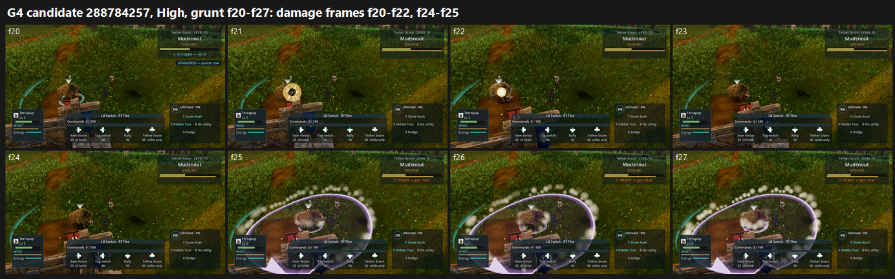

# G4 / P2-016 re-test 2 on GPU: tb/creatures-land 288784257 vs main f7b9b6a1e (25 Oct 2026)

**Verdict: P2-016 is NOT fixed on GPU. The arms are indistinguishable.**
- **P2-016 calls, 24 per arm:** 16 PRESENT / 8 PARTIAL on both.
  - Candidate: Medium 7/5, High 9/3.
  - Main: Medium 8/4, High 8/4.
- **Scores:**
  - Medium: candidate 6.12 vs main 6.13.
  - High: candidate 6.31 vs main 6.44.
- **Tier: 6–7.** The candidate's lower preset is 6.12. On this batch's scale everything sits higher than in G3, so compare within the batch only.

## Why the 0.55 s wince doesn't read on GPU

The wince is in the frames, but it is hidden.
- On the damage frames (High grunt f20 "8", f21–f22 "5", f24 "4", f25 "5"; see the sheet), Mudsnout's head is lower and its body turns away.
- On the impact frames (f21–f22), the **gold contact disc sits on top of the target** and covers the duck. The CPU judges saw the same thing in G3.
- The **high, steep camera** in the grunt run makes a head dip on a small creature only a few pixels.
- So the body work landed, but the presentation hides it.
- **Confound:** 288784257 is based on older main, so it lacks the fights landing (#741, now on main). That landing moves the contact flash to the struck creature's feet (`impact.flash_drop` 1.0) and names stagger lines by owner. On current main, the same wince would sit beside a ground-level flash, not under a disc.

**Smallest re-test that would show it:** the same capture on tb/creatures-land merged with current main (1d5faebac, which has #741), against current main. If the duck still doesn't read with the flash at the feet, the wince needs to be larger (bigger head drop or a body recoil) for the high camera.

`_sheet_g4.png` (1.25 MB): candidate, High, grunt f20–f27, full frames.

## What the judges saw (both arms)

- The small creature holds its idle silhouette under gold-disc hits. The armoured badger rears and lunges only in its heavy attack (f22–f24).
- **Camera:** the grunt run is top-down over a grass carpet, with the opponent off screen in f01–f12 and camera snaps at f15 and f29.
- **Telegraphs and smoke:** lavender cone and dome telegraphs, and white puffs over the target.
- Two judges noted "STAGGERED — punish now" sitting under the enemy plate with no body change, which is consistent with the older-main base.

## Run

- **Candidate:** `tb/creatures-land` 288784257. Every landed hit holds the wince for 0.55 s, spanning the 0.8 s damage number.
  - The checkout was verified in the reflog.
  - Known exception: hits during Mudsnout's protected heavy wind-up don't flinch, by design.
- **Control:** the G3 main arm, main f7b9b6a1e, with the same commit and flags.
- **Capture:** `capture_f38_fight.gd --trainer=south_bridge_grunt,warden_aldis --frames=32 --interval=0.15 --attack --dodge --tell-frames` at 1920x1080, Forward+ on a GTX 1060.
- **Frames:** 83 at Medium and 80 at High for the candidate; 86 and 83 for the control.

## Yardstick

- **Layout:** the same 8 sets and the same brief as G, G2 and G3 (`build_yard_G4.ps1.txt`).
- **Judges:** six fresh code-blind judges.

| Batch | Slope | Intercept | r | RMSE | Confirming |
|---|---|---|---|---|---|
| G4b1 (Medium) | 0.726 | 2.694 | 0.84 | 0.57 | yes |
| G4b2 (High) | 0.787 | 2.413 | 0.81 | 0.62 | yes |

## Path to FIXED

1. **Re-test on a current-main base** so the contact flash sits at the feet (see above). This is cheap: about 5 minutes per preset per arm.
2. If it still doesn't read, **make the wince bigger than the idle sway**: a head drop of a third of body height, plus a short body recoil away from the attacker. It has to read from the grunt run's high camera.
3. **Keep smoke and telegraph shapes off the struck creature** (P2-063), and **steady the grunt camera** (no top-down opening, no snaps), so the reaction is on screen at all.

## Files

- `_sheet_g4.png`, `build_yard_G4.ps1.txt`.
- `yardstick/b1`–`b2`:
  - `key.json`, `sets.md`, `candidates.json`, `recorded_defects.txt`, `judge_prompt_filled.txt`;
  - `j1`–`j3`;
  - `batch.json`, `mapped.json`.
